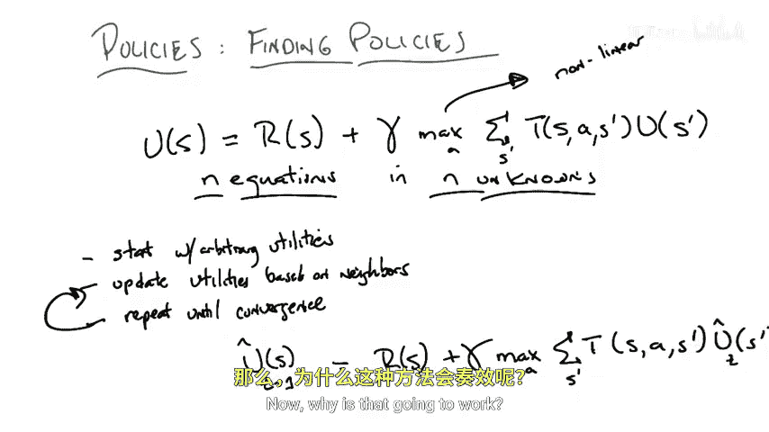
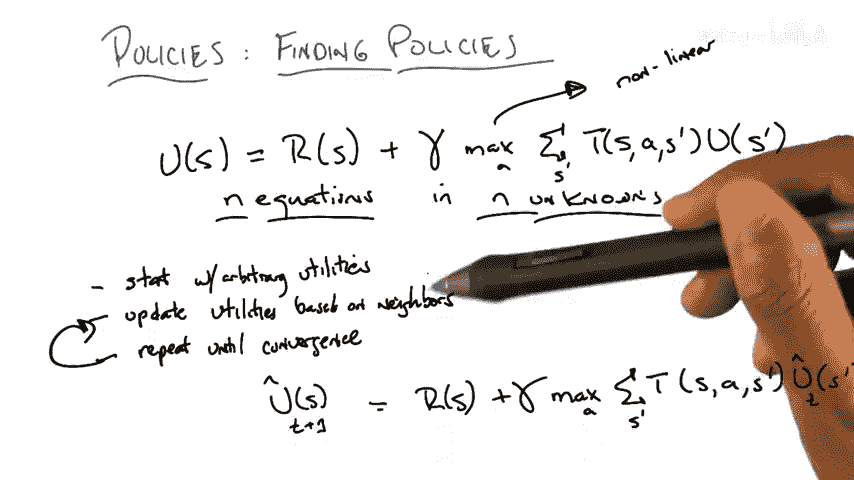
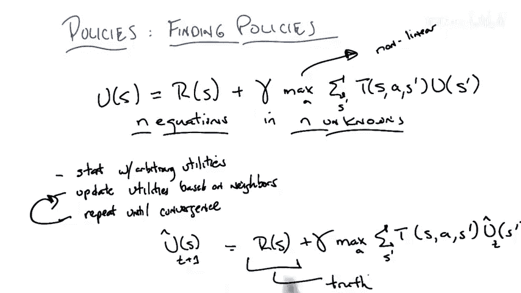
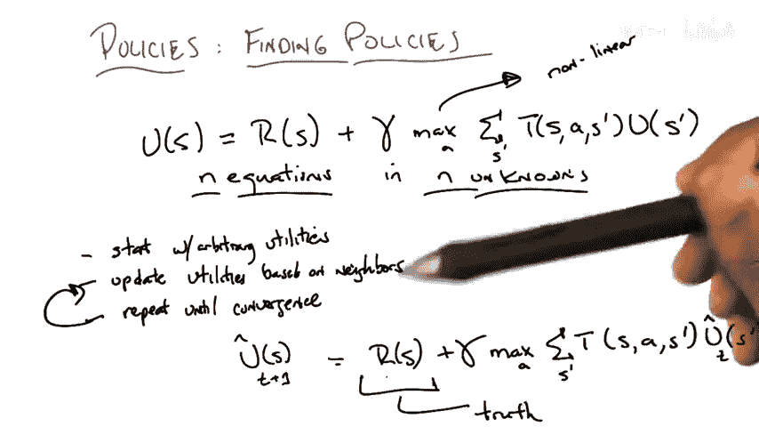
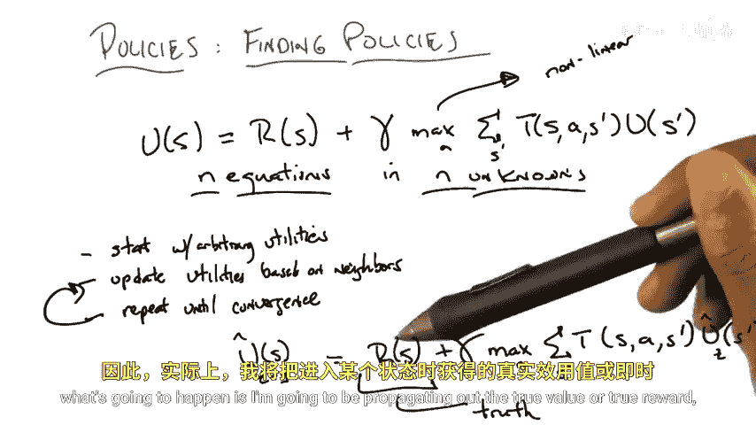
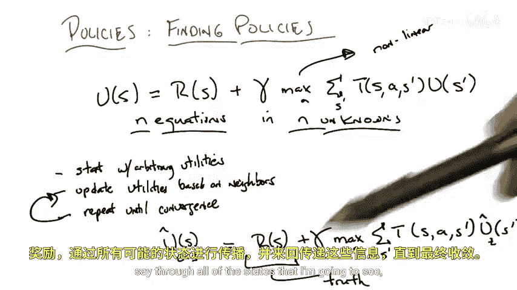
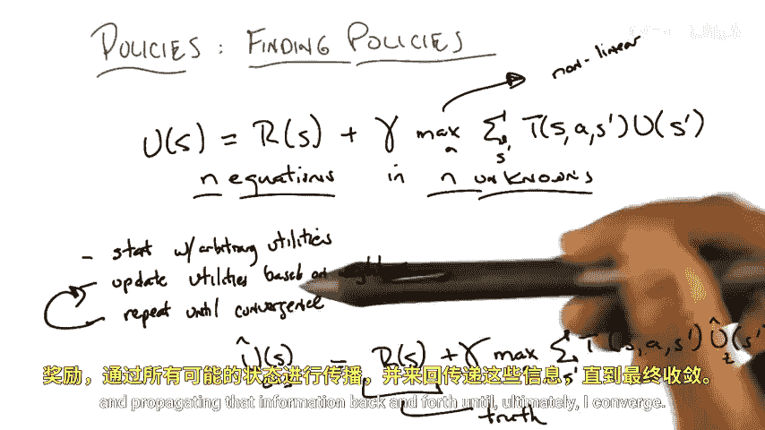
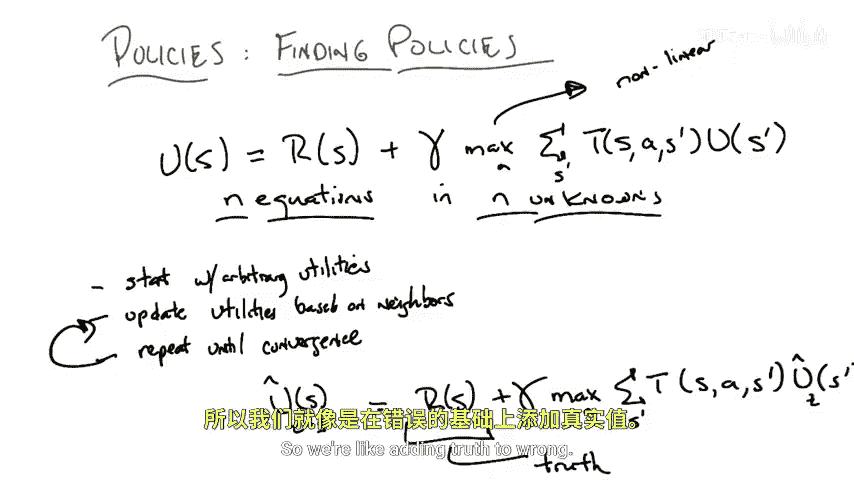

# 佐治亚理工【中英⚡强化学习导论｜CS8803 Introduction to Reinforcement Learning】 p26 P26 Finding Policies - 2 -BV1cJnfzTEBt_p26-

So I'm going to update the utility of S by looking at the utilities of all the other states。

 including itself as prime。And weight those based on my probability of getting there。

 given that I took an action and what action am'm going to take Well I'm to take the one that maximizes my expected utility So its sort of like figuring out what to do in a state assuming that this U hat really is the right answer for the future right Now why is that going to work。

 So I just made up the U hatts right， they started out arbitrary utilities。

 The next little step about updating utilities based on neighbors make some sense because effectively a neighbor is any state that you can reach which is determined by the transition function。

But all I'm doing is reaching states that are also made up of arbitrary utilities。

 So arbitrary values。 Why should that help me， Well， it's because of this value right here。

 This is actual truth。 The actual word that I get for entering into a state is a true value。

So effectively， what's going to happen is I'm going to be propagating out the true value or true reward。

 the true immediate reward that I get for entering into a state。

 say through all of the states that I'm going to see and propagating that information back and forth until ultimately。

 I converge。 Still not obvious why we should converge because we start off with an arbitrary function。

 And it seems like that could be really wrong。 So we're like adding truth to wrong。

Yes， but then the next time around I' I've been adding truth twice。

