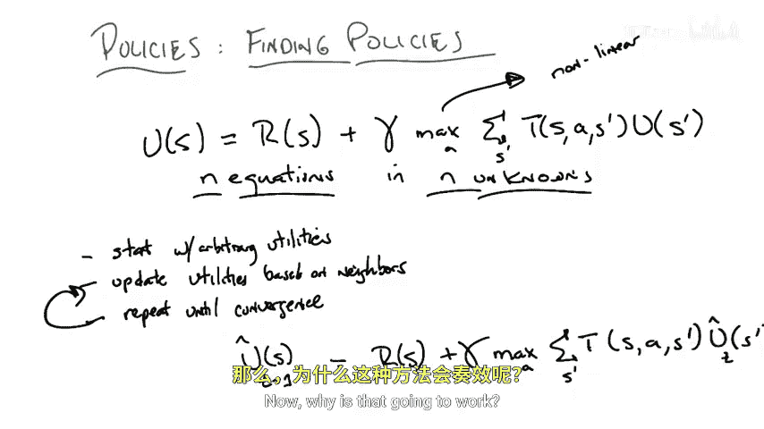
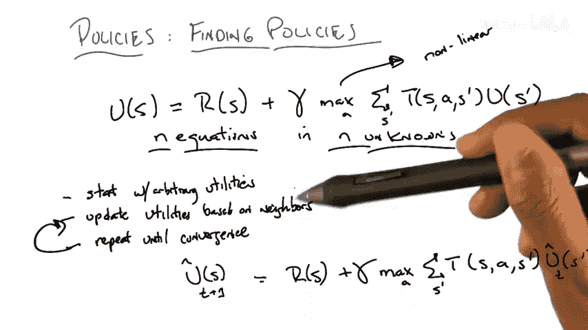
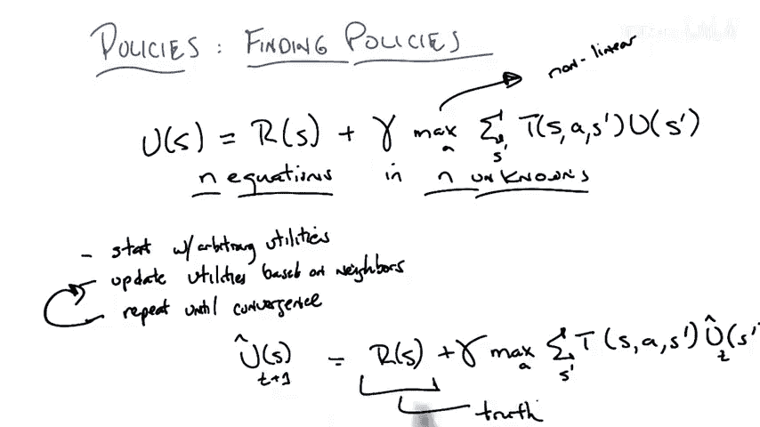
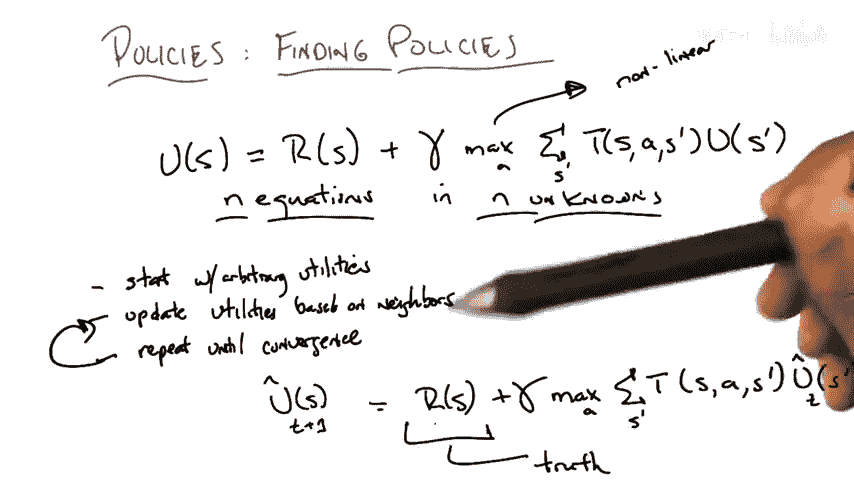
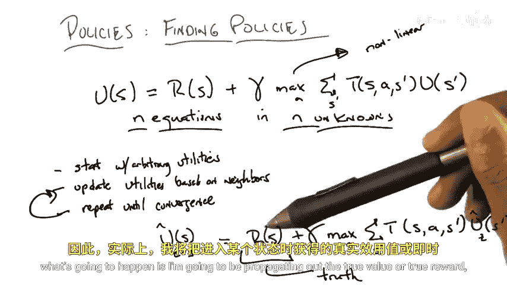
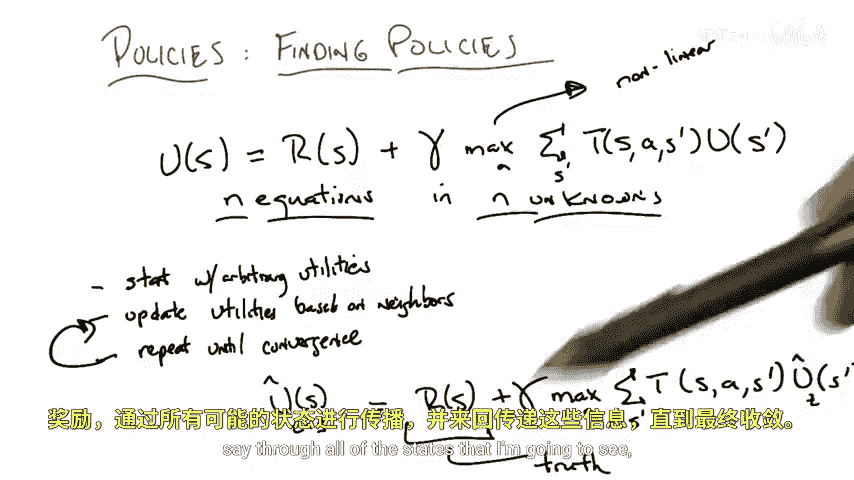
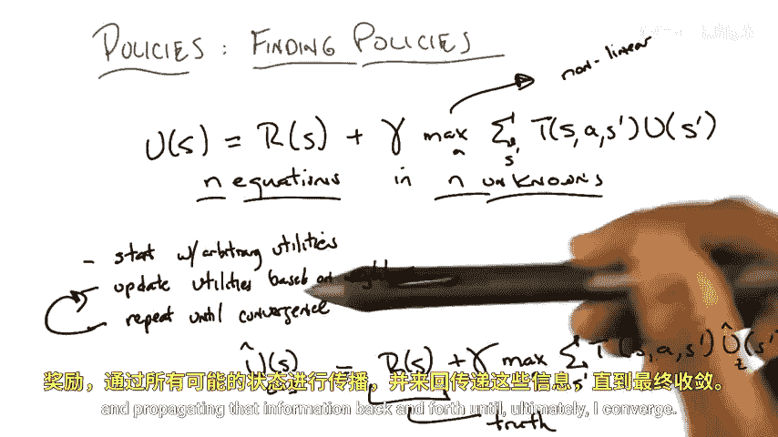
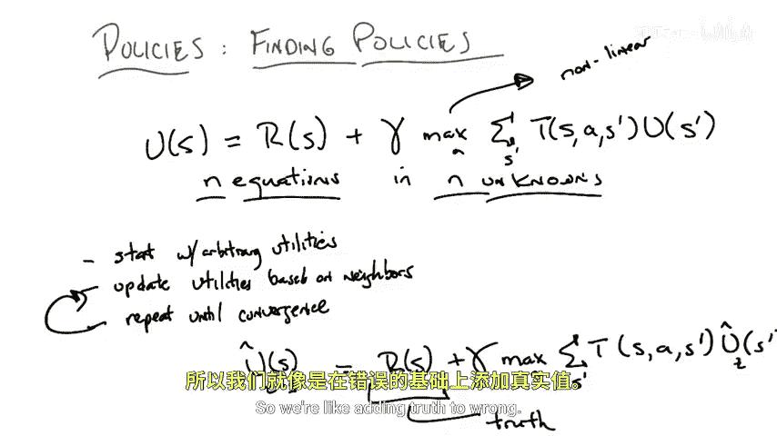

# 强化学习导论：P26：寻找策略 - 2

在本节课中，我们将学习如何通过迭代更新状态效用值来寻找最优策略。我们将探讨一个看似简单但功能强大的算法，它如何从任意的初始猜测出发，逐步收敛到正确的状态效用值。

上一节我们介绍了策略评估的基本概念，本节中我们来看看如何通过迭代更新来改进我们对状态效用的估计。

我将通过观察所有其他状态（包括其自身）的效用来更新状态S的效用。这些效用会根据我采取某个动作后到达这些状态的概率进行加权。那么，我将采取哪个动作呢？我会选择那个能最大化我期望效用的动作。这就像是在假设当前这个估计效用 `U_hat` 确实是未来正确值的前提下，去决定在一个状态下该做什么。

为什么这个方法会有效呢？我最初只是随意设定了这些 `U_hat` 值，它们始于任意的效用估计。基于邻居状态更新效用的下一步看起来有些道理，因为邻居本质上就是你能到达的任何状态，这由转移函数决定。

**公式：**
`U_{k+1}(s) = R(s) + γ * max_{a} Σ_{s'} P(s'|s, a) * U_k(s')`

但我所做的只是更新那些同样由任意效用值构成的状态。这些初始值都是任意的。为什么这样做能帮助我呢？原因在于这里的这个值。进入一个状态所获得的即时奖励是一个真实值。

实际上，接下来会发生的是：我将开始传播这个真实值，或者说真实的即时奖励。我会将进入某个状态所获得的真实即时奖励，通过所有我将访问的状态进行传播，并让这些信息来回传递，直到最终收敛。

这仍然不明显为什么我们应该收敛，因为我们从一个任意的函数开始。这看起来可能错得离谱。我们就像是在错误的基础上添加真相。

是的，但下一轮迭代时，我已经添加了两次真相。

---

本节课中我们一起学习了价值迭代算法的核心思想。我们了解到，尽管从一个任意的状态效用估计开始，但通过反复地将真实的即时奖励信息与基于转移概率的期望未来效用计算相结合，并选择最大化期望效用的动作，这些效用估计最终会收敛到其真实的最优值。这个过程就像是用真相反复冲刷初始的猜测，直到它被修正为正确的答案。