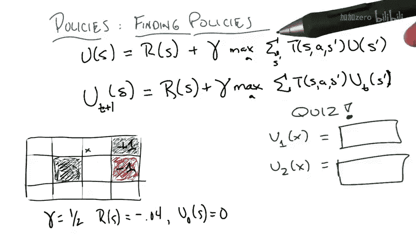
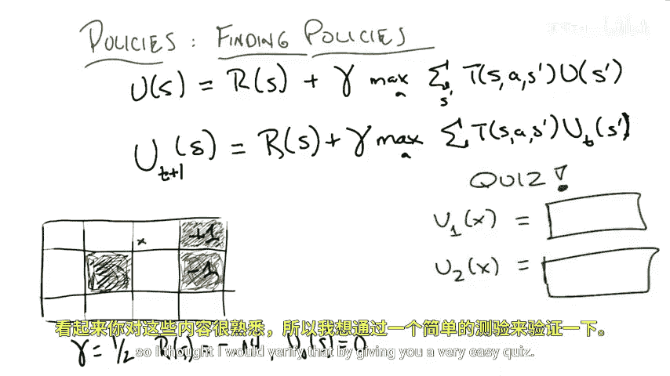
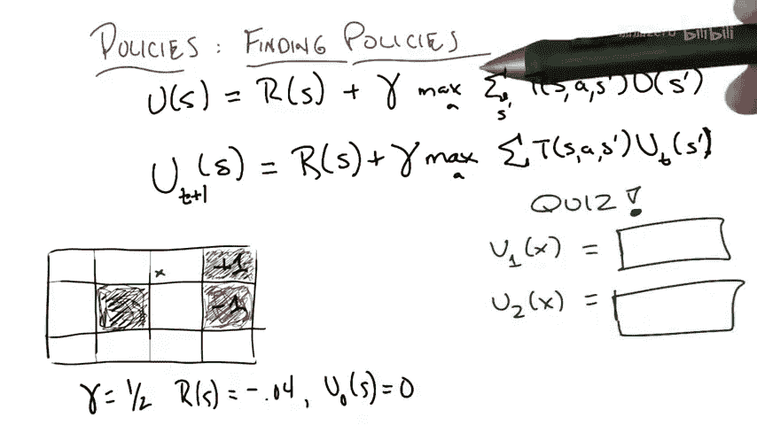
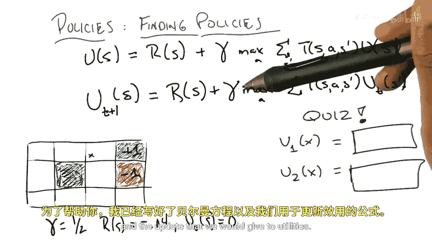
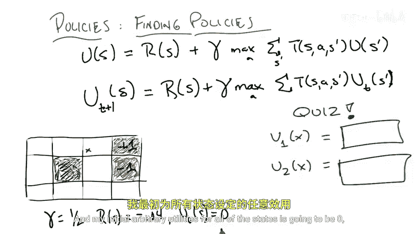
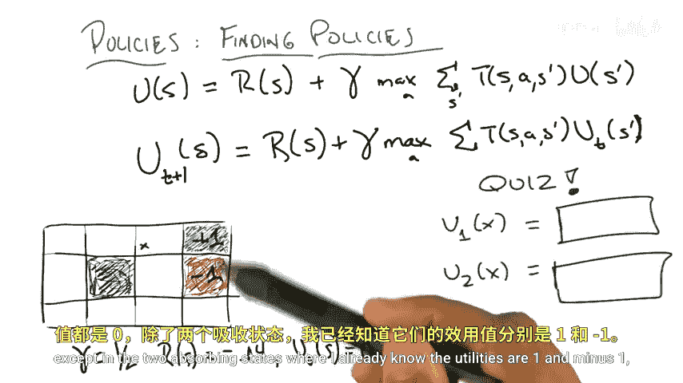
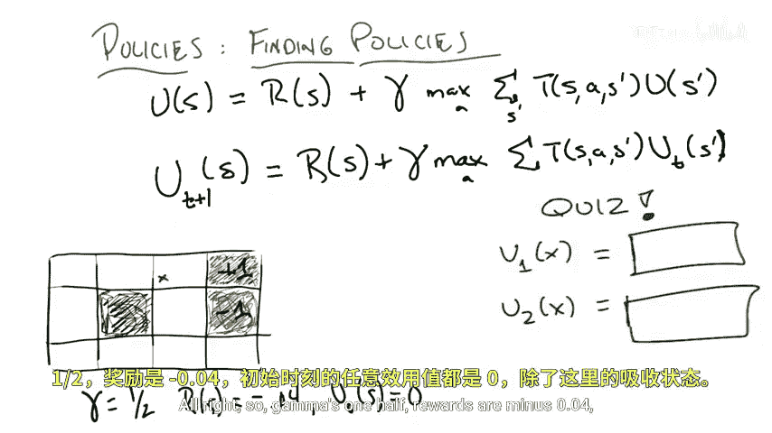

# 佐治亚理工【中英⚡强化学习导论｜CS8803 Introduction to Reinforcement Learning】 p27 P27 Finding Policies - 3 -BV1cJnfzTEBt_p27-

Okay， Michael， so you seem like you knew what you were doing。

 So I thought I would verify that by giving you a very easy quiz。 It doesn't look so easy。

 It is easy。 So here's the quiz to help you。 I've written up both the Bellllman's equation and the update that we would give to utilities。

 I'm neglected to write the little hats and everything because I just don't think you need that。

 But these are the two equations that you need to be able to think about。

 This is just what we've written up before。 and I've written down the grid world we've been playing with the entire time。

And I want you to figure out how value iteration would work from the first iteration in the second iteration for this particular state here that I've marked with an x。

 Okay， All right， and there a little more information you need to go。

 gamma in this case is going to be equal to1 half， mainly because it's easy to do the math if you do it that way。

 The rewards， just to remind you， for all of the states。

 except for the two goal or absorbing states is going to be -004。

 And my initial arbitrary utilities for all of the states is going to be 0。

 except in the two absorbing states where I already know the utilities are 1 and -1 respectively。

 Okay， You got all that。

I think so， you sure。😀呵呵。😊，I feel confident that I'm gonna。Slip ups。Okay， yeah。

 I think I can take a stab at this All right， so gamma rewards are004 arbitrary starting utilities at time zero is except here at the。

