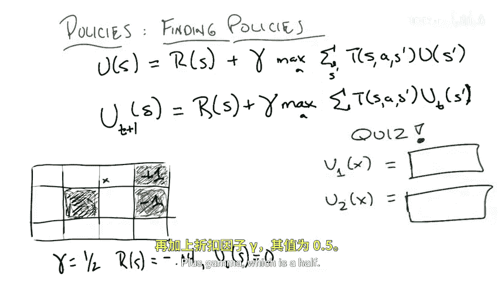
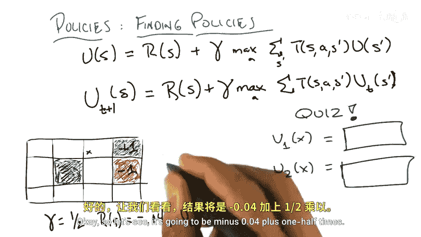
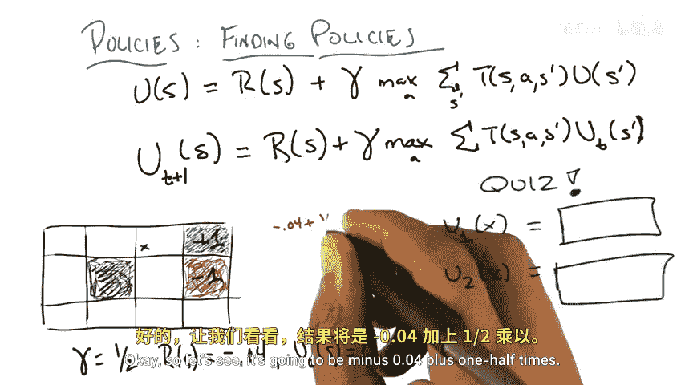
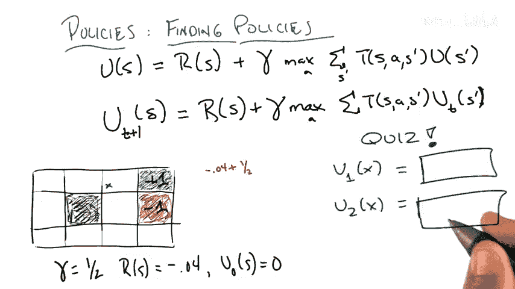
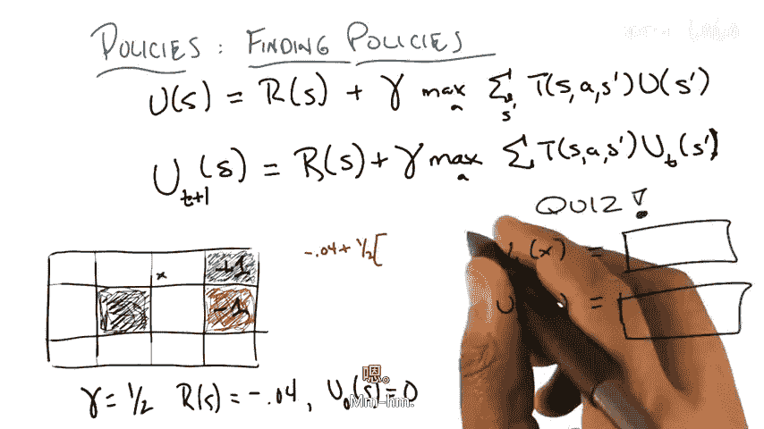
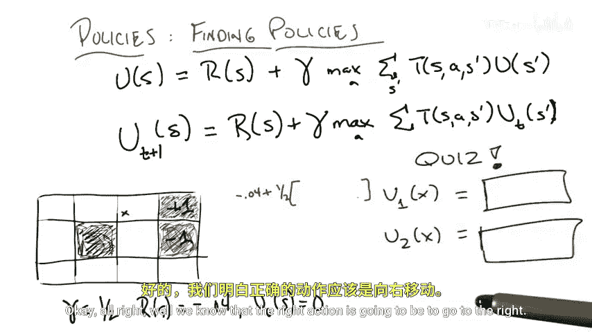
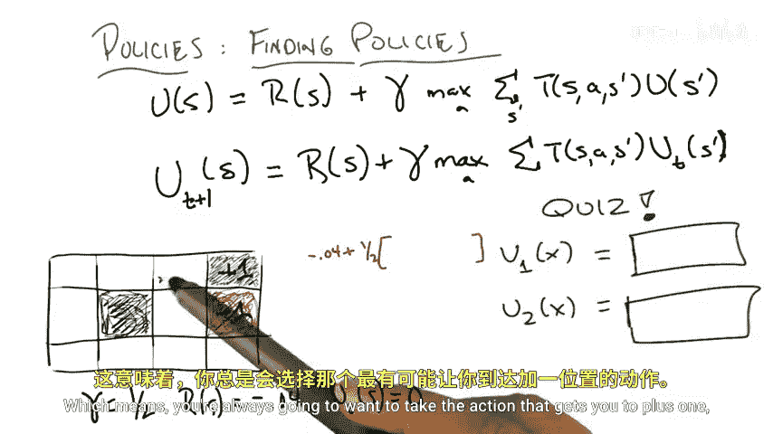
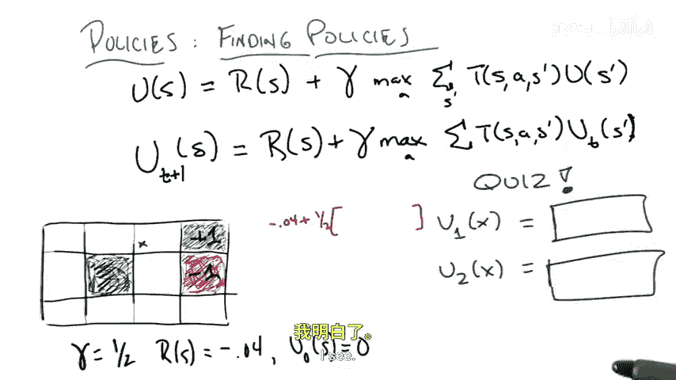

# 佐治亚理工【中英⚡强化学习导论｜CS8803 Introduction to Reinforcement Learning】 p28 P28 Finding Policies - 3 Solution -BV1cJnfzTEBt_p28-

All right， Michael， what's the answer I think I've already made a mistake Okay。

 what's the mistake suggesting that we do a quiz。I'm pretty sure that's always true。 Unless Michael。

 by doing a quiz now and suffering pain， you in the future are a better person。

 in which case you have made the right long term decision。 I see。

 you' This is an MP meta point you're making。 All right， So let， but let's。

 let's just buckle down and do this thing。 So。All right， so at that state x。

 we have to consider according to the equation， we're going to do u sub 1 at x。

 and that's going to be the reward at x， which is minus 。04 plus gamma。

 which is a half feel free to write these things down Okay so let's see it's going to be minus 0。04。

Plus one half times。 alright。 so now we need to do four different actions。 right。 So I don。

 I would make like a bracy thing at this point。

M， not a bracket， but a brace。

Oh。Or I could to do a bracket because you're going to notice immediately that it's obvious what the right action is。

 Okay， All right， well， we know that the right action is going to be to go to the right。 Yeah。

 but even then， you know， you don't have to do rest with the computation because my first guess at all the utilities is that there's zero。

 which means you're always going want to take the action that gets you to plus one with the highest chance right So there's just no point in。

Okay， fair enough， thank you for the shortcut so so we only have to do the one action which is。

