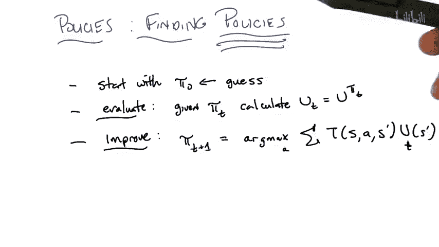
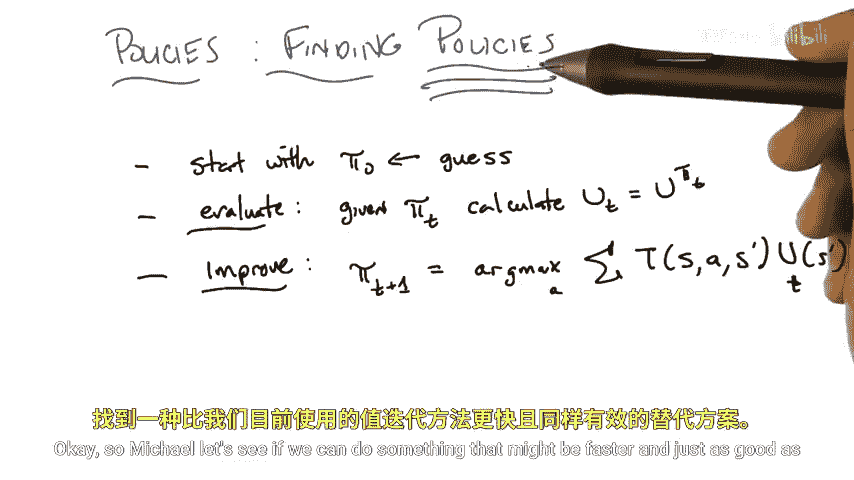
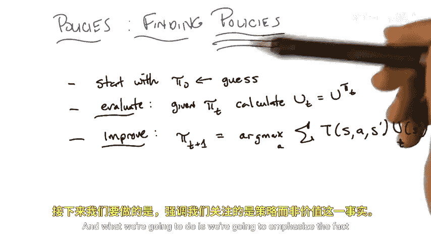
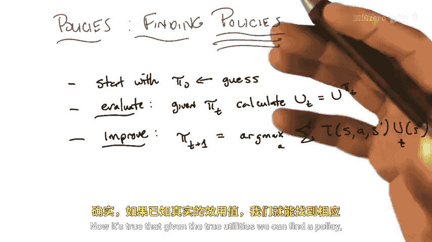
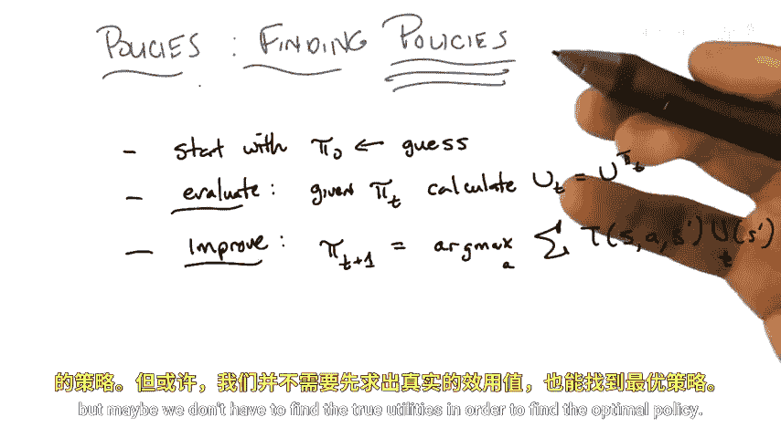
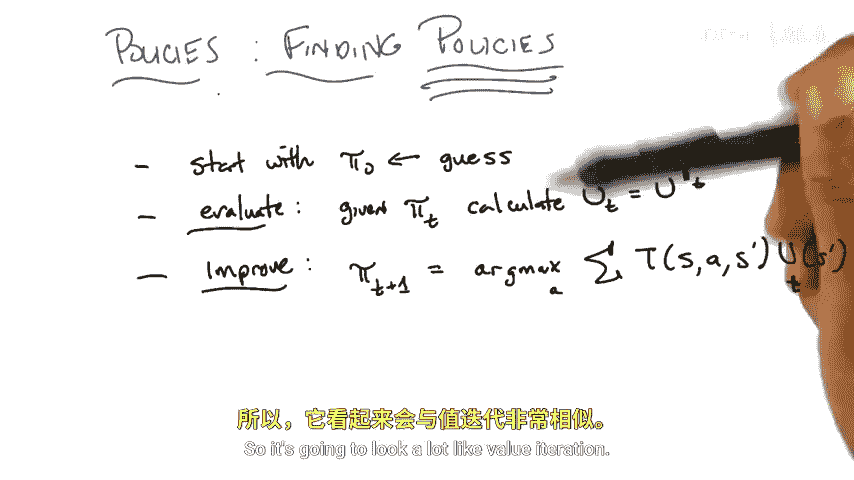
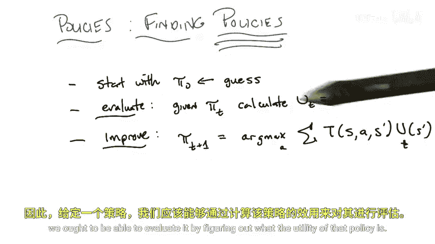
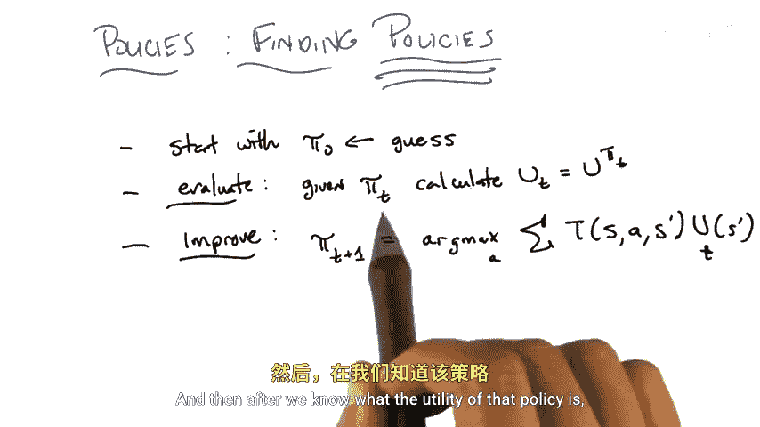
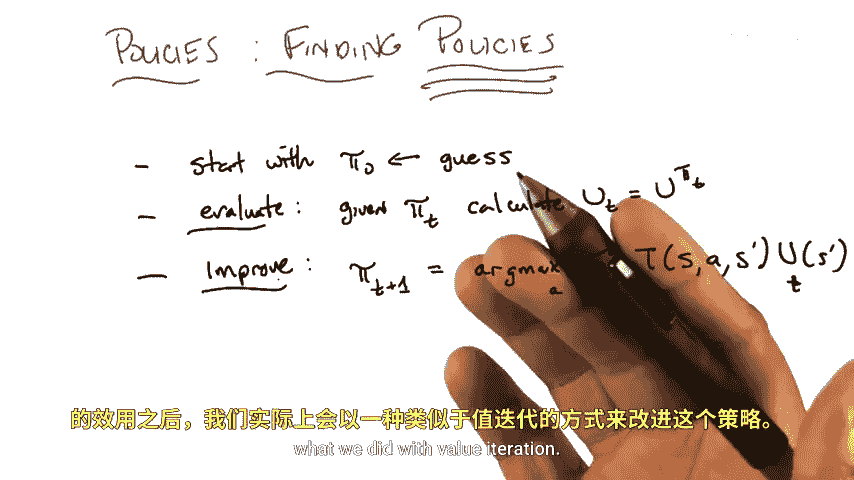
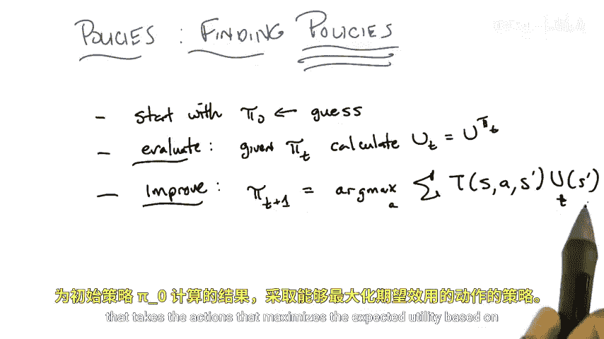

# 佐治亚理工【中英⚡强化学习导论｜CS8803 Introduction to Reinforcement Learning】 p29 P29 Finding Policies - 4 -BV1cJnfzTEBt_p29-

Okay， so Michael， let's see if we can do something that might be faster and just as good as what we've been doing with value iterations。

 And what we're going to do is we're going to emphasize the fact that we care about policies and not values。

 Now it's true that given the true utilities， we can find a policy。

 but maybe we don't have to find the true utility in order to find the optimal policy。

 So here's a little sketch of an algorithm。 Okay so it's going to look a lot like value iteration。

 We are going to start with some initial policy， let's call it pi sub0。

 And that's just going to be a guess。 or it's just going to be an arbitrary setting of actions that you should take in different states。

 Then we're going to evaluate how good that policy is。

 And the way we're going to evaluate it at time T is to calculate its utility。

 which I'm going to call use of T， which is equal to the utility you get by following that policy okay。

😊。

And I'll show you in a moment exactly how you do that but I just want to make certain that you you kind of buy that maybe we could do that。

 So we have given a policy， we ought to be able to evaluate it by figuring out what the utility of that policy is。

 And again， we'll talk about that in a second。 And then after we know what the utility of that policy is。

 we're actually going to improve that policy in a way similar to what we did with value duration。

 we're going to update our policy time t plus1 the policy that takes the actions that maximizes the expected utility based on what we just calculated for Pis of T。

Now， notice that will allow us to change。