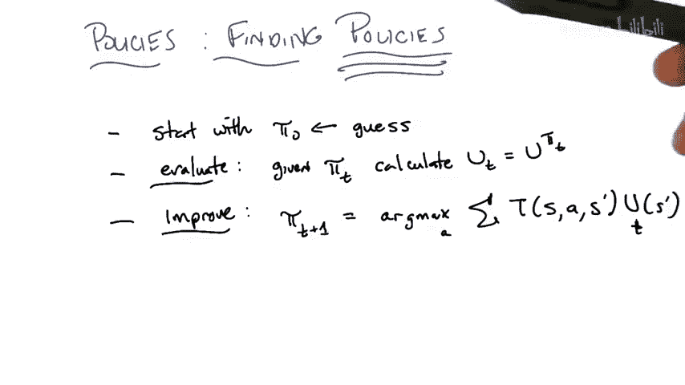
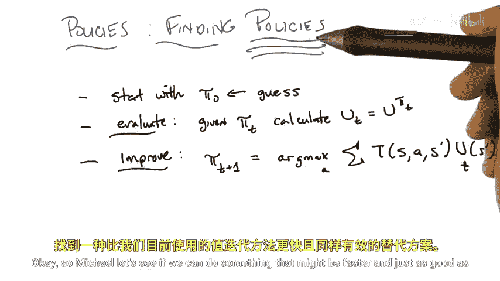
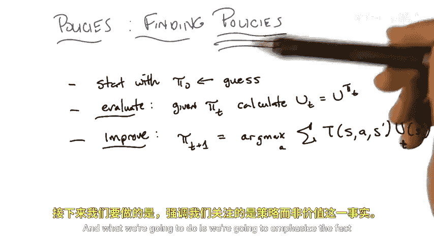
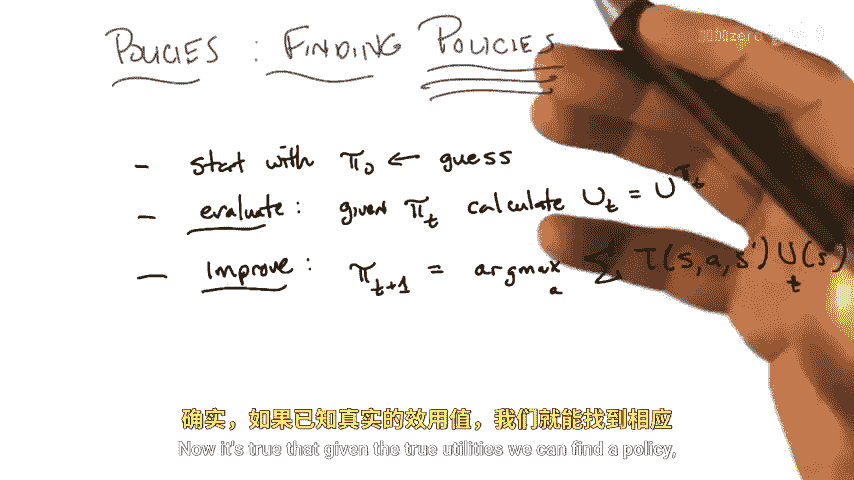
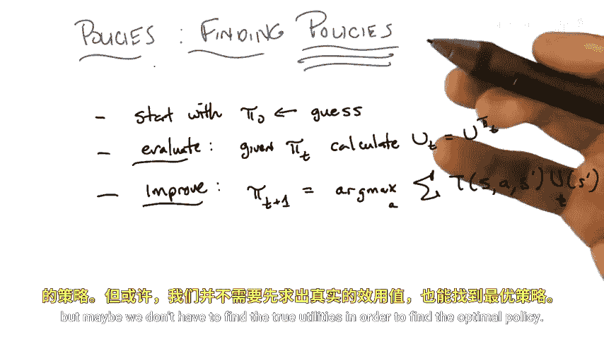
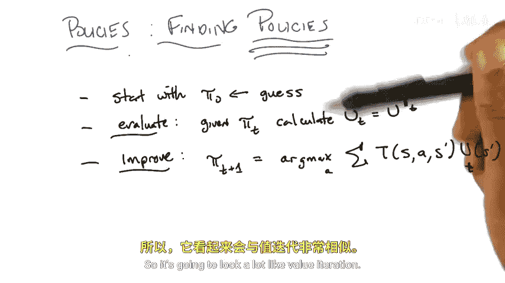
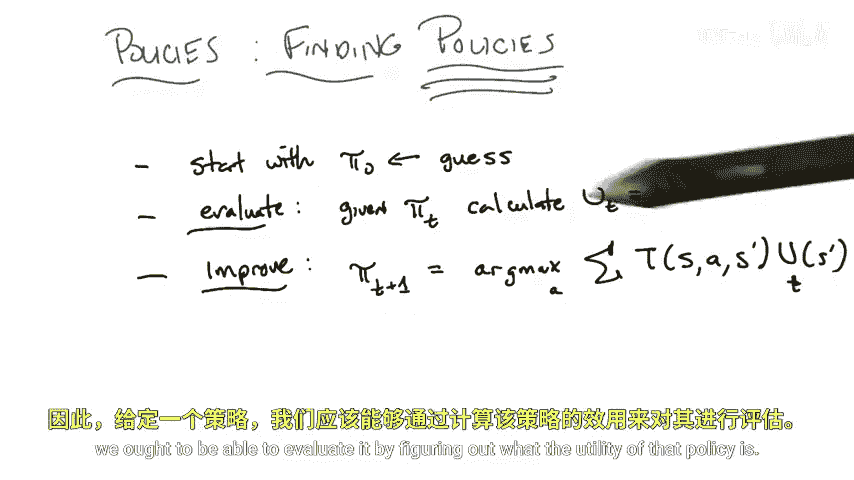
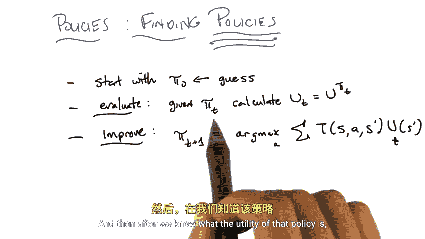
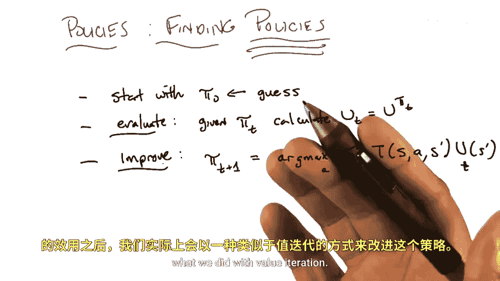
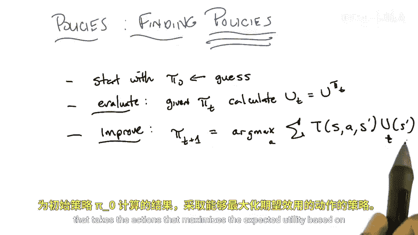

# 强化学习导论：P29：寻找策略 - 4




## 概述 📋

在本节中，我们将探讨一种可能比价值迭代更快、效果同样好的策略寻找方法。我们将强调一个核心观点：我们最终关心的是策略本身，而非具体的价值数值。我们将介绍一种名为**策略迭代**的算法。

## 从价值到策略的转变 🔄

上一节我们介绍了价值迭代，它通过不断更新状态价值来逼近最优价值函数，并从中提取最优策略。本节中我们来看看一种更直接关注策略本身的算法。

给定真实的状态效用，我们确实可以找到一个最优策略。但也许我们不必先求出真实的效用，就能找到最优策略。

以下是一个新算法的简要框架。这个算法看起来与价值迭代很相似。





## 策略迭代算法框架 🧠





我们将从一个初始策略开始，称之为 **π₀**。这个初始策略可以是一个猜测，或者只是为不同状态随意设定的动作。



然后，我们将评估这个策略的好坏。在时间步 T，我们通过计算遵循该策略所能获得的效用来评估它，我们称这个效用为 **Uₜ**。

接下来我们将展示具体如何计算，但首先需要理解我们可以通过计算策略的效用来评估它。

在计算出当前策略 πₜ 的效用 Uₜ 之后，我们将以类似于价值迭代的方式改进这个策略。我们将基于刚刚为 πₜ 计算出的效用，更新策略为 πₜ₊₁，新策略选择的动作是能最大化基于 Uₜ 计算的期望效用的动作。

**策略改进步骤的公式化描述如下：**
```
πₜ₊₁(s) = argmaxₐ Σ_s‘ P(s‘|s, a) * [R(s, a, s‘) + γ * Uₜ(s‘)]
```
其中，`argmaxₐ` 表示选择能使后续期望总和最大的动作 `a`。

请注意，这种方法允许我们改变策略。







## 总结 ✨



本节课中我们一起学习了**策略迭代**算法的基本思想。它从一个初始策略出发，通过“策略评估”计算当前策略的效用，再通过“策略改进”基于当前效用生成一个更好的新策略，并不断迭代这两个步骤。这种方法直接对策略进行优化，可能比先求解精确价值函数再提取策略更为高效。下一节我们将深入探讨策略评估的具体实现方法。