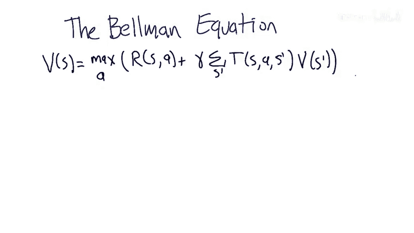
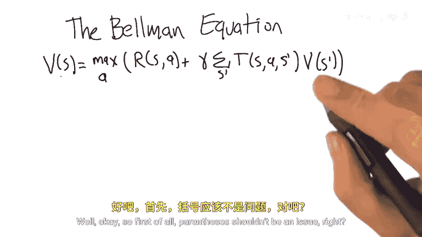
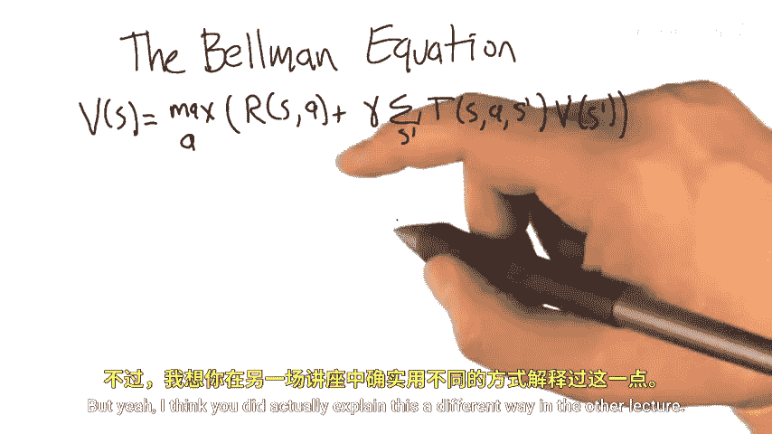
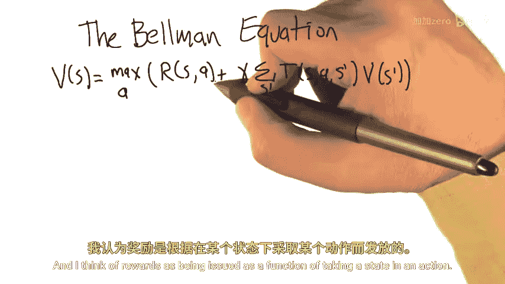
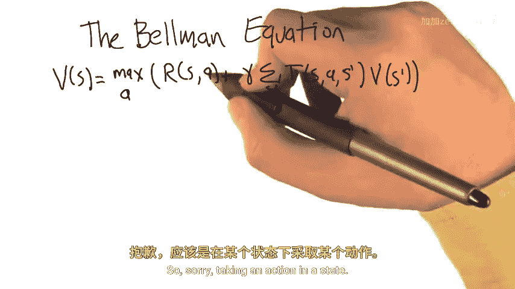
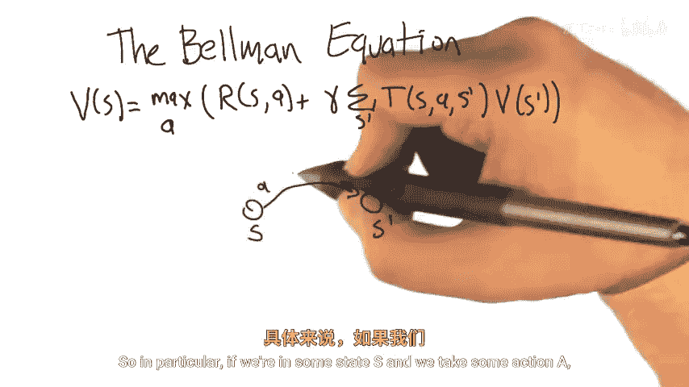
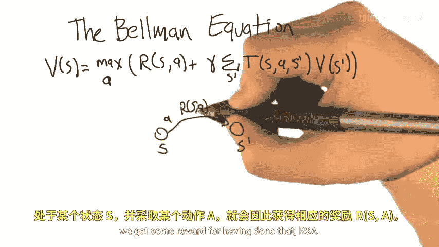
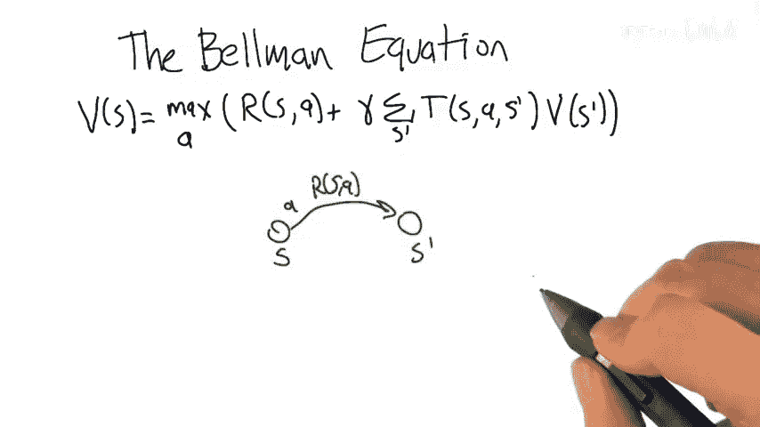
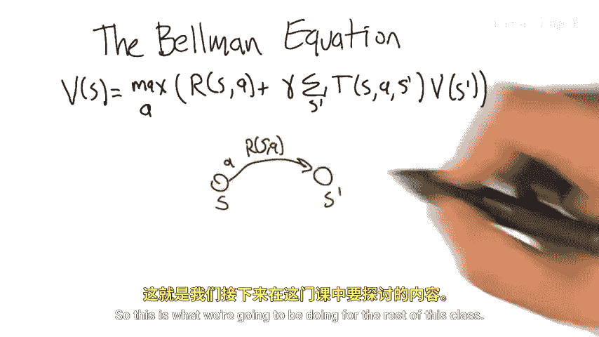
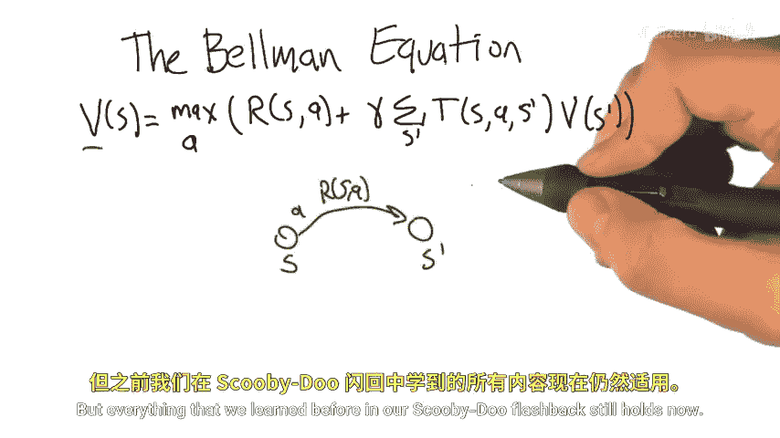

# 佐治亚理工【中英⚡强化学习导论｜CS8803 Introduction to Reinforcement Learning】 p31 P31 The Bellman Equations - 1 -BV1cJnfzTEBt_p31-

So this is the Belman equation that we were just talking about。

 right So the value of a state is the max over all the actions。

 the reward that you get for taking that action from the state。

 plus the discounted value of the state you end up in weighted by the probability that you end up there。

 So this should look familiar， right， No， it doesn't look familiar at all。 I mean， there's a V。

 There's a max on the outside。 There're more parentheses。 It's a reward of Sa instead of what。

 you're making this up。 well， so first of all， parentheses shouldn't be an issue。

 right parentheses just let you group things。 But yeah。

 I think you did actually explain this a different way in the other lecture。

 So I use V for value instead of you for utility。 Okay and I think of rewards as being issued as a function of taking a state in an action。

 So taking an action in a state。

Which is to say that you're in some state of the MP。

 so in particular if we're in some state S and we take some action A。

 we get some reward for having done that Rs and then we land in some new state S prime。

 I guess that is different than how you were talking about it before。

 Yeah but you know when we went over the definition of an MP I did point out that you could think of reward as a function of state or as a function of state and action or as a function of state action in next state and they're kind of all mathematically equivalent。

 so this is what we're going be doing for the rest of this class we're going to be talking about it this way Yeah I'm used to thinking about V as being the value function。

 So it be I think I'm going to slip into it no matter what we might as well just switch to it。

 Okay so we're going to do these I'm going to do R S of As but everything that we learned before in our scubby do flashback still holds。

