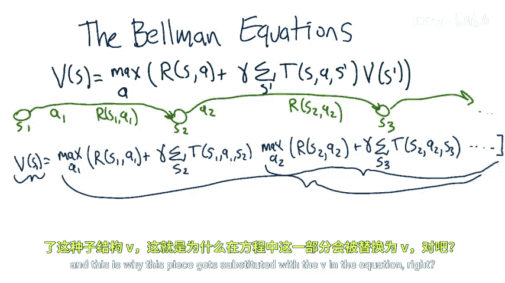
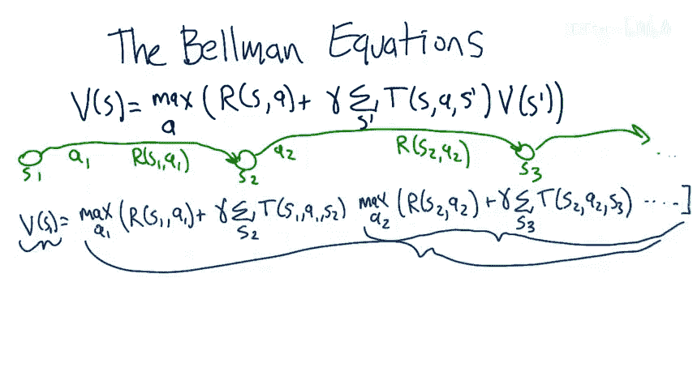
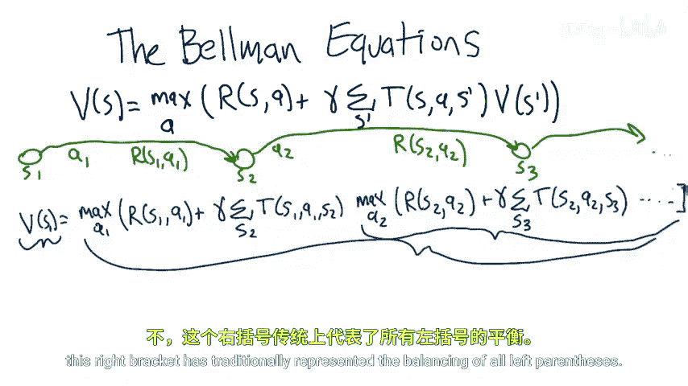
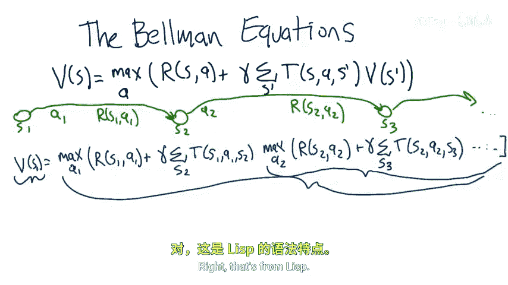
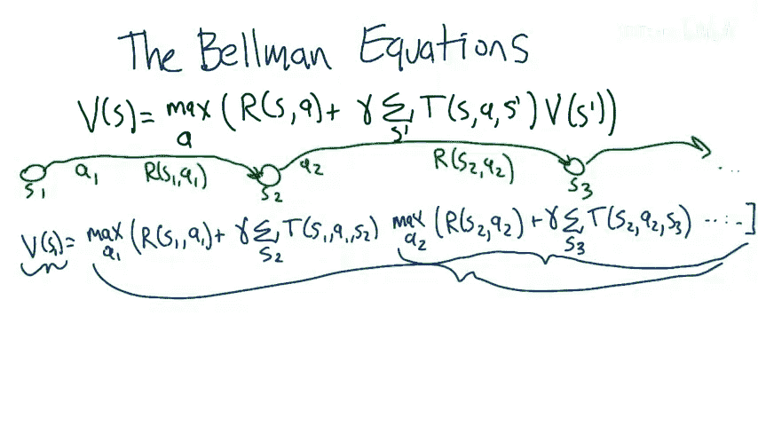

# 佐治亚理工【中英⚡强化学习导论｜CS8803 Introduction to Reinforcement Learning】 p32 P32 The Bellman Equations - 2 -BV1cJnfzTEBt_p32-

So we're going to generalize this notion of a bellman equation to Belllman equations and the way we're going to do that is by noting that in that previous derivation。

 the way that we're thinking about things is we capture this V here as the repeating structure that starts with the max max a right so it's actually this piece。

 this sort of infinite piece here。 So the whole V consists of this sort of sub v in it。

 And this is why this piece gets substituted with the V in the equation right Yeah that makes sense。

 And you have an infinite number of these things going on forever and ever。

 And I notice an infinite number of left parentheses and not enough right parentheses。

 Oh no this right bracket has traditionally represented the balancing of all left parentheses。

 All right， that's from Lisp。 Yeah， it's just a shorthand。 nice list Lisp C Lisp。

Lift rest。Nice lisp reference。 Thanks so but the thing is because this is an infinite sequence。

's there's actually a number of other ways that we can group this infinite sequence。

 So let me draw another one。 so we can also group the infinite sequence here and notice that it repeats like this。

 So this expression after the max the starting from the R and then moving forward repeats again here。

 And so we can actually make a new equation that depends on that substructure repeated。

 So let me write that out。 So the idea is that we can actually just give a name to this big outer brace。

 So we'll call it QsA and we'll say that it's equal to Rsa plus the discount factor times the sum over next possible states。

 the probability of getting there time yeah， times max a2 or next max。😊。

