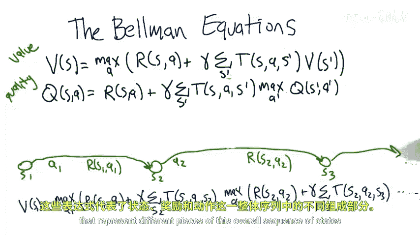
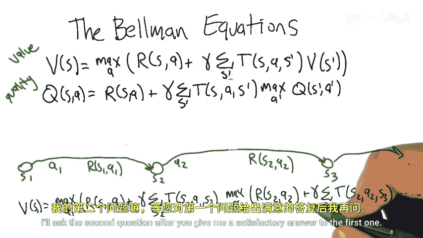

# 佐治亚理工【中英⚡强化学习导论｜CS8803 Introduction to Reinforcement Learning】 p33 P33 The Bellman Equations - 3 -BV1cJnfzTEBt_p33-

All right， so here's a summary of what we're just talking about。

 We have actually have these two different forms of the Bellllman equation，1 v。

 which we can think of as standing for value and1 Q， which we can think of as standing for quality。

 But mostly they're just letters from the end of the alphabet that we made up names for。 So you。

 you had U for utility。 This is V for value and  Q for quality。 But anyway。

 the point is that these are just expressions that represent different pieces of this overall。

Sequence of states and rewards and actions。 Okay， so I got two questions。

1 is， why？ I mean， why are we bothering to create this quality function when value function worked just fine。

 Thank you very much。 And my second question， Well。

 I'll ask the second question after you give me a satisfactory answer to the first one。 So why， So。

 you know， in some sense， because they're both equally good。 But in fact。

 what's going to turn out to be the case is that this Q form of the Belman equation is going to be much more useful in the context of reinforcement learning。

 And the reason for that is we're going to be able to take expectations of this quantity using just experience data and you don't need to actually have direct access to the reward function or the transition function to do that。

 whereas if we're going to try to learn v values， the only way to connect one v value to to the next v value is by knowing the transitions and rewards。

 So this is going to be really helpful in the context of reinforcement learning where we don't know the transition and rewards in advance。

 I'll buy that。 So here's my second question then you've got V function for what happens when you're。

