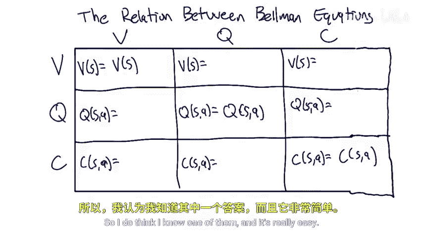
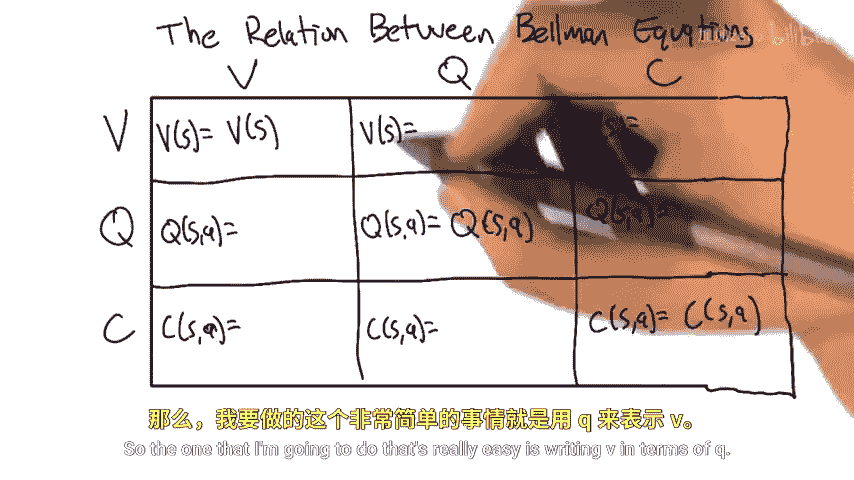
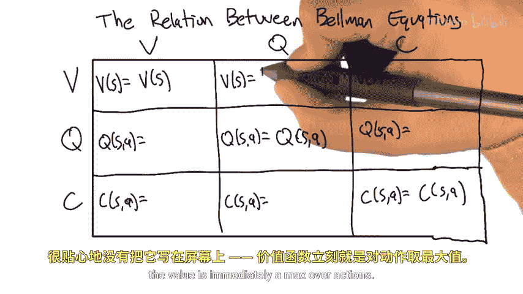
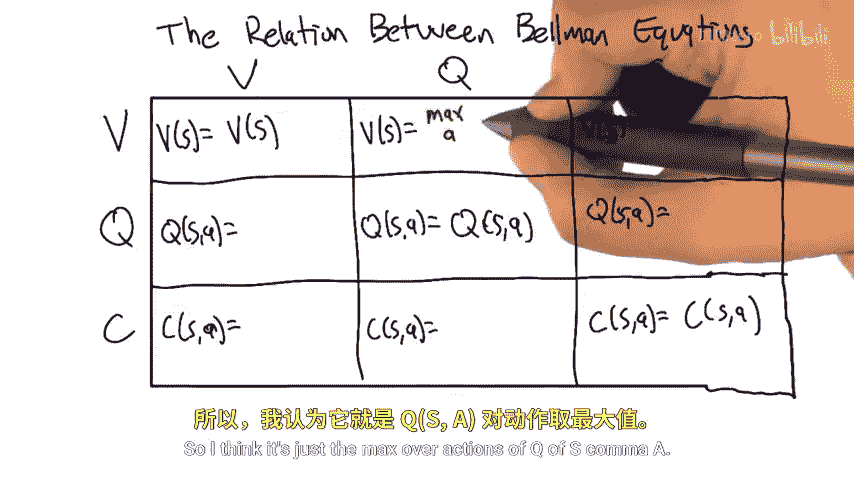
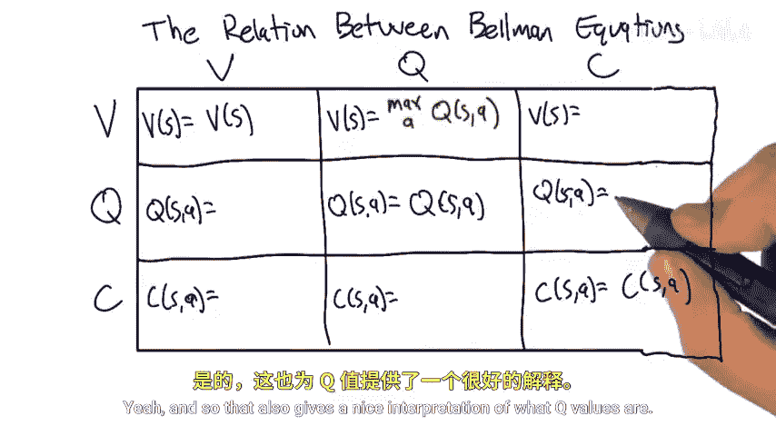
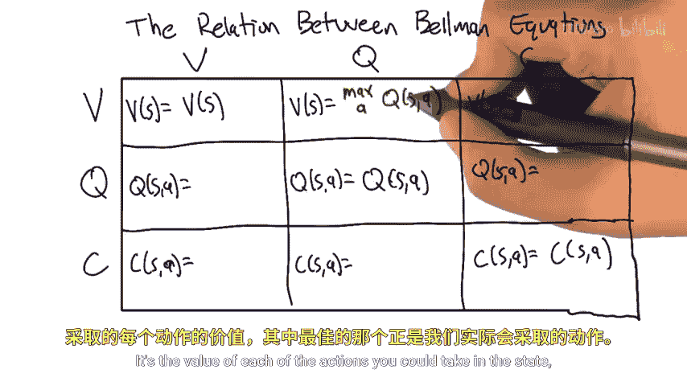
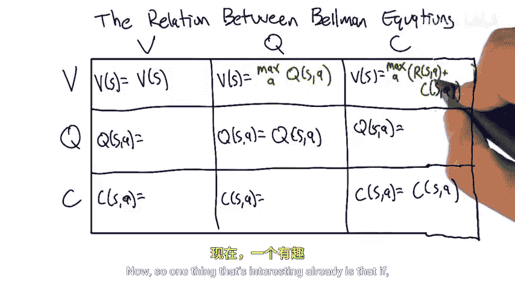
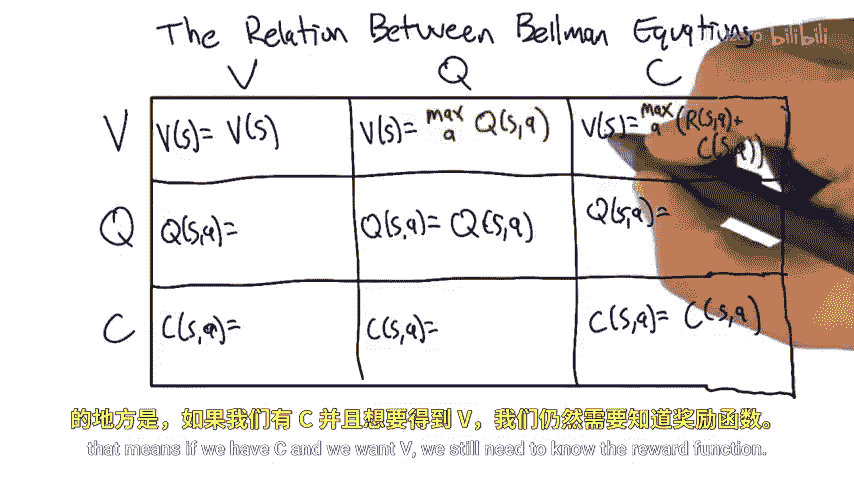

# 佐治亚理工【中英⚡强化学习导论｜CS8803 Introduction to Reinforcement Learning】 p37 P37 Bellman Equation Relations Solution -BV1cJnfzTEBt_p37-

You're ready to fill some of these in。 You might not know all them right off the bat。

 but I think we can piece them together。 Okay， well， if we're gonna work together。

 I think we can do a pretty good job here。 we can ask you a question first。 Sure。

 do you know the answers。 No， but I'm confident that they exist。 Okay， good。 So let's work this out。

 So I do think I know one of them and it's really easy。

 So the one that I'm gonna do that's really easy is writing V in terms of Q。 Excel choice。

 So if you think about the equation which we have conveniently not written on the screen。

 the value is immediately a max over actions。 So I think it's just the max over actions of Q of S A。

 Yeah， exactly so very good。 So one way of saying that is that the true value of a state is just you know you're going to take the best action。

 Yeah and so that also gives a nice interpretation of what Q values are sort it's the value of each of the actions you could take in the state。

 the best of which is the one we're actually going to take right exactly， exactly。

 So I think there's a similar argument to make for C。 So I guess I don't know。😊。

where you want to put the max but I guess what I'm thinking of is you know you had a state followed by an action and that gives you Q but in C you have sort of a state followed by an action and a reward so C is happening after the reward right so it should be the reward that you get plus C right So is that right that makes sense right Yeah that feels right to me now so one thing that's interesting already is that if that means if we have C and we want V we still need to know the reward function but if we want V and we know Q。

