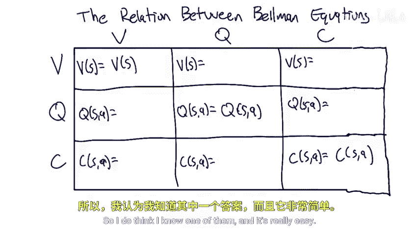
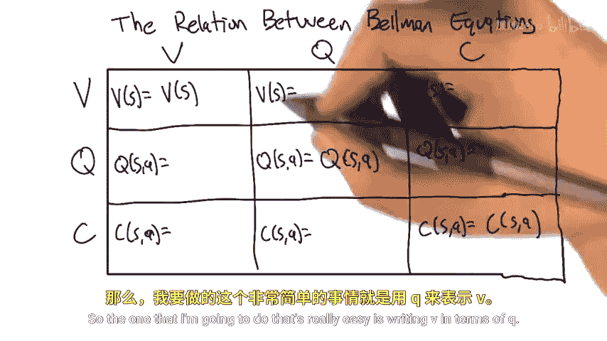
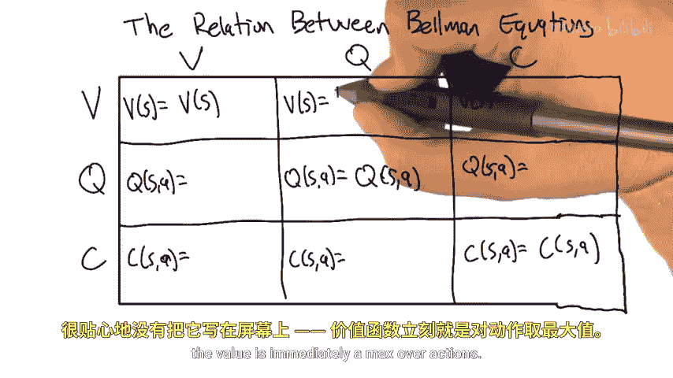
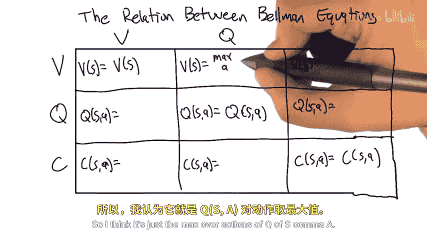
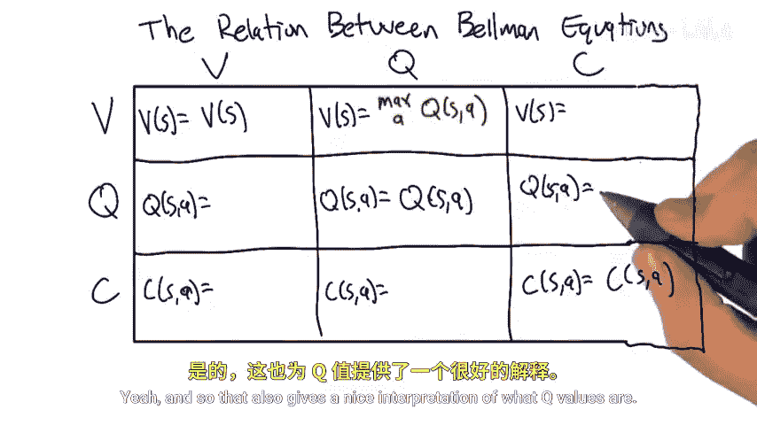
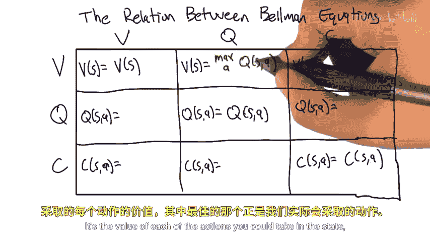
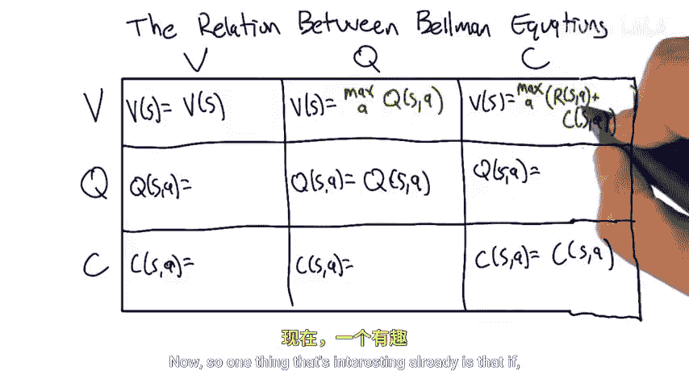
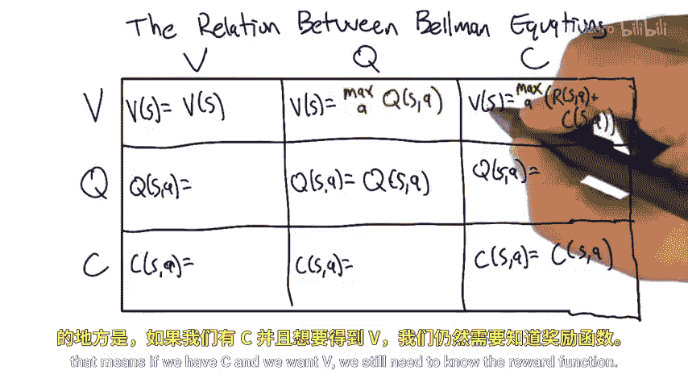

# 强化学习导论：P37：贝尔曼方程关系式求解 🧩

在本节课中，我们将学习如何推导和连接强化学习中的几个核心价值函数：状态价值函数 `V(s)`、动作价值函数 `Q(s, a)` 和延续价值函数 `C(s, a, r)`。我们将通过逻辑推理，一步步建立它们之间的数学关系。

上一节我们介绍了这些价值函数的基本概念，本节中我们来看看如何用公式将它们联系起来。

## 从 `Q` 函数推导 `V` 函数

首先，我们来看如何用 `Q(s, a)` 来表示 `V(s)`。状态价值 `V(s)` 的定义是：从状态 `s` 开始，遵循最优策略所能获得的期望回报。这意味着，在状态 `s` 下，我们会选择能带来最大期望回报的动作。

因此，`V(s)` 就是所有可能动作 `a` 对应的 `Q(s, a)` 中的最大值。用公式表示如下：

**`V(s) = max_a Q(s, a)`**

这个公式有一个直观的解释：`Q(s, a)` 衡量了在状态 `s` 下采取特定动作 `a` 的价值，而 `V(s)` 就是这些动作价值中最好的那个，因为我们总是会选择最优动作。

## 从 `C` 函数推导 `Q` 函数

接下来，我们探讨如何用延续价值 `C(s, a, r)` 来表示动作价值 `Q(s, a)`。`C(s, a, r)` 表示在状态 `s` 采取动作 `a` 并**立即**获得奖励 `r` 后，从**下一个状态**开始所能获得的期望回报。

而 `Q(s, a)` 的定义是：在状态 `s` 采取动作 `a` 后所能获得的**总**期望回报。这个总回报包括两部分：
1.  立即获得的奖励 `r`。
2.  获得奖励 `r` 之后，从新状态开始的未来回报，这正是 `C(s, a, r)` 所定义的。

因此，`Q(s, a)` 应该是立即奖励 `r` 加上后续的延续价值 `C(s, a, r)`。由于奖励 `r` 可能是一个随机变量（取决于环境动态），我们需要对其取期望。用公式表示如下：

**`Q(s, a) = E_{r ~ p(·|s,a)} [ r + C(s, a, r) ]`**

这里，`E` 表示期望，`r ~ p(·|s,a)` 表示奖励 `r` 是从状态 `s` 和动作 `a` 决定的概率分布中采样得到的。

## 核心关系总结

以下是本节课推导出的两个核心关系式：

1.  **状态价值与动作价值的关系**：状态价值是动作价值的最大值。
    **`V(s) = max_a Q(s, a)`**
2.  **动作价值与延续价值的关系**：动作价值是立即奖励与延续价值之和的期望。
    **`Q(s, a) = E_{r ~ p(·|s,a)} [ r + C(s, a, r) ]`**

一个重要的观察是：如果我们已知 `Q` 函数，我们可以直接通过取最大值得到 `V` 函数。然而，如果我们已知 `C` 函数，要得到 `V` 函数，我们还需要知道环境的奖励函数（模型）来计算 `Q` 函数。

本节课中我们一起学习了如何连接 `V`、`Q` 和 `C` 这三个关键的价值函数。我们推导出 `V(s)` 是 `Q(s, a)` 的最大值，而 `Q(s, a)` 是立即奖励 `r` 与 `C(s, a, r)` 之和的期望。理解这些关系是掌握贝尔曼方程和后续强化学习算法的基础。