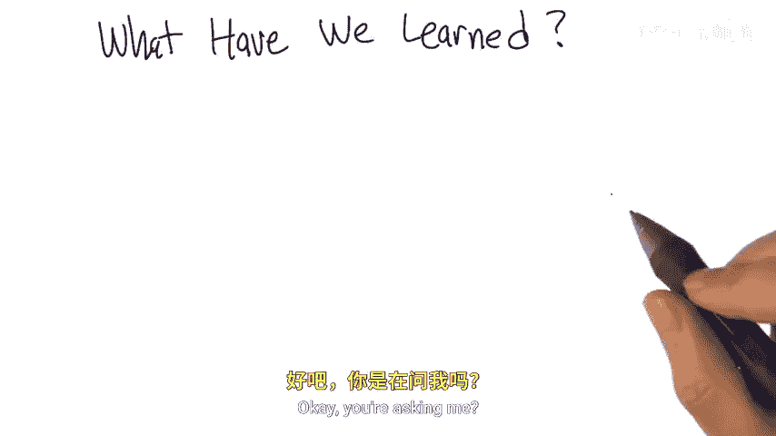
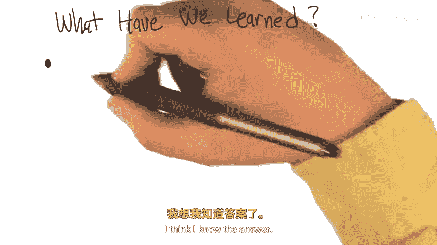
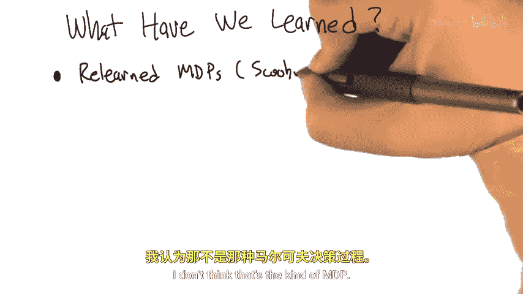
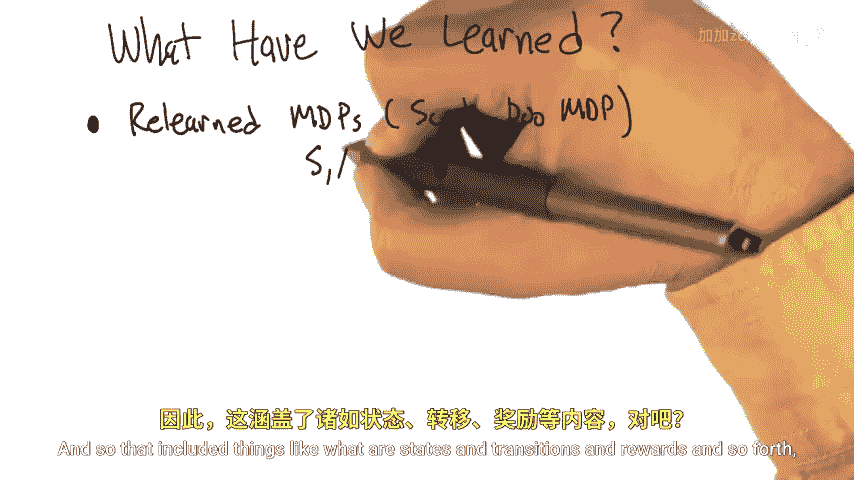
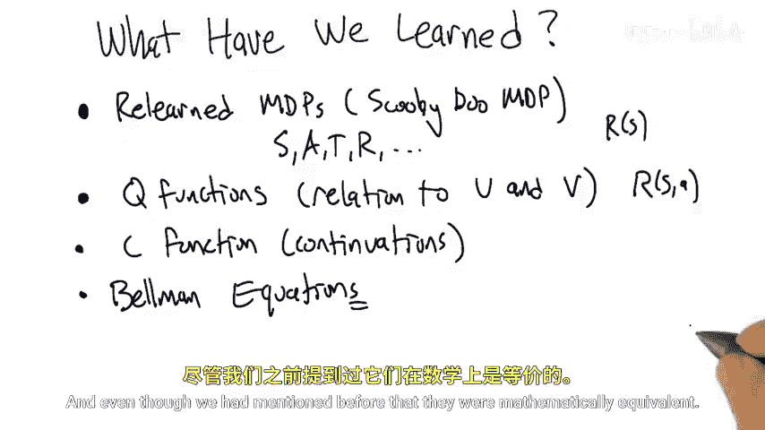

# 佐治亚理工【中英⚡强化学习导论｜CS8803 Introduction to Reinforcement Learning】 p38 P38 What Have We Learned_ -BV1cJnfzTEBt_p38-

All right， so this seems like a good time to stop and ask ourselves， what have we learned。 Okay， oh。

 you're asking me。 I am indeed， I'm sorry。 Okay， well， that's not， that's not a problem。

 I think I know the answer。 So the first thing is we relearned everything that we learned from the MP lesson before。

 So， you know， we learned all about scooby do MDpss。😊。

I don't think that's a kind of MP。 It is now。 We should write a paper quick。

 And so that included things like what are states and transitions and rewards and so forth， right。

 right， I think anything else。 Well， I think we learned a bunch of new things。

So for me， I learned all about Q functions。 I learned about continuations。 and in general。

 when I think about that， I really learned about what the Bellllman equations as opposed to equation are really trying to capture for you。

 even more than we did when we when we talked about them with MDP。 All right。

 so deeper understanding of the Bellllman equation and how it relates the rewards in this infinite sequence of rewards to each other。

 Yeah， that's sort of what I was going for。 Yeah， and I think that's a lot。

 And I think I learned that notation matters。Okay。Now。

 remember we talked about the reward in the Scooby do MVP， we talked about R as a function of S。

 and when we talked about Q functions and C functions and the Belman equations。

 we went to R being S of A and even though we had mentioned before that they were mathematically equivalent。

 it turns out just like sometimes thinking about Q。

