# 佐治亚理工【中英⚡强化学习导论｜CS8803 Introduction to Reinforcement Learning】 p40 P40 First MDP Problem -BV1cJnfzTEBt_p40-

Let's consider the following decision problem from an initial state。

 We have a choice of three actions， a。

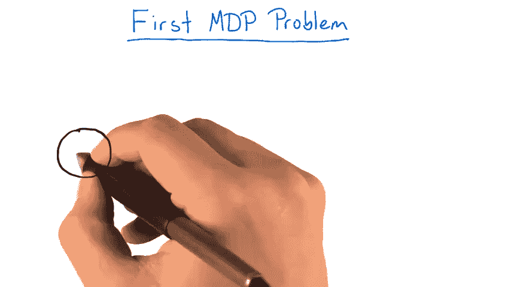

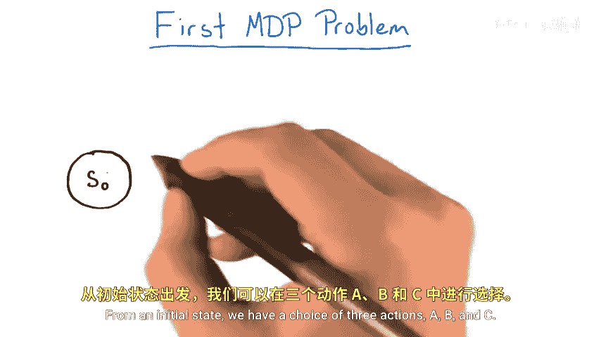

B and C， the immediate reward associated with each of these actions is 0。

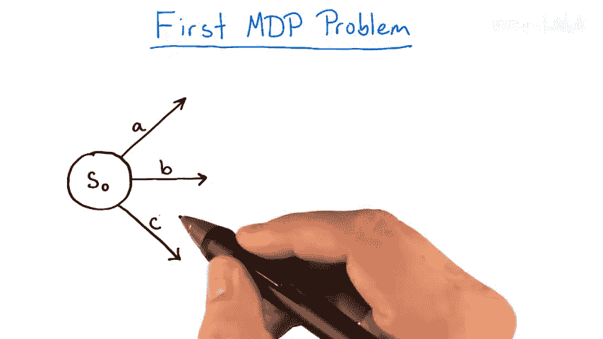

But these three actions will take us to different states with different possible rewards available from these states。

 Action A takes us to state S1。

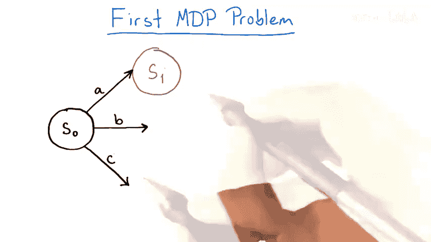

From which our only action is to loop at each step back into state S1， accruing a reward of。P1。

 which is a parameter each time。 If we take action B at the initial state。

 we will spend the rest of the game alternating between states S2 and S 4。

 We will gain a reward of P2 each time we move from state S2 to S 4。

 and we will receive a reward of P3 on the return trip。

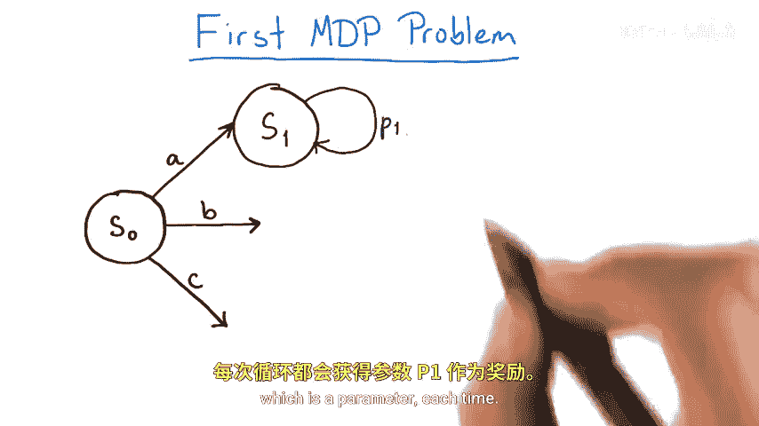

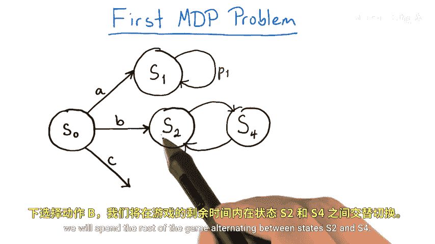

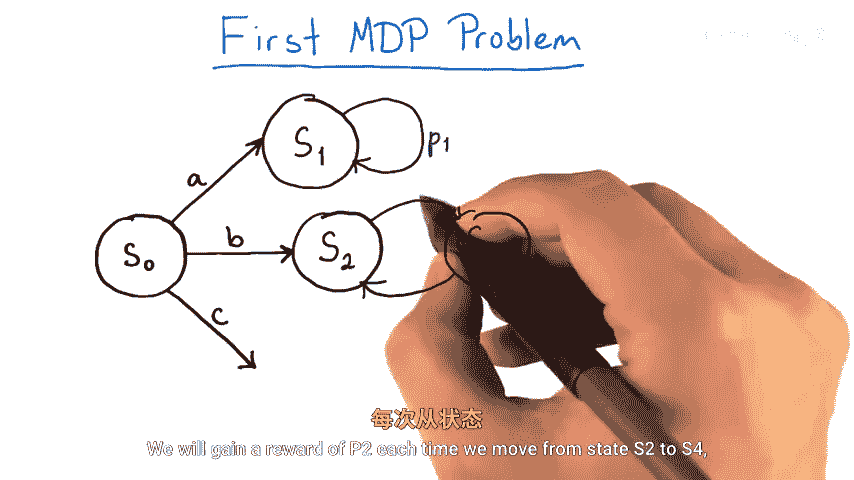

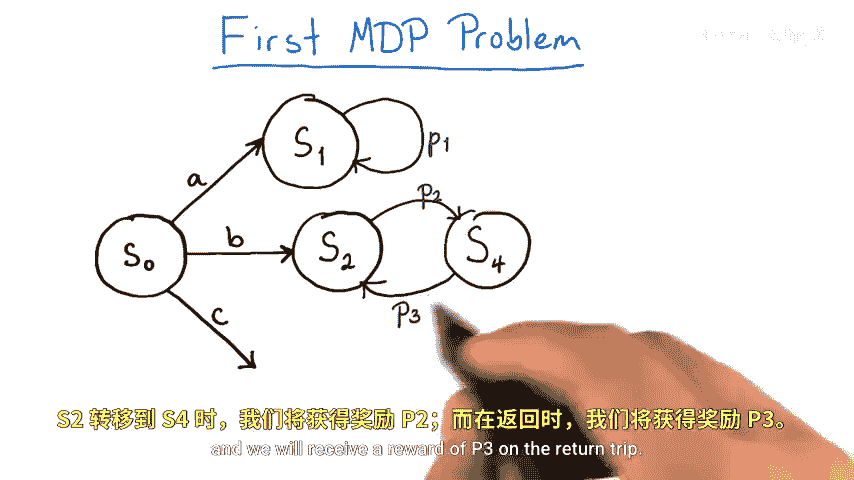

And if we take action C initially， we will move into state S3。

 from which our only next action is to move into state S5， attaining no reward。After that。

 we repeatedly loop in state S 5， attaining a reward of P 4 at each step。

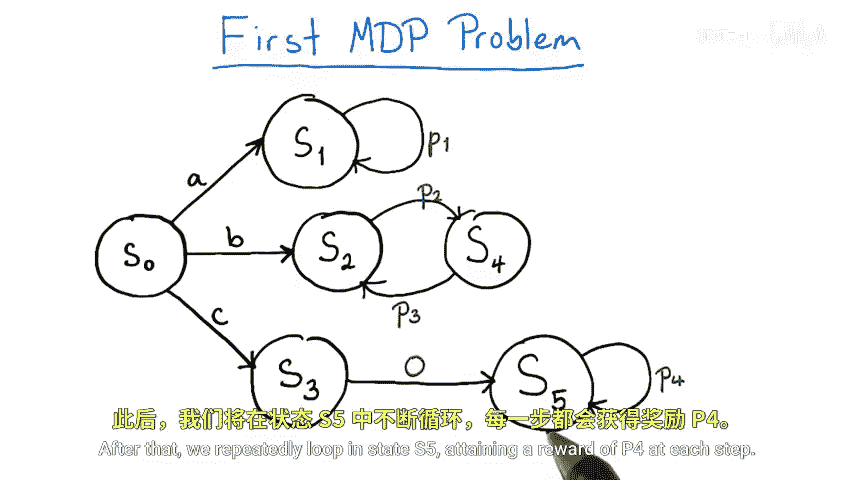

Suppose the game has an independent probability of ending after each step。

 And let's call this probability 1 minus gamma so that the effective discount factor for the scenario is gamma。

 Given the parameters P1， P2， P3 and P4。

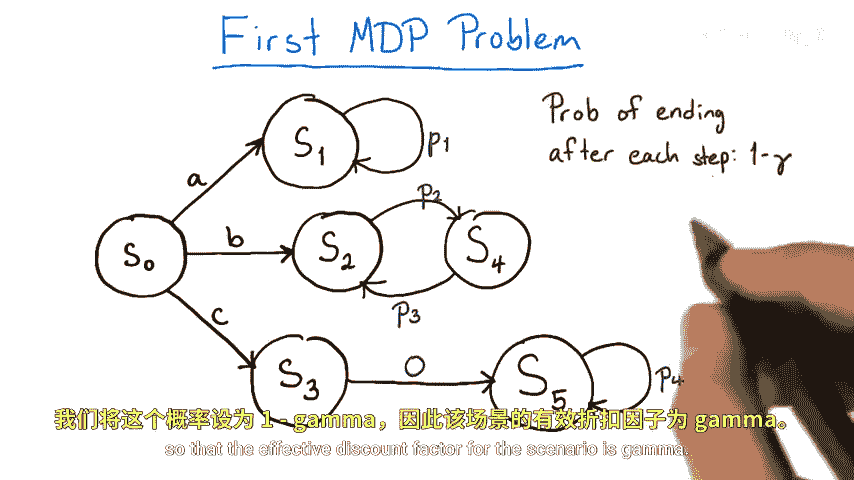

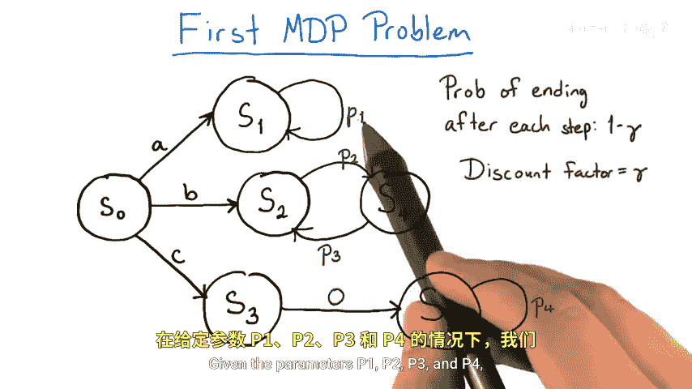

Our problem。