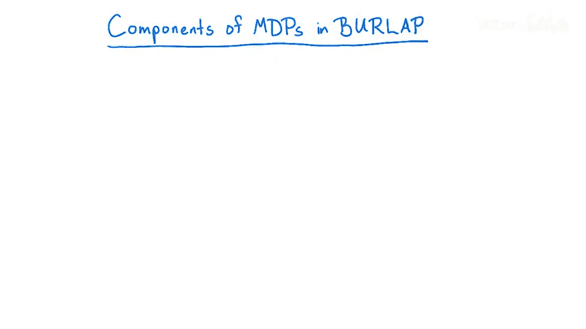
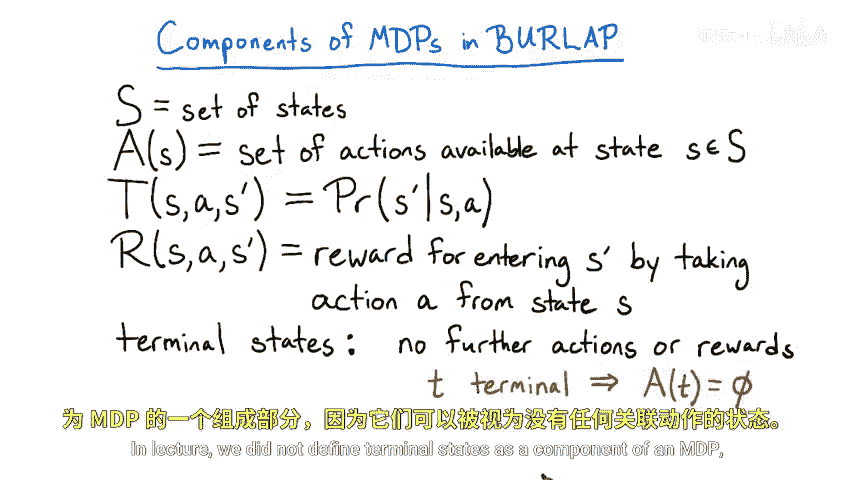

# 佐治亚理工【中英⚡强化学习导论｜CS8803 Introduction to Reinforcement Learning】 p41 P41 Components of MDPs in BURLAP -BV1cJnfzTEBt_p41-

Before jumping into the code， let's quickly review the components of a Markov decision process or MDP and see how they are implemented using the burlap library。

 The first component of an MP is a set of states S that the system can be in。

 associated to each state S in S is a set of actions A of S that can be taken at the state little S。

 Additionally， there is a transition function T of S A S prime that gives the probability that if we are in state S and take action A that we end up in state S prime。

 Finally， there is a reward function。 R of S A S prime。

 which gives the reward we attain by taking action A at state S and ending up in state S prime。

Recall that it is sometimes more natural to express the reward as a function of just S N A or even as a function of just the initial state。

 S。We will use the most general form R of S A S Prime in this tutorial。

 since reward functions are implemented in Burlap in this manner。

 a terminal state is a state in which no further agent action is possible after entering the terminal state。

 An agent receives no more reward for the rest of time。In lecture。

 we did not define terminal states as a component of an MDP because they can be considered states without any associated。

