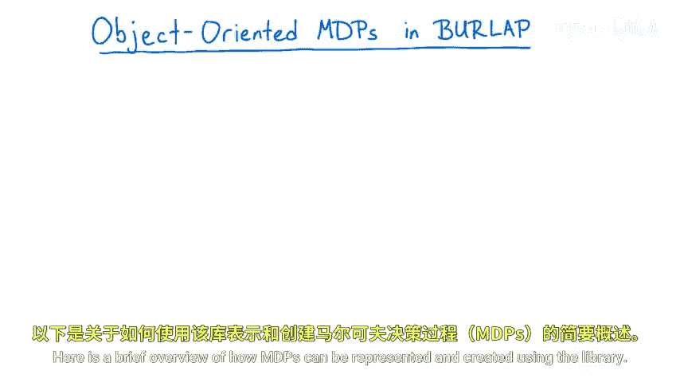
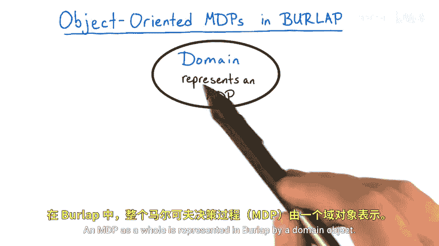
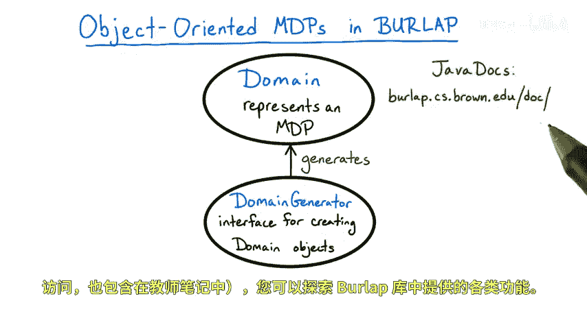

# 佐治亚理工【中英⚡强化学习导论｜CS8803 Introduction to Reinforcement Learning】 p42 P42 OOMDPs in BURLAP -BV1cJnfzTEBt_p42-

Burlap uses the object oriented paradigm to represent Markov decision processes。

 Here is a brief overview of how MDps can be represented and created using the library。

 An MDP as a whole is represented in burlap by a domain object。

Doomains can be created directly， but it is often useful to use one of several classes in the burlap library。

 specifically to generate certain types of MDpss。 These classes are implementations of the domain generator interface in the Java documentation for burlap located at the URL here and also included in the instructor notes。

 You can explore the classes available through the burlap library。

 in the left hand pane of the documentation， you'll see a list of all the classes available in burlap。

 Sc down until you find domain generator。 notice that domain generator is italicized。

 This means that the classes and interface。 If you click the link on the left side for domain generator。

 You will see information about the interface in the main pane。

Notice that at the top of the page。 there is a list of classes that implement the domain generator interface。

 If you're not familiar with Javads， you can click each of these classes to read a brief description of the type of domain each class generates。

 Now， considering the type of MP we are interested in building which of these classes would be most appropriate for us to use to generate a domain object。

 Use the documentation for each of these implementing classes and the。

