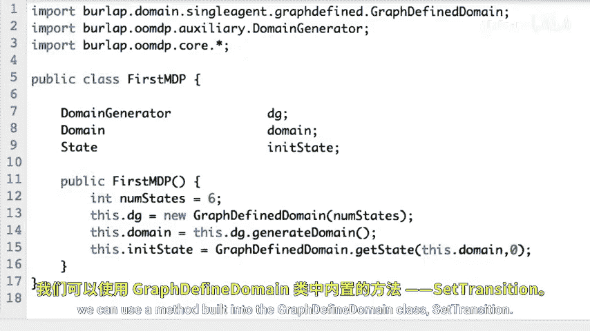
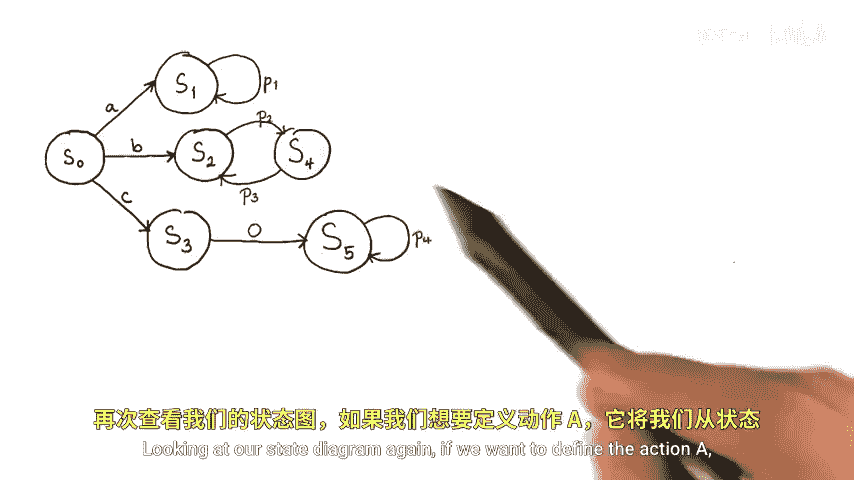
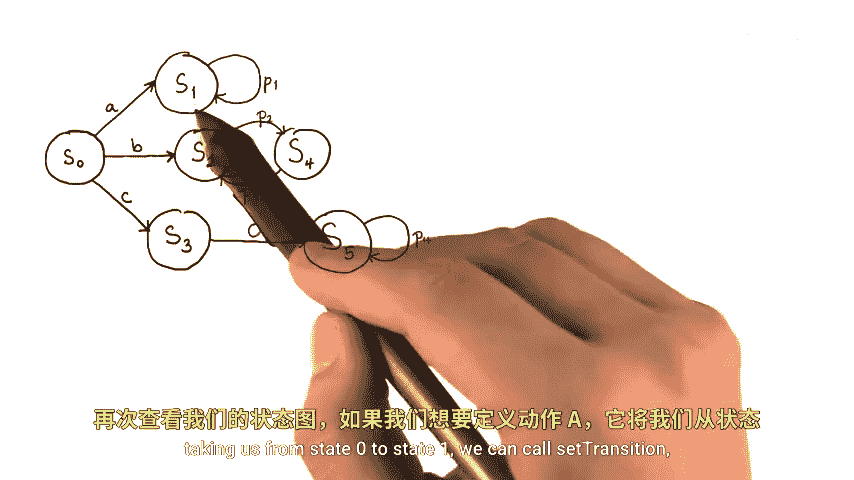
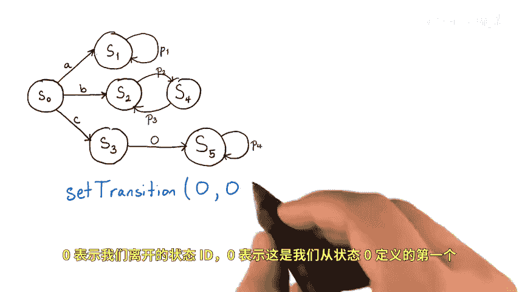
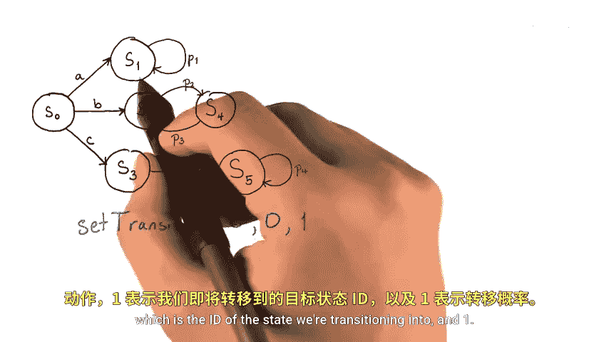

# 佐治亚理工【中英⚡强化学习导论｜CS8803 Introduction to Reinforcement Learning】 p48 P48 Transitions in BURLAP -BV1cJnfzTEBt_p48-

We finished encoding our states in the burlap domain， so now let's add actions to the domain as well。

To add actions to domain objects we generate， we can use a method built into the graph defined domain class。

 set transition。 This method is used to define both the set of actions and the transition function for the MDP。

The first argument is an int giving the I D of the state S we are transitioning from。

 The second argument is also an int， giving the I D of the action we are defining。

 I'll talk about that more in just a second。 The third argument is an int。

 giving the I D of the state T we are transitioning into。 and the fourth argument is a double。

 giving the probability of transitioning to state T upon taking this action。

 note that many different actions coming out of the same state can have the same I D。

 but the probabilities of the actions with the same I D， leaving a given state must add up to one。

 Looking at our state diagram again， if we want to define the action A taking us from state 0 to state 1。

We can call set transition， with the arguments 0。For the I D of the state， we are leaving。Zero。

Since this is the first action we're defining from state 0。

1， which is the I D of the state we are transitioning into。

And one。