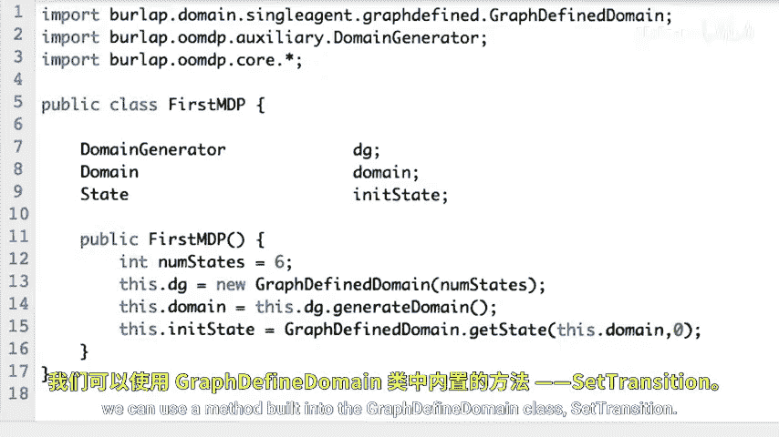
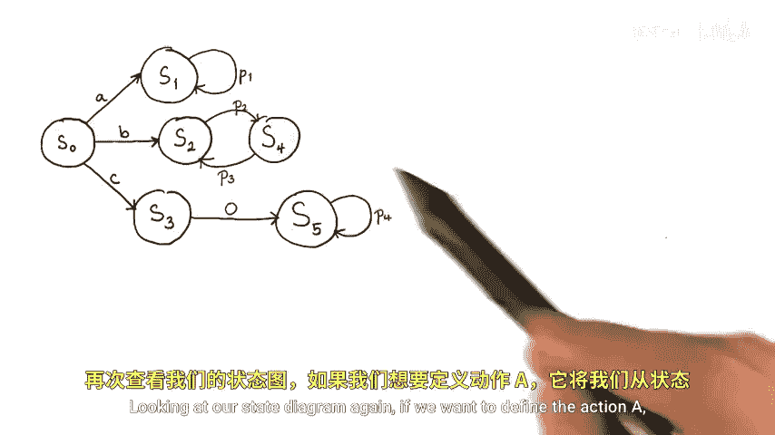
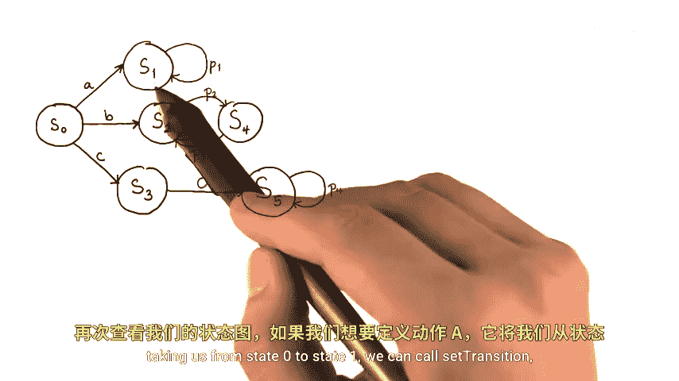
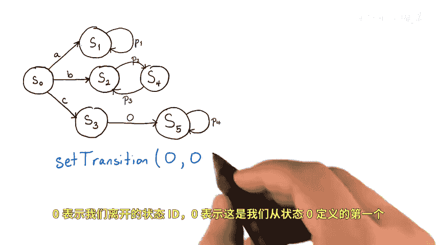
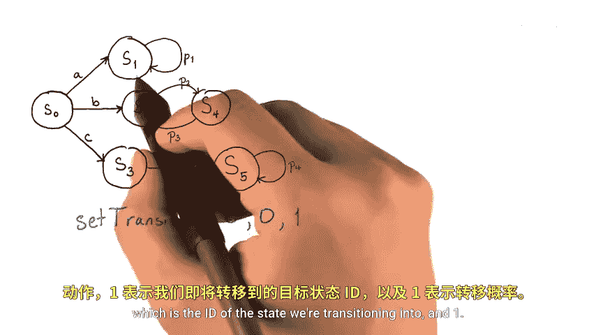

# 强化学习导论：P48：BURLAP中的状态转移 🚀

在本节课中，我们将学习如何在BURLAP中为已定义的状态添加动作，并配置马尔可夫决策过程（MDP）的转移函数。我们将使用 `setTransition` 方法来完成这一任务。

上一节我们介绍了如何在BURLAP领域中编码状态。本节中，我们来看看如何为这些状态添加动作。

## 添加动作与定义转移函数



要为领域对象添加动作，我们可以使用图定义域类（`GraphDefinedDomain`）内置的方法 `setTransition`。此方法用于同时定义MDP的动作集合和转移概率函数。

其方法签名如下：
```java
setTransition(int fromStateID, int actionID, int toStateID, double probability)
```

以下是该方法各参数的含义：
*   **第一个参数** `fromStateID`：一个整数，表示转移起始状态 `S` 的ID。
*   **第二个参数** `actionID`：一个整数，表示所定义动作的ID。稍后将对此进行详细说明。
*   **第三个参数** `toStateID`：一个整数，表示转移目标状态 `T` 的ID。
*   **第四个参数** `probability`：一个双精度浮点数，表示执行此动作后转移到状态 `T` 的概率。

> **注意**：从同一状态出发的不同动作可以具有相同的 `actionID`。但是，对于给定的起始状态，所有具有相同 `actionID` 的动作，其转移概率之和必须为1。

## 示例：定义动作转移

回顾我们的状态图，假设我们想定义动作 `A`，该动作将我们从状态 `0` 转移到状态 `1`。





我们可以调用 `setTransition` 方法，并传入以下参数：
*   `0`：作为起始状态（我们离开的状态）的ID。
*   `0`：作为动作ID。因为这是我们从状态 `0` 定义的第一个动作。
*   `1`：作为目标状态（我们转移到的状态）的ID。
*   `1.0`：作为转移概率。

对应的代码调用如下：
```java
setTransition(0, 0, 1, 1.0);
```







本节课中我们一起学习了如何使用BURLAP的 `setTransition` 方法为MDP定义动作和转移概率。我们了解了方法的参数含义，并通过一个简单示例演示了如何从特定状态出发定义确定性转移。这是构建可计算强化学习环境的关键一步。