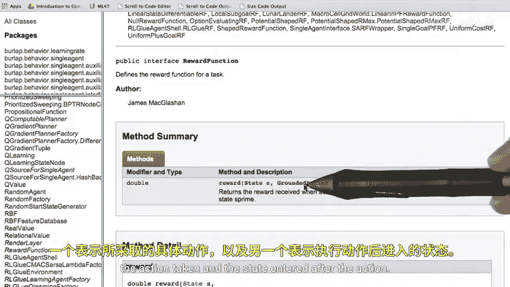
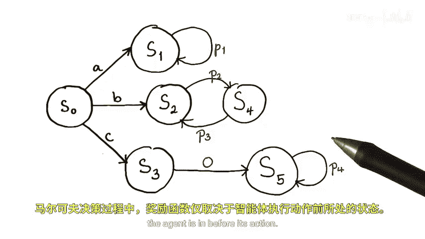
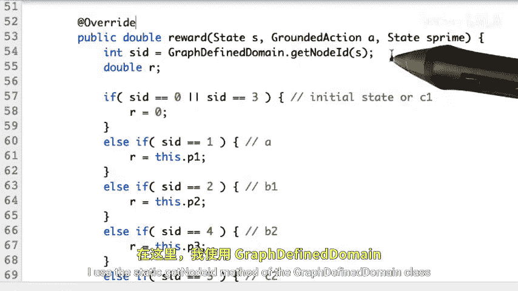
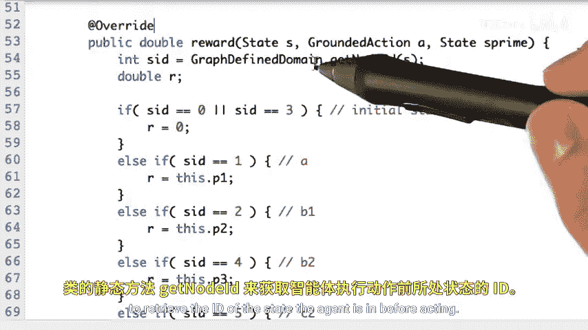
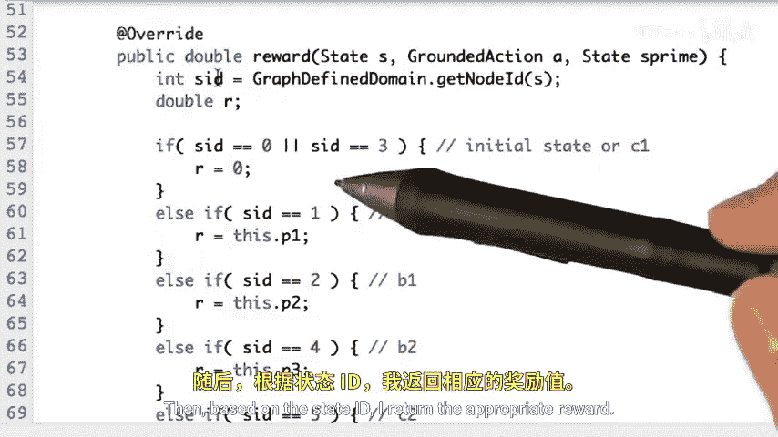
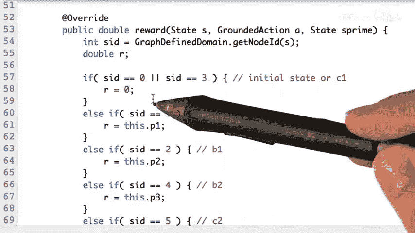
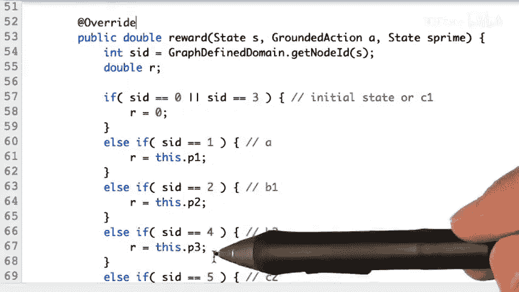
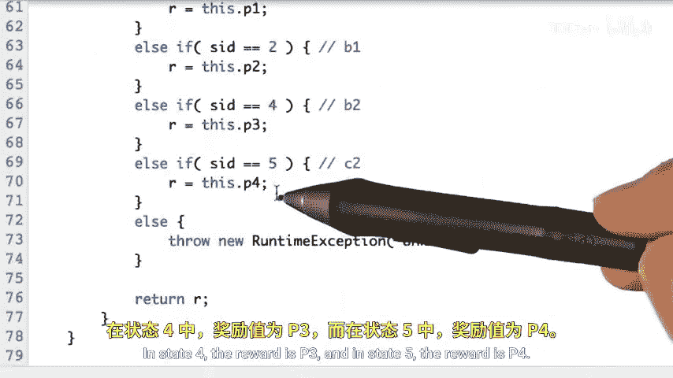
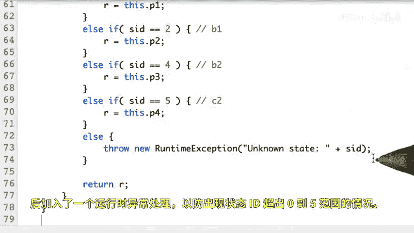

# 佐治亚理工【中英⚡强化学习导论｜CS8803 Introduction to Reinforcement Learning】 p52 P52 Adding the Reward Function Solution -BV1cJnfzTEBt_p52-

Here's how I implemented the reward method。According to the reward function documentation。

 the method takes a state， a grounded action， and another state representing the state before the action。

 the action taken and the state entered after the action。

And the method needs to return a double in our state diagram。

 notice that we only have one action leaving each state， except for the initial state。Also。

 each action is deterministic， each will lead to exactly one possible state。Finally。

 all the actions coming out of the initial state have the same reward zero。

So the reward function in this particular MDP will only depend on the state the agent is in before its action。

Therefore， it's fine to just perform a check on the argument S and to disregard the arguments A and S prime here。

 I use the static get note I D method of the graph defined domain class to retrieve the I D of the state。

 The agent is in before acting。 Then based on the state I D。

 I return the appropriate reward in states 0 and 3。 The reward is 0。

In state 1， the reward is P1 In state 2， the reward is P2， In state 4， the reward is P3。

 and in state 5， the reward is P4。

Finally， I include a run time exception after my check in the case that a state ID outside of the range 0 to5 occurs this isn't。

