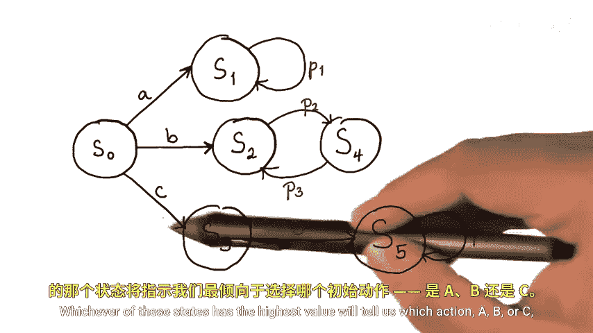
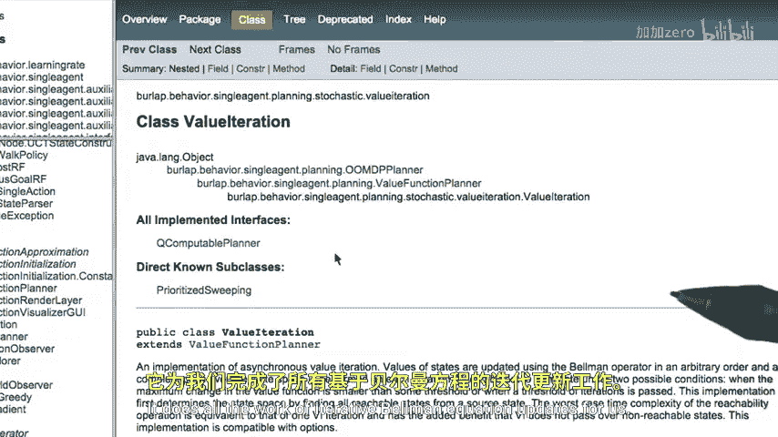
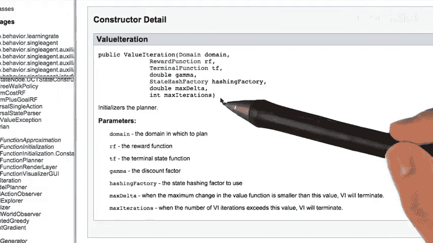
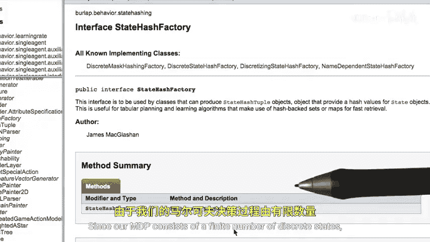

# 佐治亚理工【中英⚡强化学习导论｜CS8803 Introduction to Reinforcement Learning】 p55 P55 Performing Value Iteration -BV1cJnfzTEBt_p55-

Now that we finished defining the MDP and burlap， we can use a planning or reinforcement algorithm provided by burlap to solve this MDP for this tutorial。

 we'll use a value iteration to find the values of states S1， S 2 and S3。

Whichever of these states has the highest value will tell us which action， A。

 B or C we most prefer for our initial action。 Value iteration is a class in burlap。

 which implements the value iteration algorithm from lecture。

 It does all the work of iterative Bellman equation updates for us to instantiate it。

 We need to pass the domain reward function and terminal function we previously defined。

 We also need to pass a few more parameters。

A double gamma， which is the discount factor between 0 and 1。A state hashfactor object。

 which I'll talk about in a moment。A double max Dellta。And an int max iterations。

 which are two stopping conditions for the value iteration procedure。

The procedure will stop if no state's value changes by more than max delta in a single iteration。

And the procedure will also stop after running max iterations times。

 The state hash factory is an interface providing the method hash state。

 which takes a state object and produces a state hash tuple。

This allows for fast retrieval of state objects during the value iteration procedure。

Since our MP consists of a finite number of discrete states， we will pass。

