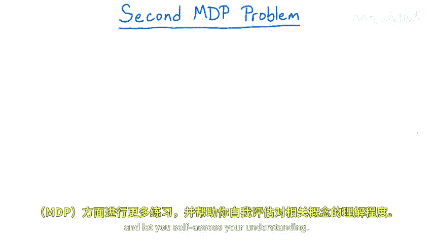
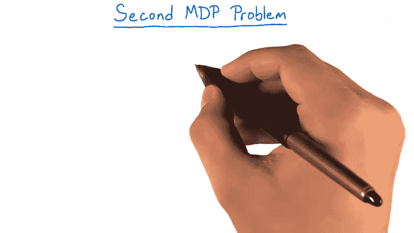
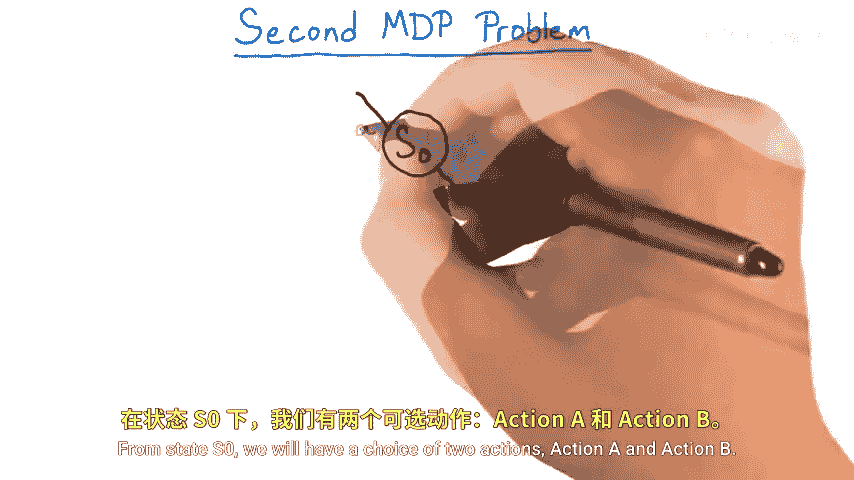
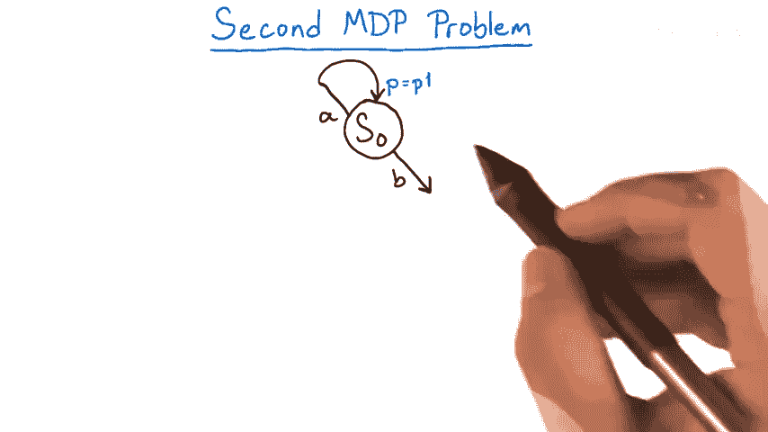
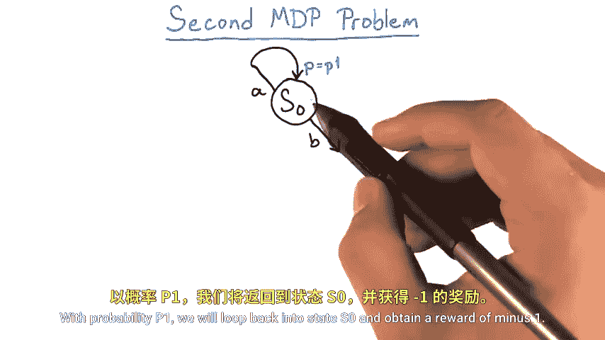
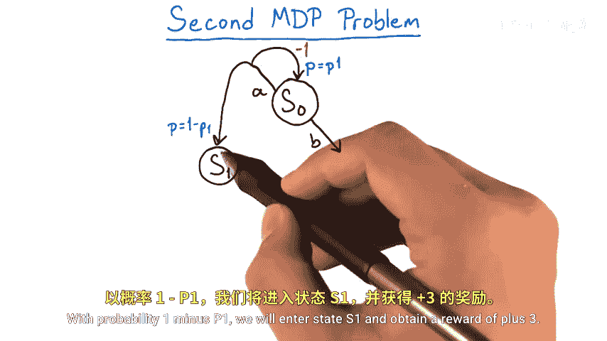
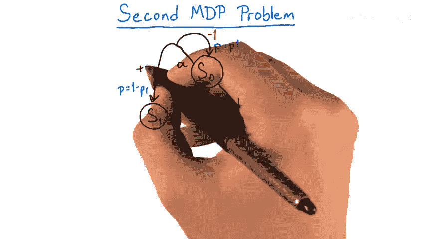
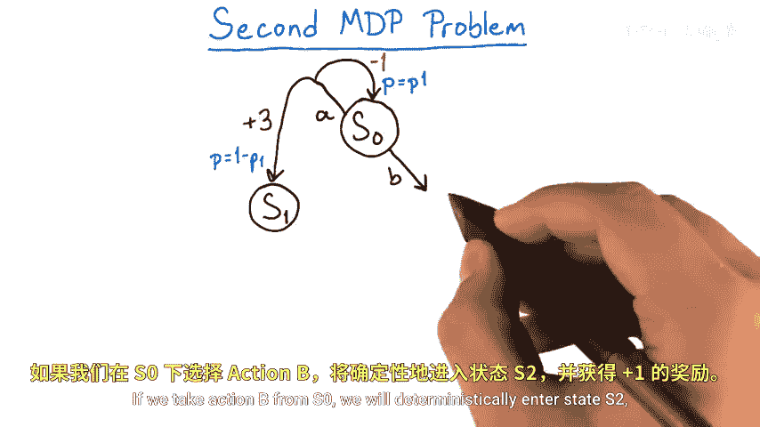
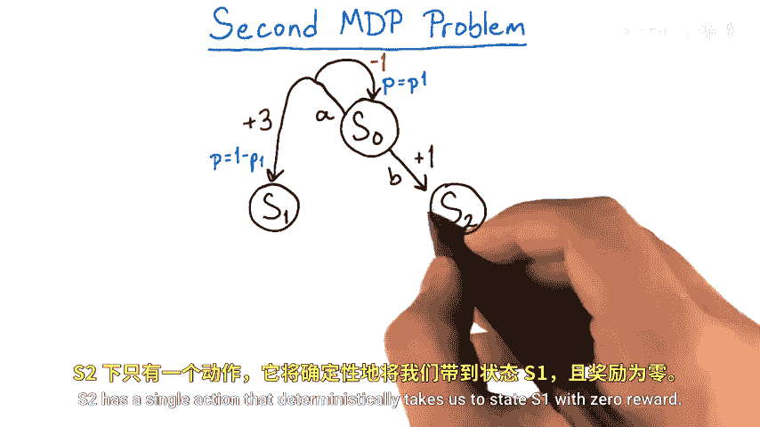
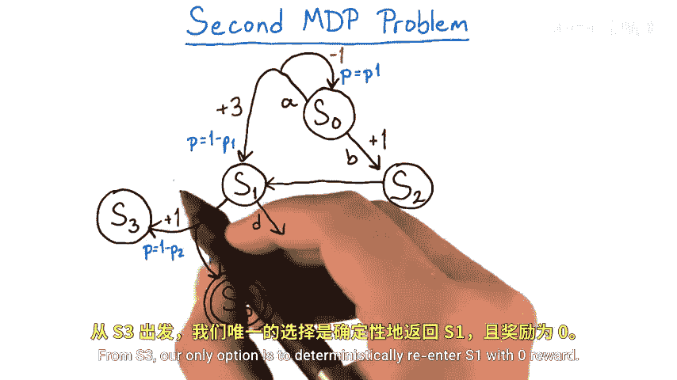

# 佐治亚理工【中英⚡强化学习导论｜CS8803 Introduction to Reinforcement Learning】 p59 P59 Second MDP Problem -BV1cJnfzTEBt_p59-

Now that we've walked through solving our original problem together。

 here's a new problem for you to solve on your own。

 This will let you practice a bit more with building Mpss in burlap and let you self assess your understanding In this MP。

 we will again begin in state S 0 from state S 0， we will have a choice of two actions。

 A A and action B action A will have two possible outcomes With probability P1。

 We will loop back into state S 0 and obtain a reward of minus1 with probability 1 minus P1。

 We will enter state S1 and obtain a reward of plus 3 If we take action B from S 0 We will deterministically enter state S 2 and we will obtain the reward plus1 S 2 has a single action that deterministically takes us to state S 1 with0 reward at state S 1。

 We have another choice of actions。

Action C will be stochastic。And action D will be deterministic with probability P2 action C from S1 will take us to the terminal state S 5 with 0 reward。

 and with probability 1 minus P2， action C will take us into state S 3。

And will obtain a reward of plus one。From S3， our only option is to deterministically reenter S1 with 0 reward if we take。

