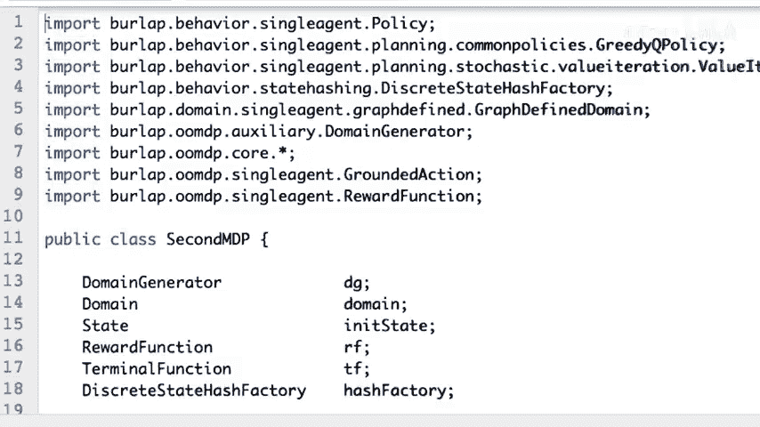
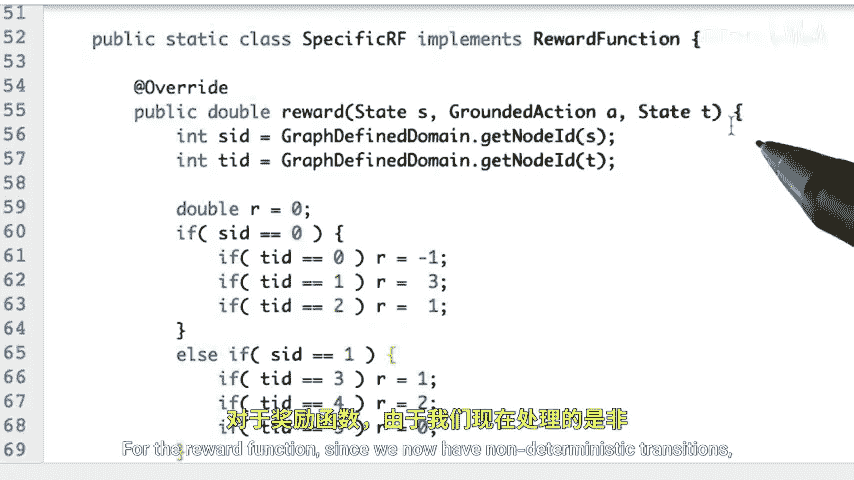
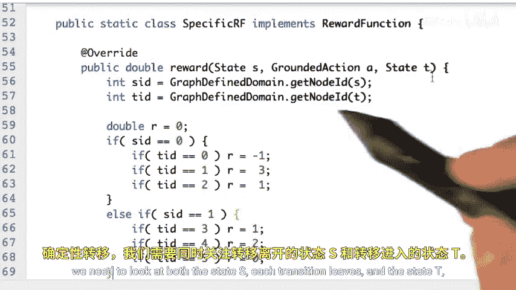
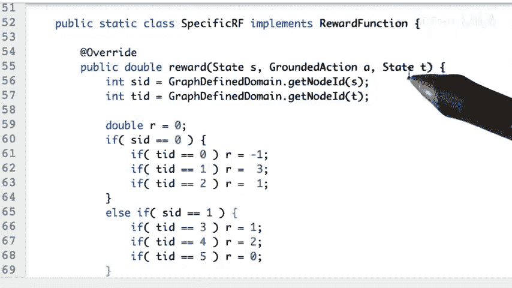
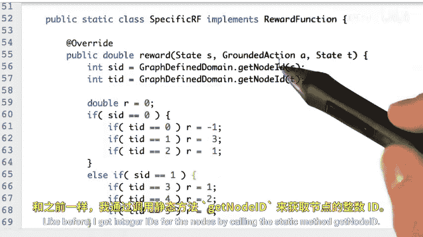
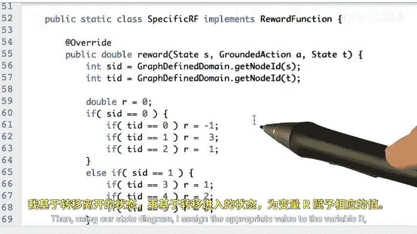
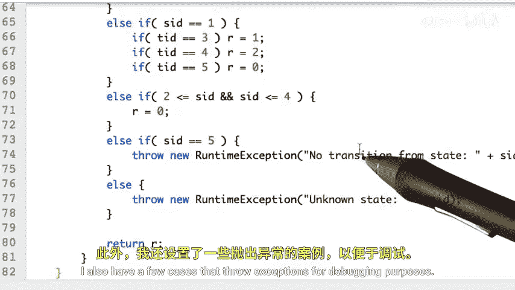
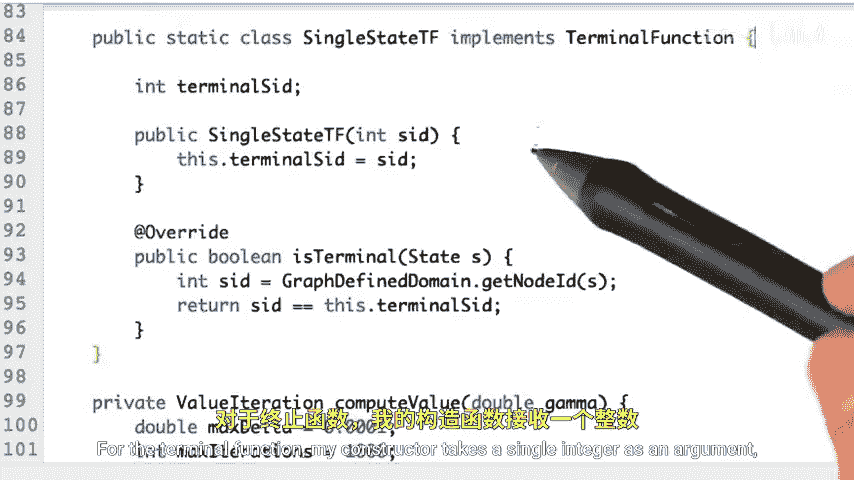

# 佐治亚理工【中英⚡强化学习导论｜CS8803 Introduction to Reinforcement Learning】 p60 P60 Second MDP Problem Solution -BV1cJnfzTEBt_p60-

Here's how I implemented my solution using burlap。 Let's take a look at our constructor。

 As before we have six states。 We only have two parameters now instead of  four。

 not counting the discount factor。And these parameters are now probabilities of transitions。

 instead of rewards。I use these probabilities in the last parameter in the stochastic transitions denoted in our state diagram。

 Then， as before， we conclude by generating the domain。Setting the initial state to 0。

Setting the reward and terminal functions。And then instantiating a discrete state hash factory。

You'll notice I'm using the class specific R F and single state T F here。

 These are custom classes I wrote to implement the reward and terminal function interfaces。

 We'll look at these， next。For the reward function， since we now have non deterministic transitions。

 we need to look at both the state S， each transition leaves and the state T each transition enters。

Like before I get into your I Ds for the nodes by calling the static method get node I D。

 Then using our state diagram， I assign the appropriate value to the variable R based on the state the transition leaves。

And then based on the state， the transition enters。

 I also have a few cases that throw exceptions for debugging purposes。

For the terminal function， my constructor takes a single integer as an argument。

 the Id of the terminal state and then stores it in the member field。

