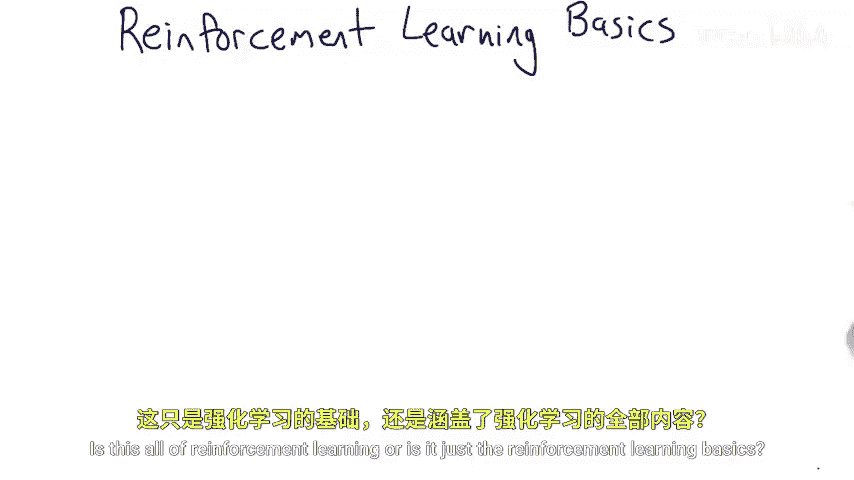
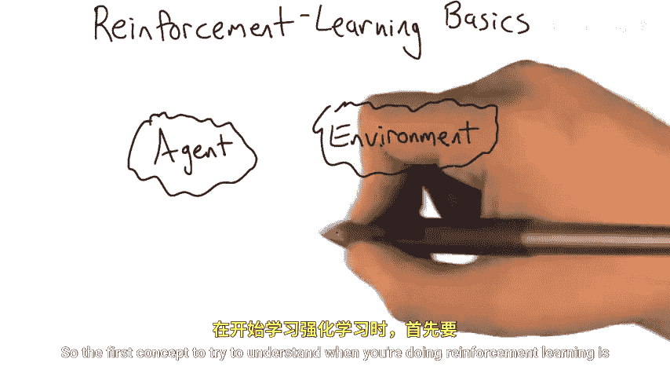
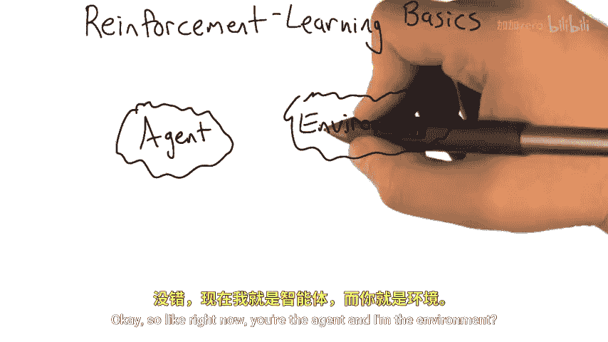
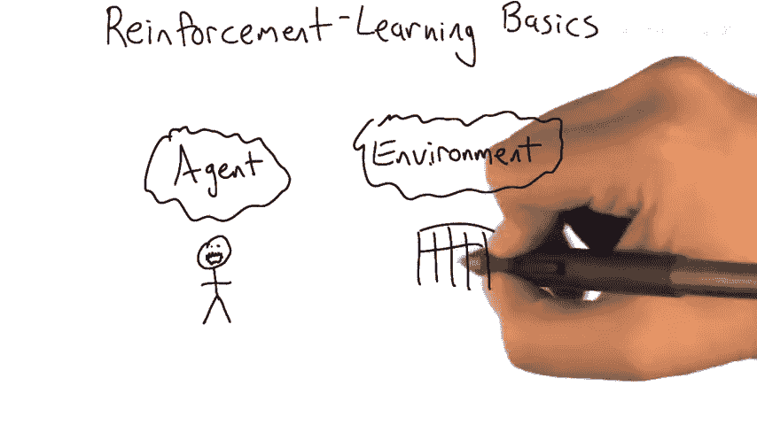
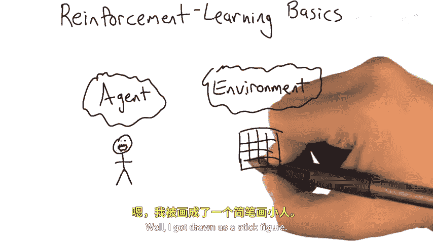
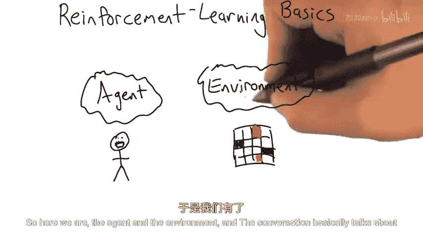
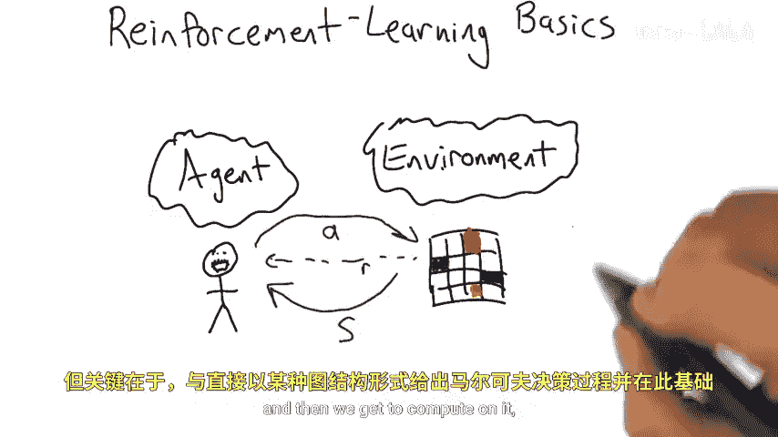

# 佐治亚理工【中英⚡强化学习导论｜CS8803 Introduction to Reinforcement Learning】 p61 P61 Reinforcement Learning Basics -BV1cJnfzTEBt_p61-

Hey， Charles， this is when we get to talk about reinforcement learning。 Hi， Michael。

 this is when I get to hear about reinforcement learning。 Wow， I'm glad we're on the same page。

 So are we on the same page， Is this all a reinforcement learning or is it just the reinforcement learning basics。

 We're gonna to start with the basics。 I can't wait to hear what that is。

 So the first concept to try to understand when you're doing reinforcement learning is that a lot of it takes place as a conversation between an agent and an environment。

 Okay so like right now， You're the agent and the environment， Actually。

 I think I'm going to have you be the agent。 Okay， and we'll just imagine some kind of， I don't know。

 like a video game environment， soon as reasonable， by the way， do you notice I've lost weight。😊。

Oh good job How did you do that Well， I got drawn as a stick figure。

That's fair。So here we are， the agent and the environment and the conversation。

Basically talks about what is going back and forth between the agent and the environment。

 So the environment is going to reveal itself to you to the agent in the form of states S。

You then get to。Have some influence on the environment by taking actions， a。

And then you also receive back before the next state。

Some kind of reward for the most recent state action combination。Okay， fair enough。

So this is the same kind of elements that we have in an MDP。

 but the important thing is that instead of just being given an MDP as some kind of a graph structure and then we get to compute on it。

 really the computation is happening inside the head of the agent。😡。

