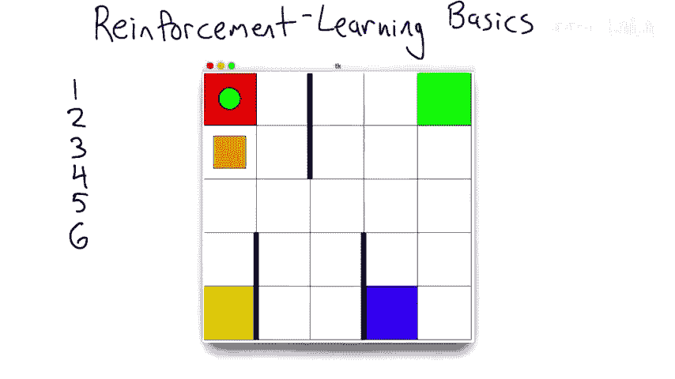
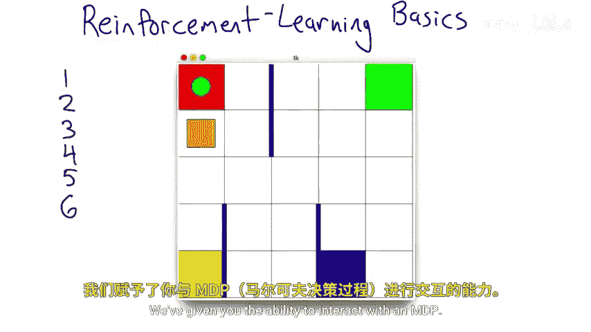
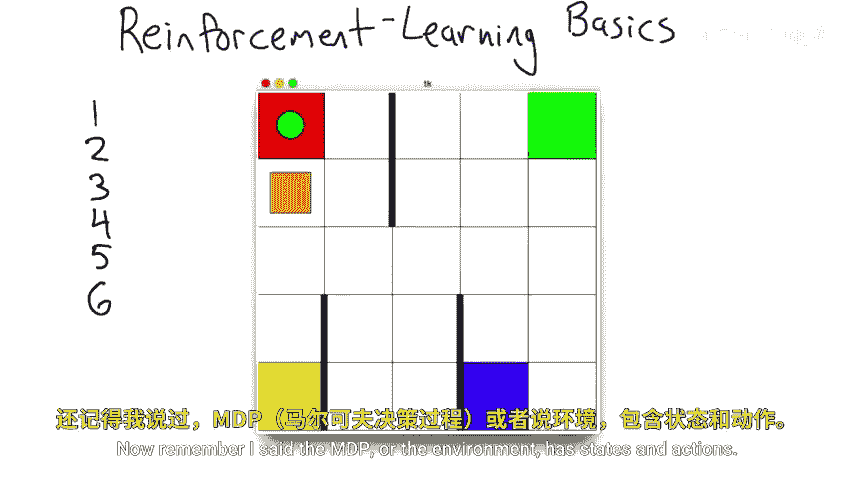
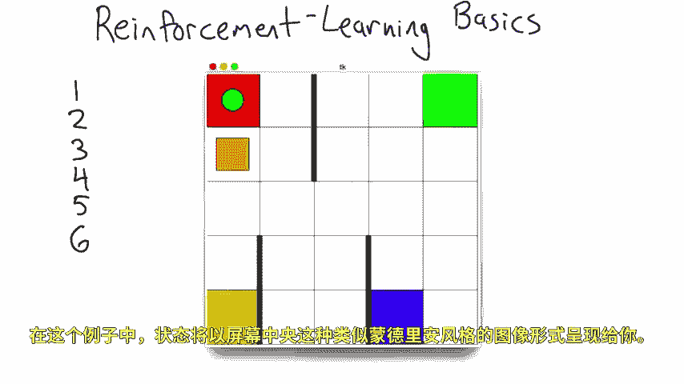
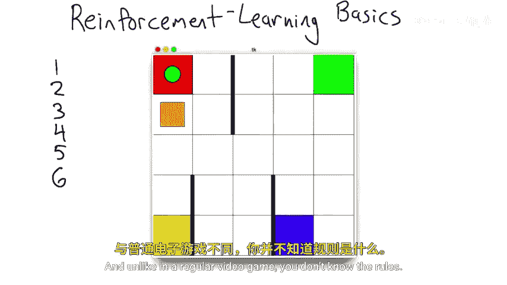
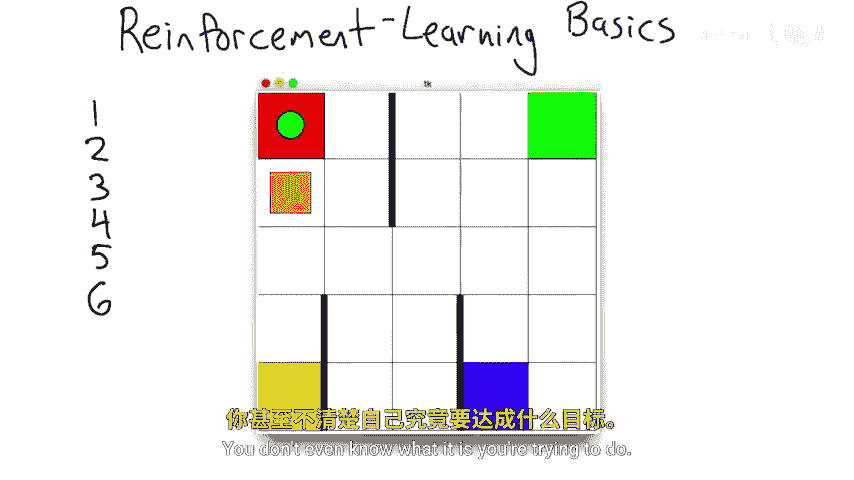
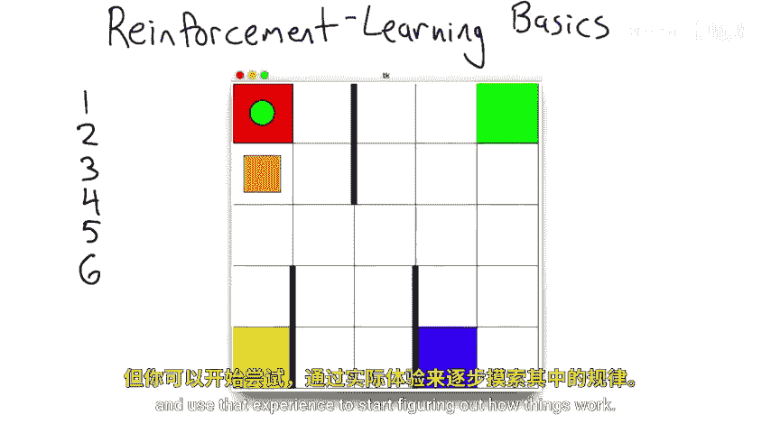
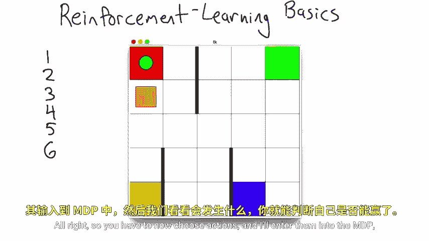
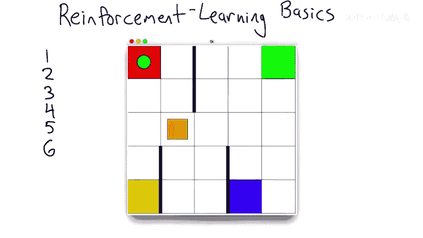

# 佐治亚理工【中英⚡强化学习导论｜CS8803 Introduction to Reinforcement Learning】 p62 P62 Mystery Game - 1 -BV1cJnfzTEBt_p62-

So we've transported you into an MDP or we actually， we didn't transport you in anything。

 We're given you the ability to interact with an MDP。 And here's the MDP。 Now， remember。

 I said the MDP of the environment has states and actions。

 The states in this case are going to be visualized to you in terms of this sort of。

Mdrerian looking picture in the middle of the screen， Monrerian。I'm going to go with that and。

 you know， it's like colors and squares and things。 And the actions are the numbers one through6。

And unlike in a regular video game。

You don't know the rules you don't really know how things work。

 you don't even know what it is you're trying to do。

 but what you can do is start playing and use that experience to start figuring out how things work Okay。

 so it's just like grad school。😡。

あえた。😊，Maybe。

Alright， so you have to now choose actions and I'll enter them into the MP and we'll see what happens。

 And then you can see if you can win or not。

Okay。thre。嗯呃。thre。I did it。Just nothing changed。5。I did it。 Nothing changed。6ix。H。

 I'm back where I was。 That's true。 h one， nothing changed。2。Three， that's a new state。

 It is a new state。

I， I figured something out then but you want to tell me what it is No because I forgot。

