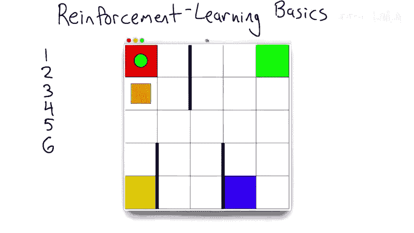
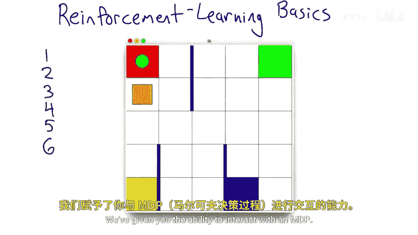
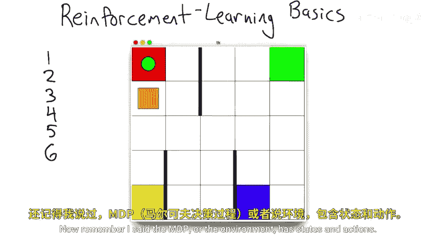
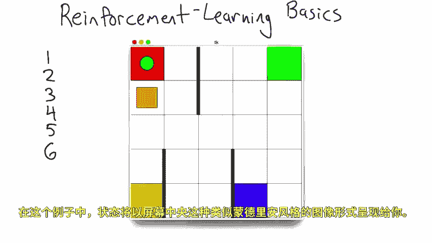
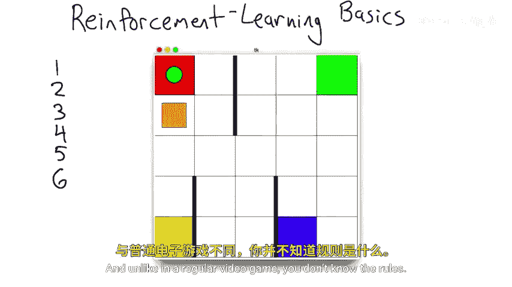
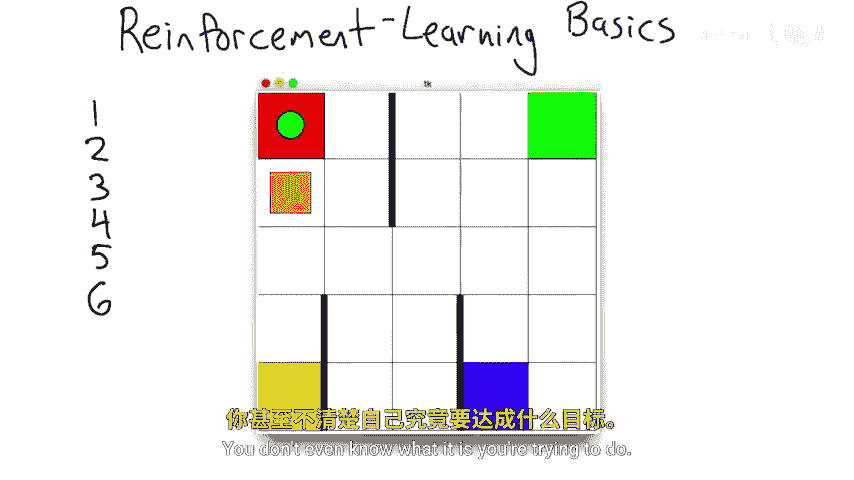
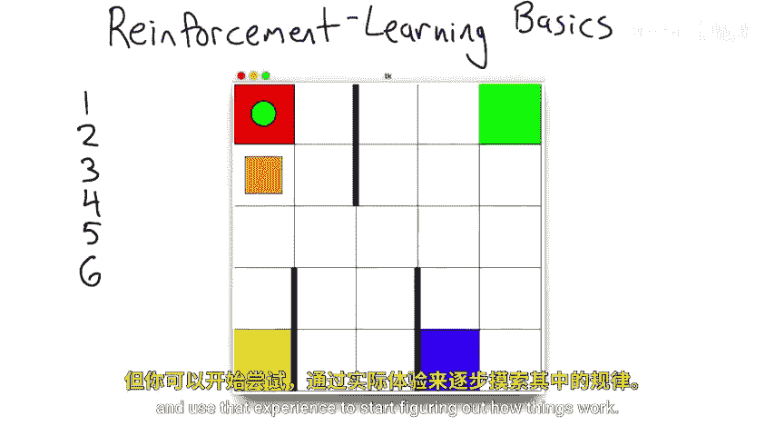
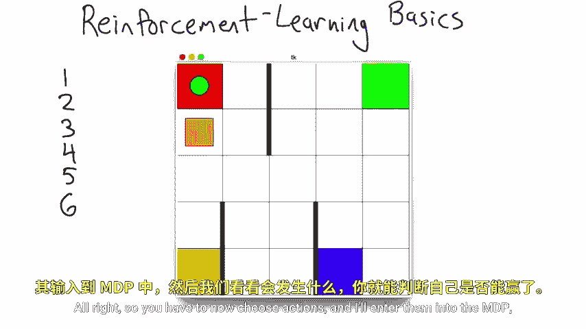
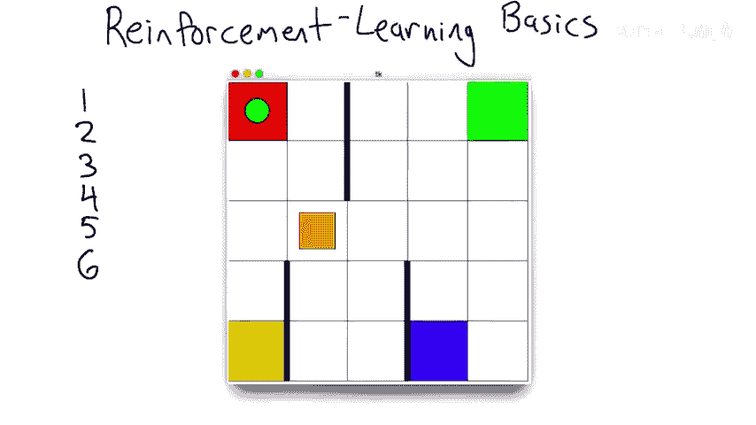

# 强化学习导论：P62：神秘游戏 - 1 - 🎮

在本节课中，我们将通过一个名为“神秘游戏”的互动示例，来探索马尔可夫决策过程。我们将学习如何在一个规则未知的环境中，仅通过尝试动作和观察结果来理解其运作机制。

---

上一节我们介绍了马尔可夫决策过程的基本概念。本节中，我们来看看如何在一个具体的、规则未知的MDP环境中进行探索。

我们被置于一个MDP环境中，或者说，我们获得了与一个MDP交互的能力。这个MDP如下图所示。

请记住，环境的MDP包含状态和动作。在这个例子中，状态将以屏幕中央这种类似“Mdrerian”风格的图片（包含颜色和方块等元素）可视化地呈现给你。而动作则是数字1到6。

与常规视频游戏不同，你并不知道规则，也不清楚事物如何运作，甚至不知道你的目标是什么。但你可以开始尝试，并利用这些经验来逐步理解系统的运作方式。这有点像读研究生。

现在，你需要选择动作，我会将它们输入MDP，然后我们观察会发生什么。接着你可以尝试看看是否能获胜。

以下是互动的过程记录：

*   动作“3”：没有变化。
*   动作“5”：没有变化。
*   动作“6”：回到了初始状态。
*   动作“1”：没有变化。
*   动作“2”：没有变化。
*   动作“3”：进入了一个新状态。

通过这个过程，我推断出了一些信息，但你想让我告诉你是什么吗？不，因为我已经忘了。

---

本节课中，我们一起学习了如何在规则完全未知的MDP环境中进行初步探索。我们通过尝试不同的动作（1到6），观察状态的变化（或无变化），来收集关于环境动态的信息。这个过程是强化学习智能体理解其所在世界的第一步。