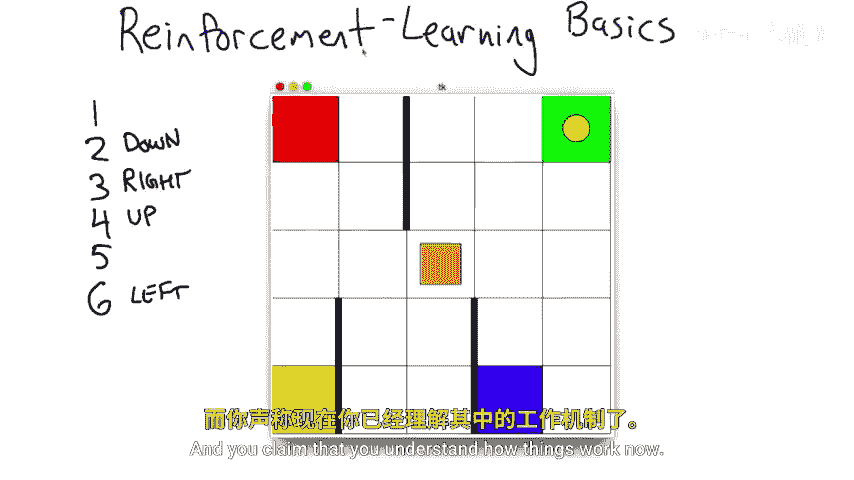
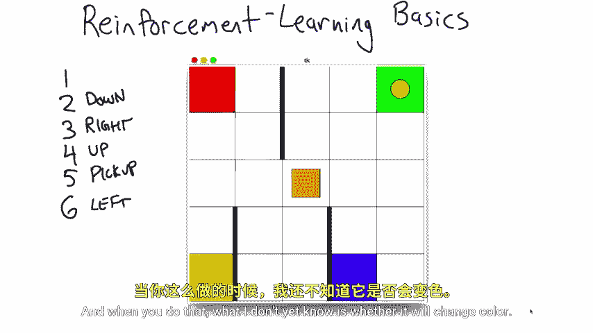
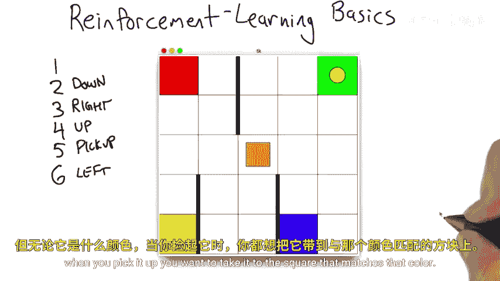
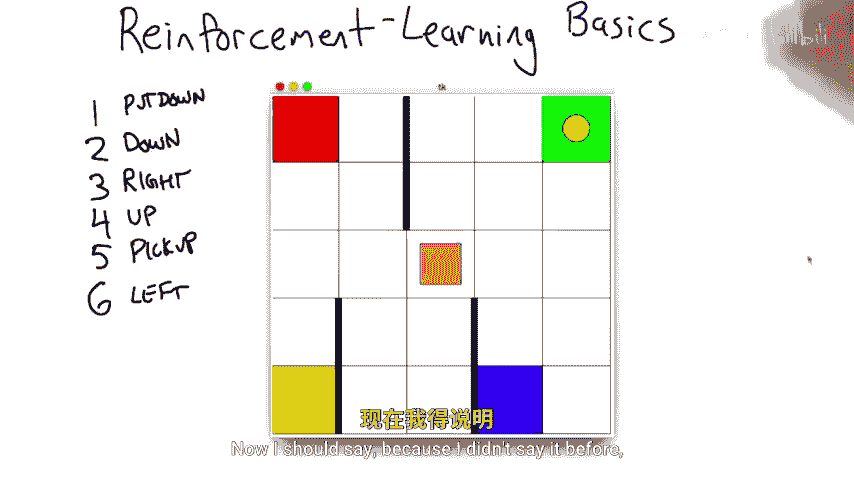
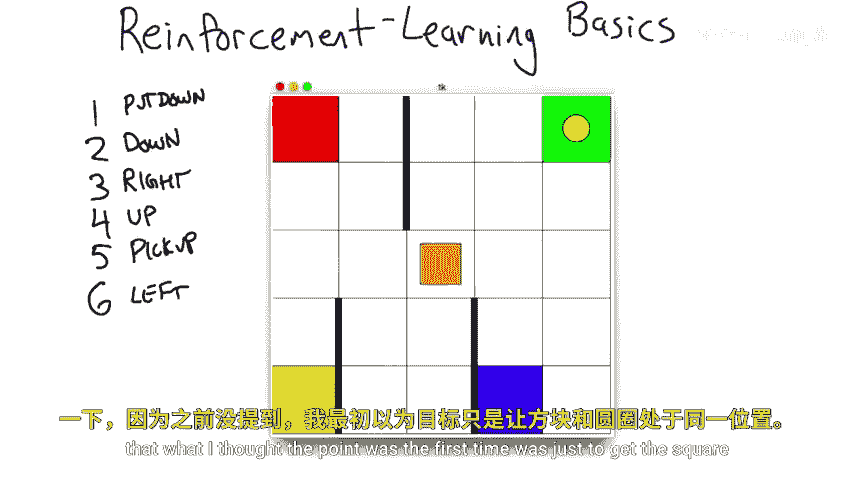
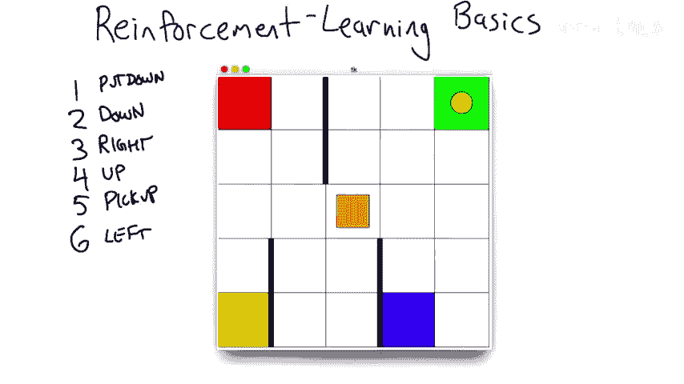
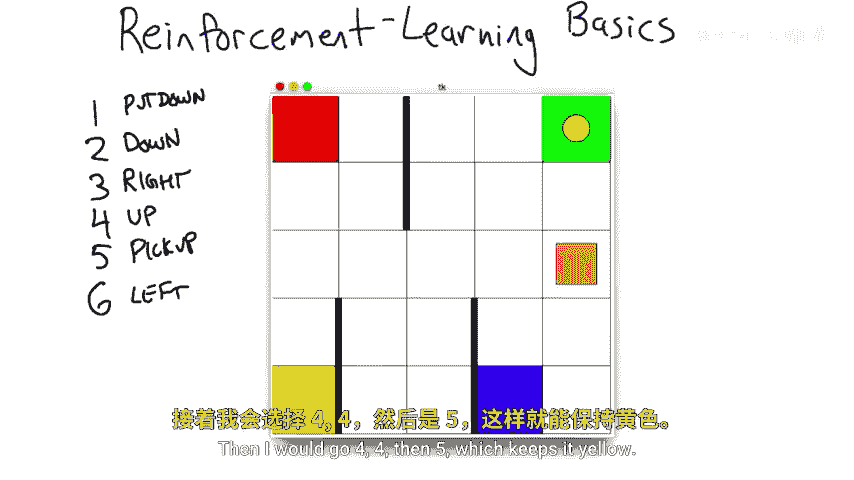

# 佐治亚理工【中英⚡强化学习导论｜CS8803 Introduction to Reinforcement Learning】 p63 P63 Mystery Game - 2 -BV1cJnfzTEBt_p63-

All right， so here's another state。 I just transported you randomly to another start state。

 and you claim that you understand how things work now。 So can you explain， Okay。

 I think I do So the goal is to go get the little yellow circle or the circle。

 which was yellow to begin with the last time。 I don't know if that means anything and I think it was green last。

 it and you want to pick it up which was I think five， And when you do that。

 what I don't yet know is whether it will change color。

 but whatever color it is when you pick it up you want to take it to the square that matches that color and then put it down which is action1。

 Now I should say because I didn't say it before， that what I thought the point was the first time was just to get the square and the circle in the same place。

 the square and the circle Yeah， you did that right and then but you didn't get any reward for that right。

 so then I figured out maybe I didn't do anything。 but at that time I was also still trying to figure out what all the commands did。

I was doing a lot of exploring All right， so you learned a bit about the transition function。

 you learned a little bit about how actions change the state and and you also learned a little bit about what states are rewarding Yes。

 and so now you think even though things are a bit different。

 you think you could actually get kind of on a minimal path to a goal state now Sure so from here I would go 33。

Then I would go 4，4。

Then5。Which keeps it。