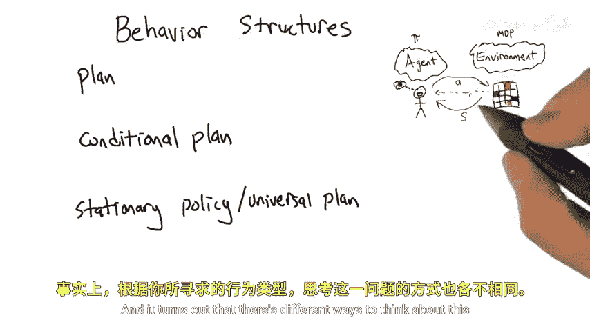
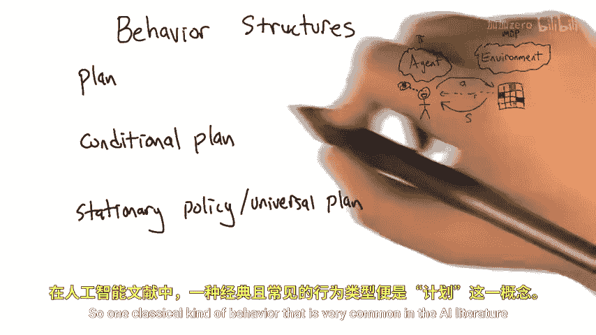
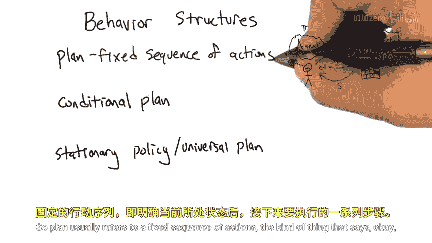
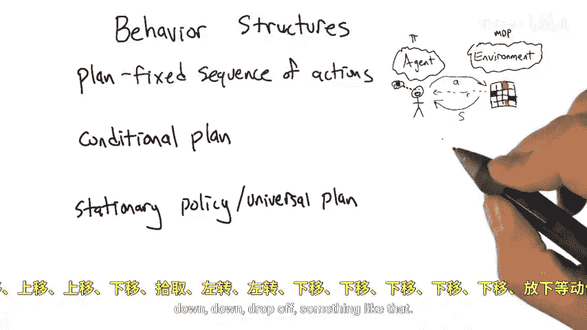
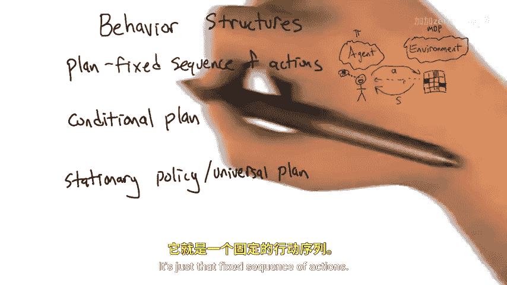
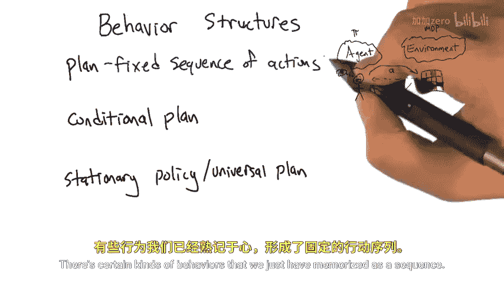
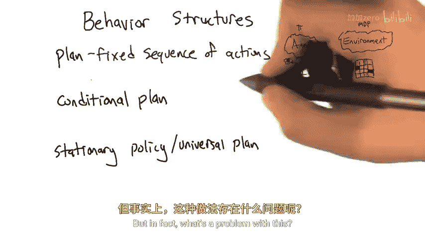
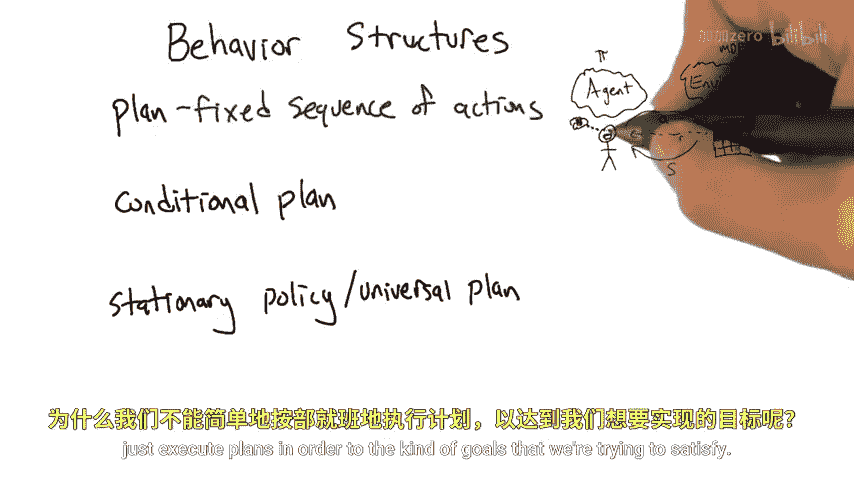

# 佐治亚理工【中英⚡强化学习导论｜CS8803 Introduction to Reinforcement Learning】 p64 P64 Behavior Structures - 1 -BV1cJnfzTEBt_p64-

All right， so our goal is going to be to try to create learning algorithms that are not quite as smart as you were in that example。

 but you know trying to approximate that， getting as far along the rock to Charles continuum as we possibly can。

Okay。We want algorithms that are Charles complete。No。

 I think you're probably still going to beat the algorithms that we're going to talk about in this class someday。

 someday。Allright， so， so the important thing is that we have to figure out what it is that we are trying to learn。

 So in this case， what we're trying to learn is a behavior。

 We're trying to learn a way of interacting with the environment that that obtains high reward。

And it turns out that there's different ways to think about this。

 depending on what kind of behavior you are looking for。

 So one classical kind of behavior that is very common in the AI literature is the notion of a plan。

 So plan usually refers to a fixed sequence of actions。 So the kind of the kind of thing that says。

 okay， I see where I am now， This is the sequence of things I'm going to do。 I'm going to go left。

 right， up， up， up down。

Pick up left， left down down， da， down， down， drop off something like that。 So that that plan。

Once you've chosen the plan， you can just execute it。 It's just that fixed sequence of actions。

 And this happens sometimes in real life。 you know。

 there's certain kinds of behaviors that we just have memorized as a sequence。

But in fact， one， what's a problem with this， Why can't we， in general。

 just execute plans in order to。

Satisfed the kind of goals that we're trying to satisfy Well， so I'll say two。

