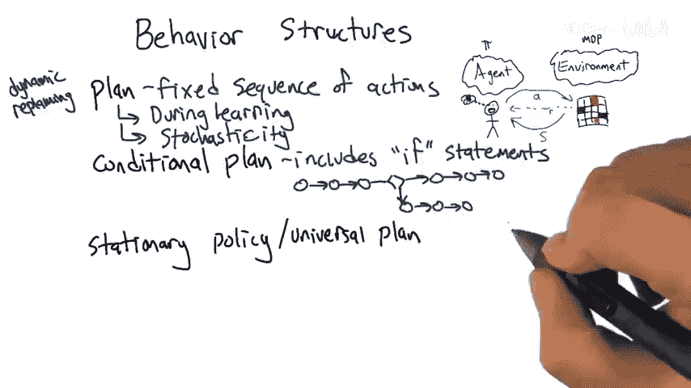

# 佐治亚理工【中英⚡强化学习导论｜CS8803 Introduction to Reinforcement Learning】 p65 P65 Behavior Structures - 2 -BV1cJnfzTEBt_p65-

All right， now stationary policy， which sometimes in the literature is referred to as a universal plan。

 is actually what we talked about in the context of MDPs。

So mapping from states to actions， and this is a very powerful sort of thing because it can handle stoasticity really well every time you take a transition。

 you go back to your table， you go back to your policy to say，All right。

 here's the state I ended up in， what's the right thing to do from here？

It is kind of hard to convey these to people， though， do you see why that might be， Yeah， well。

 so one way it might be is because I will claim that a stationary policy or universal plan is just a conditional plan where you have an if at every single possible state。

That's true， but it's actually a little bit more constrained than that。

 which is it's the same if at every possible state， right？So no matter where you came from。

 no matter what you were in the middle of doing， once you discover where you are。

That's going to determine what your next step is going to be right and that's a lot of statements。

It's a lot of if statements。 Yeah， and right， so if you try to convey it。

 you have to actually tell someone what all those if statements are。

 It's sort of like if I want to give you directions to my house， a plan might say go left， go right。

 go left， you know， go down until you get to Maple Street， make a right。

A conditional plan might say something like， go to the highway if you get there and it's crowded。

 then go these backros， otherwise go on the highway and a policy would say something like for every location。

