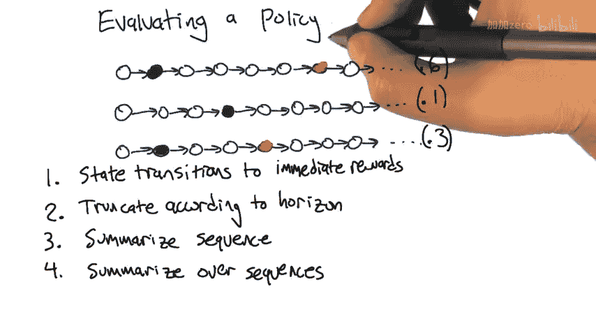
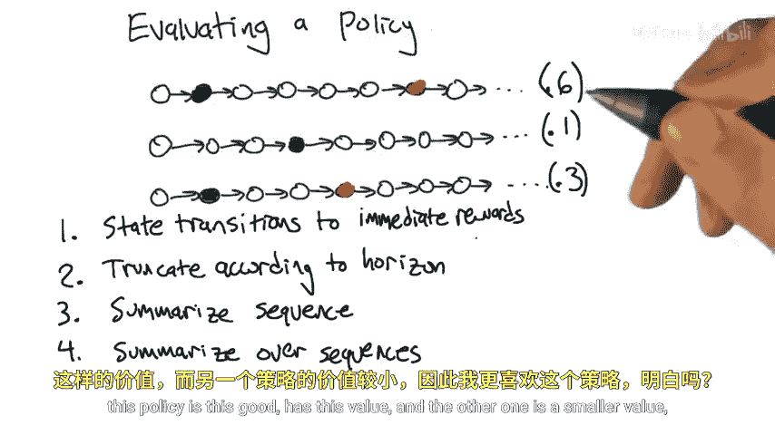

# 佐治亚理工【中英⚡强化学习导论｜CS8803 Introduction to Reinforcement Learning】 p66 P66 Evaluating a Policy -BV1cJnfzTEBt_p66-

We're going to want our learning algorithms to return optimal policies but to do that。

 we're going to have to say what we mean by optimal。

 So I know we talked about this in the context of MDPs。

 but I thought it might be worth revisiting just to see that there's different choices we could make and the choices that we make have implications about what it means to be optimal So here here's in particular what I want to get at notion let's say we have some particular policy that we're going to follow by following that policy from some initial state。

 we're going to have a sequence of states， actions and rewards。

 but there's actually multiple possible sequences of state actions and rewards that can happen because the domains are stochastic So let's we've got some particular policy that we want to evaluate and it generates this kind of sequence of states with this probability and this kind of sequence of states with this probability and this kind of sequence of states with this probability。

How do we turn all that possibilities into a single number so that we can say， oh。

 this policy is this good has this value and the other one is a smaller value。

 so I like this one better so here here's this four steps that we need to do to take what was once a sequence of sequences or a set of sequences of states and turn them into a single number。

 so the first step is for each of the state transitions we need to turn it into actual numbers。

 the immediate rewards。

So in this case， maybe landing in a red state gets us minus 0。

2 and landing in a green state gets us a positive one。

