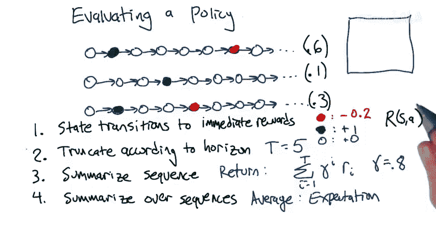

# 佐治亚理工【中英⚡强化学习导论｜CS8803 Introduction to Reinforcement Learning】 p67 P67 Evaluating a Policy Solution -BV1cJnfzTEBt_p67-

Okay， Charles， how are we going reduce this to a single number。

 We're gonna follow those steps that you have outlined。 I don't know the answer， but I know。

 I think I know how to get to the answer。 All right， let's do it。 Okay， so well， first off。

 are we doing finite or infinite here。 T equals 5。 It says T equals 5。

 So we're definitely doing equals。 That's what I thought。 just wanted to be sure。 Okay， well。

 so all I have to do is actually turn everything that I see into turn the straight into immediate rewards。

 So I can do that。 would you mind writing some stuff for me。 Yeah， there you go。

So let's do ones over the greens and -02 over the reds。 But actually。

 I don't really care about the one you just wrote down because it's more than t equals 5 away。

 All right， Well， that's going to come up in the next step。 Trunccate according to horizon。 So 1，2，3。

4，5。Cut 1，2，3，4，5。Cut 1，2，3，4，5。Cut now I was a little bit sloppy with how I defined the five。

 It could be that you actually put it one step deeper。

 but I was careful to pick a pick a horizon length so that it wouldn't matter which way you interpret it。

 This would just add zeros to it。 It wouldn't change anything。 So anyway。

 here we are cutting it at 5。 Okay， very smart， Michael。 All right， cool。

 So now that we've done the truncating。 I just need to summarize each of the sequences in turn。

 So I know that whatever I would give for the first value would be  point8 to the。😊。

