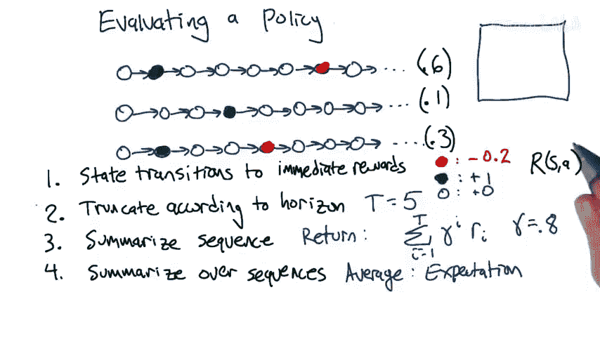

# 强化学习导论：P67：策略评估求解

在本节课中，我们将学习如何对一个给定的策略进行评估，并将其价值总结为一个单一的数字。我们将通过一个具体的例子，演示从状态序列到最终价值计算的完整步骤。

上一节我们介绍了策略评估的基本概念，本节中我们来看看如何将其应用于一个有限时间范围的例子。

---

Okay， Charles， 我们如何将其简化为一个单一的数字。

我们将遵循你概述的那些步骤。我不知道答案，但我知道，我认为我知道如何得到答案。好的，我们开始吧。

首先，我们处理的是有限还是无限时间范围。这里 T 等于 5。它说 T 等于 5。所以我们明确在处理有限范围。这正是我所想的，只是想确认一下。

好的，那么我需要做的实际上是将我看到的所有东西都转化为即时奖励。我可以做到这一点。你介意帮我写一些东西吗？好的，给你。

所以，让我们在绿色状态上标上 +1，在红色状态上标上 -0.2。但实际上，我并不关心你刚刚写下的那个，因为它距离起点超过了 T=5 步。

好的，这将在下一步中处理。根据时间范围进行截断。所以数 1，2，3，4，5。在这里切断。数 1，2，3，4，5。在这里切断。数 1，2，3，4，5。在这里切断。

现在，我对“五步”的定义有点随意。可能你实际上会多算一步，但我特意选择了一个时间范围长度，使得无论你如何解释，结果都不会改变。这只会增加零值，不会改变任何东西。总之，我们在这里在第五步处进行了截断。非常聪明，Michael。好的，很好。

现在我们已经完成了截断。我只需要依次总结每个序列的价值。

我知道，无论我给第一个序列什么值，它都会是 0.8 的若干次方。

---

本节课中我们一起学习了如何对一个有限时间范围的策略进行评估。我们通过将状态序列转化为即时奖励，根据时间范围进行截断，然后对每个截断后的序列进行价值总结，最终将策略的表现简化为一个可计算的数值。这个过程是理解策略价值计算的基础。