# 佐治亚理工【中英⚡强化学习导论｜CS8803 Introduction to Reinforcement Learning】 p68 P68 Evaluating a Learner -BV1cJnfzTEBt_p68-

So at this philosophical level， there's one last thing I want to talk about。

 We just talked about evaluating a policy。 But remember， in the reinforcement learning setting。

 the policy is what gets output as as a result of the learning process。

 So what if we want to actually evaluate the learner。 How good as this learner。

 Do Can you think of some ways that we might be able to decide how good a learner is。 Sure。

 it's as good as its policy， So that seems like a good idea that a good learner is one that returns a good policy。

 Sure， what if we have two learners that return the same policy， say the optimal policy， Oh， okay。

 well， I can think of two responses that one is， who cares。

 They're both the same and only thing the matters is how good the policy is that you come up with。

 or I can come up with another answer， which would be， I will take the one that does it more quickly。

 quickly in terms of what， Let's say time。😊。

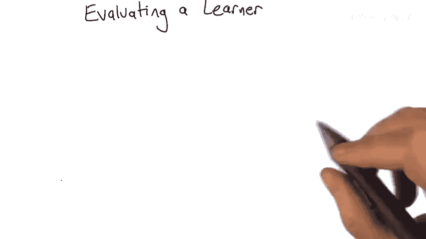

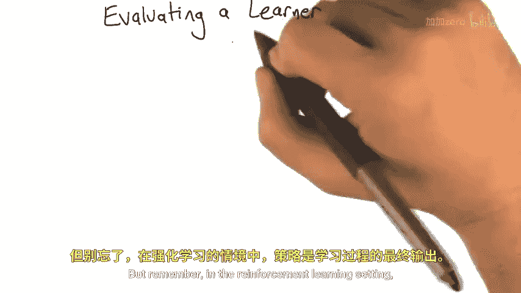

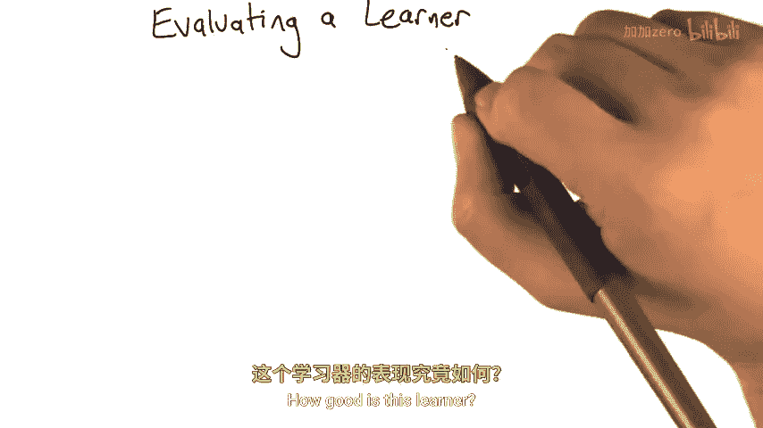

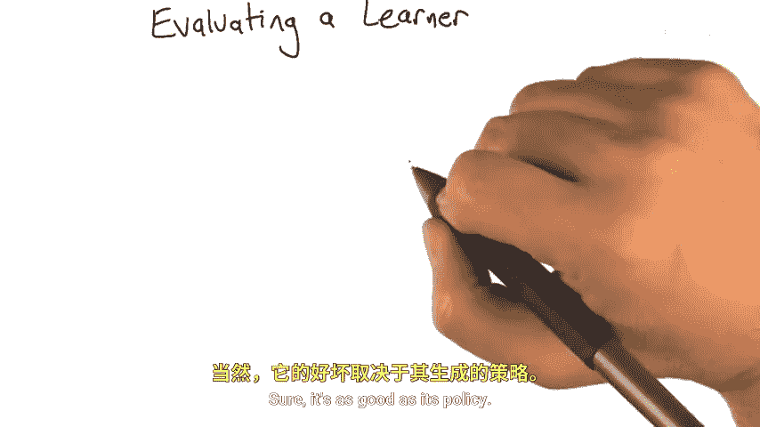

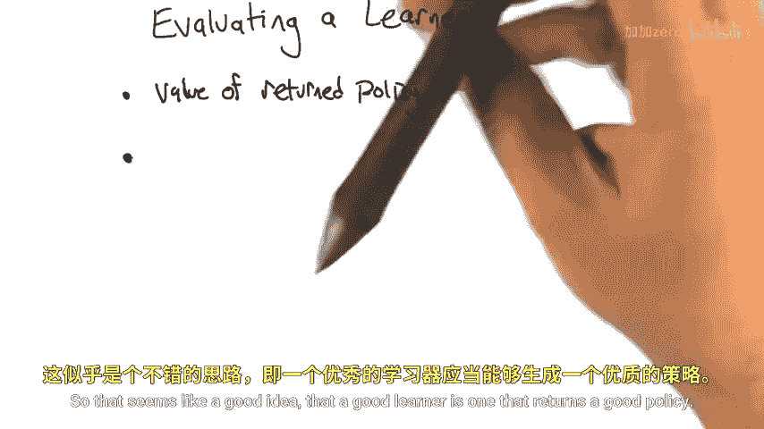

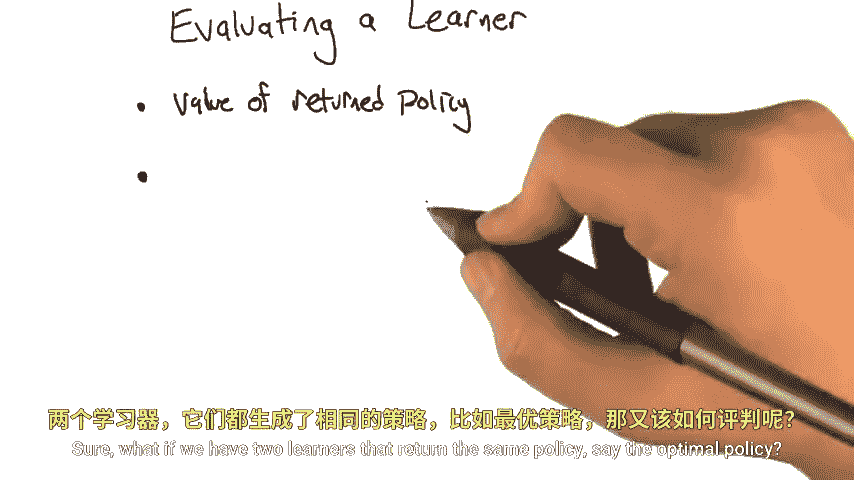

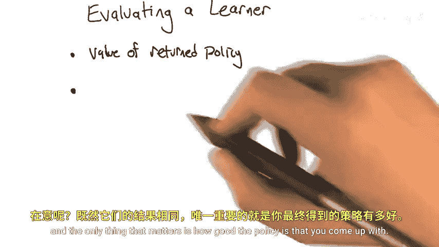

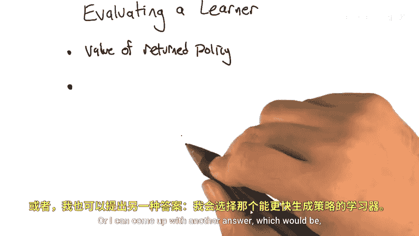

I think that I think that's what quickly means， yes， but like time of what？

There's lots of different kinds of time that matter。 So one is one in particular is computation time。

 Yeah， wall clock time。 And that seems like an important one， right。

 We want one that's going to be more efficient in terms of the computations that it does in the process of learning the policy。

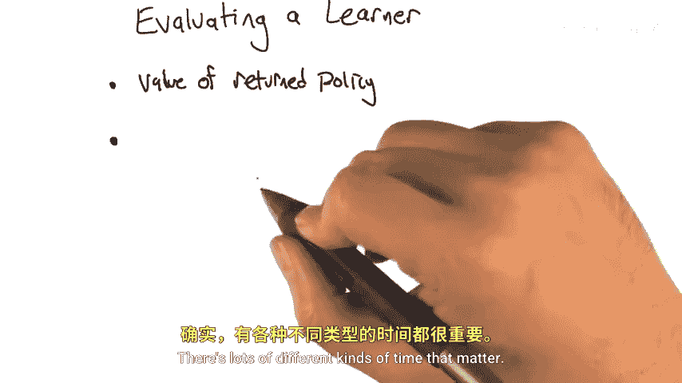

But there's another kind of time that actually matters a lot in the reinforcement learning setting。

 So I think it's worth mentioning。 Okay， so the other kind of complexity that turns out to be really important in this learning setting is experience complexity。

 Do you have a sense of what that might mean。

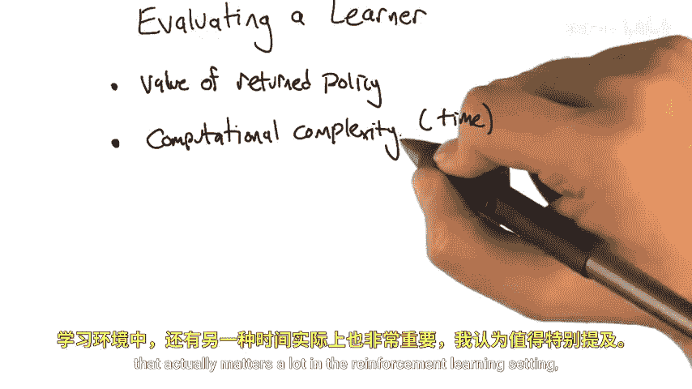

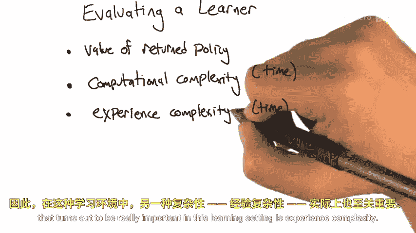

How complex your experiences are I'm going to say no， well okay， get it。

 So computational complexity is sort of how much computational energy you have to put into it。

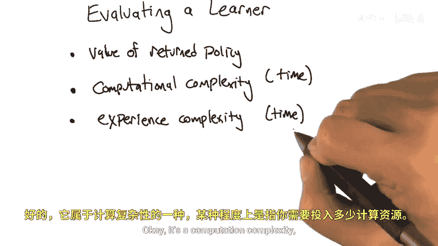