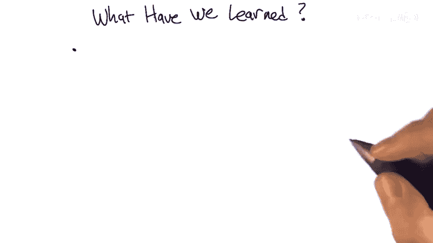
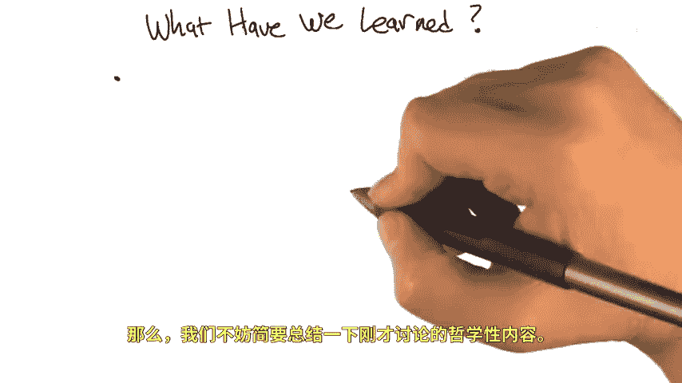
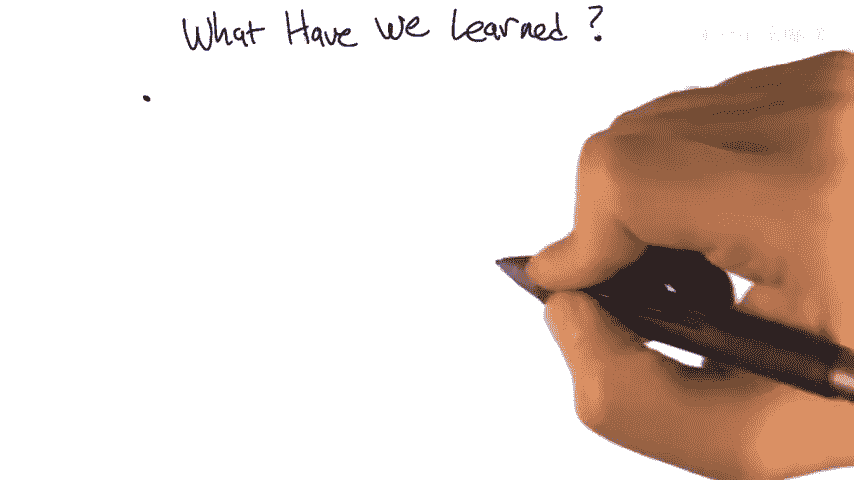
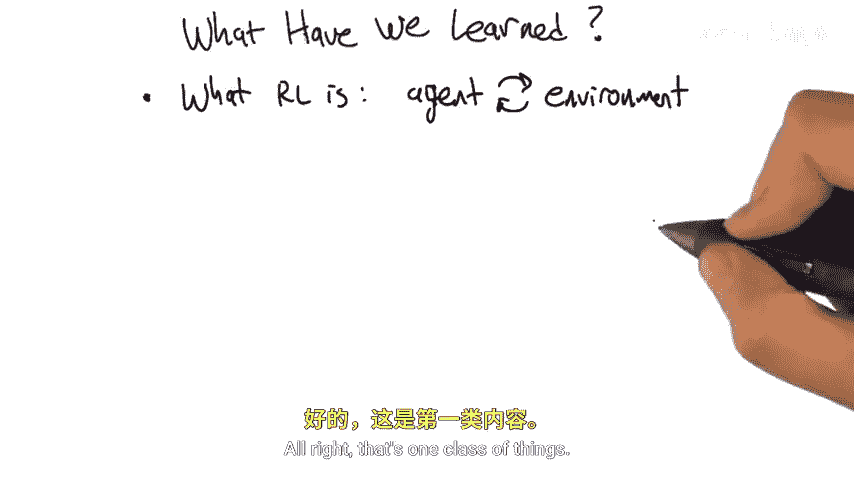
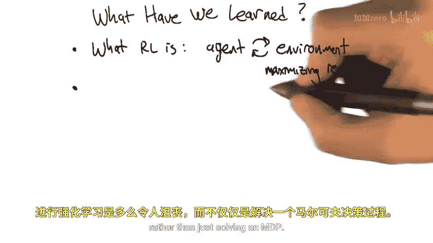
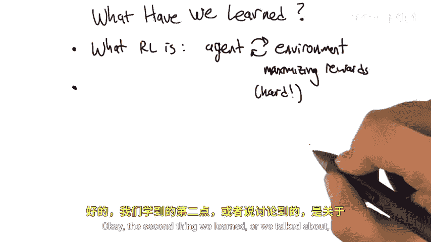
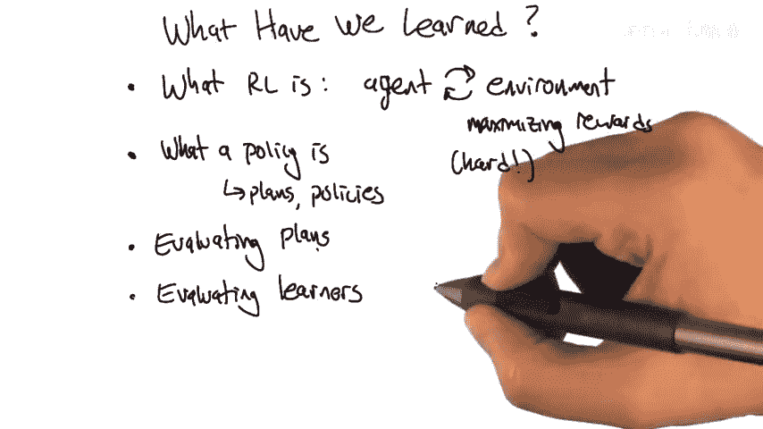
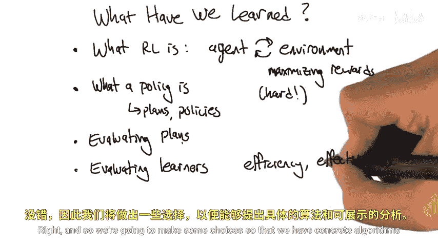

# 佐治亚理工【中英⚡强化学习导论｜CS8803 Introduction to Reinforcement Learning】 p69 P69 What Have We Learned_ -BV1cJnfzTEBt_p69-

So， yeah， so next time we're going to dive into algorithms and talk about temporal difference learning。

 So why don't we just sort of summarize this the philosophical stuff that we we talked about just now。

 Okay， so what have we learned， So I think we learned a bunch of stuff。

 but we really learned three classes of things。

We learned sort of what reinforcement learning is All right， that's one class of things。

 Yeah and and as you wrote up there， we realized RL is about agents interacting with environments and getting rewards and sort of figuring out what the world is And by the way。

 as a part of that， we learned just how frustrating it is to actually do reinforcement learning rather than just solving an MDP I agree with that Okay the second thing we learned or we talked about was a description of what a policy is and the different ways you might go around solving these RL problems and evaluating them。

 What does it mean to have a good policy。

Right， and then the third class of things that we learn was about evaluating learners and we realized that there are lots of different ways to evaluate learners。

 just like there's lots of different ways to evaluate policies and plans。

 you can talk about truncating them or doing things that are infinite。

 we can talk about whether a learner is fast， whether a learner is efficient， in a different sense。

 like with sample complexity， whether it actually returns good values。

 you can think about it just in terms of its output or how it got to its output right。

 and so we're gonna make some choices so that we have concrete algorithms that we can present and analyses that we can present。

 but it's worth keeping in mind that。

