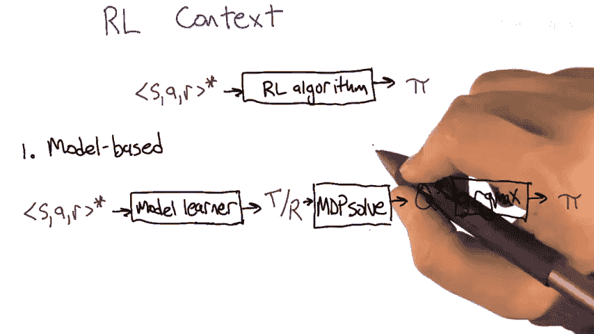
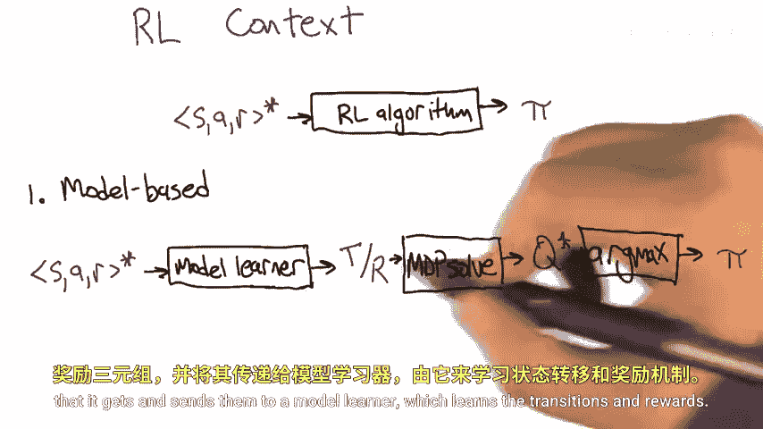
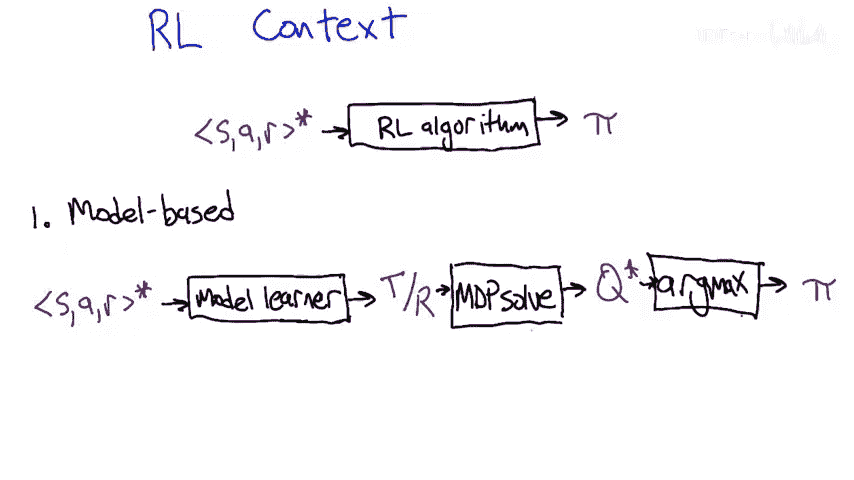
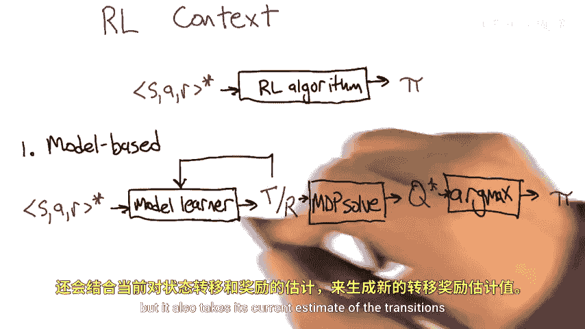
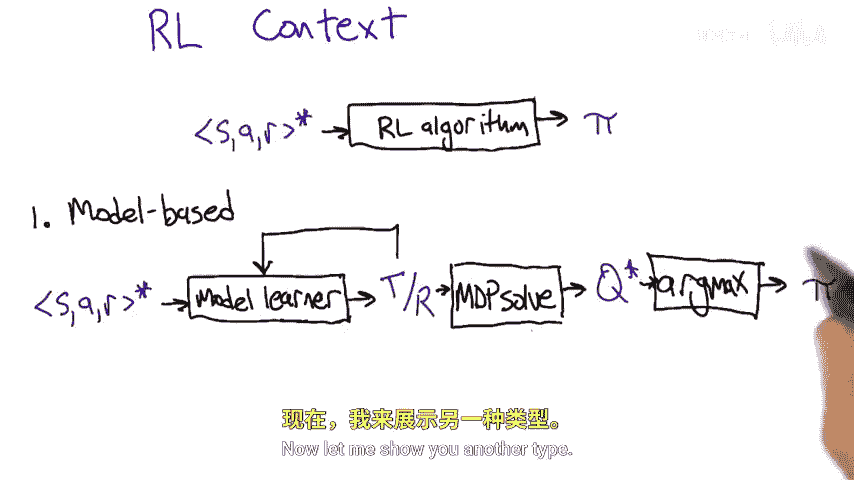
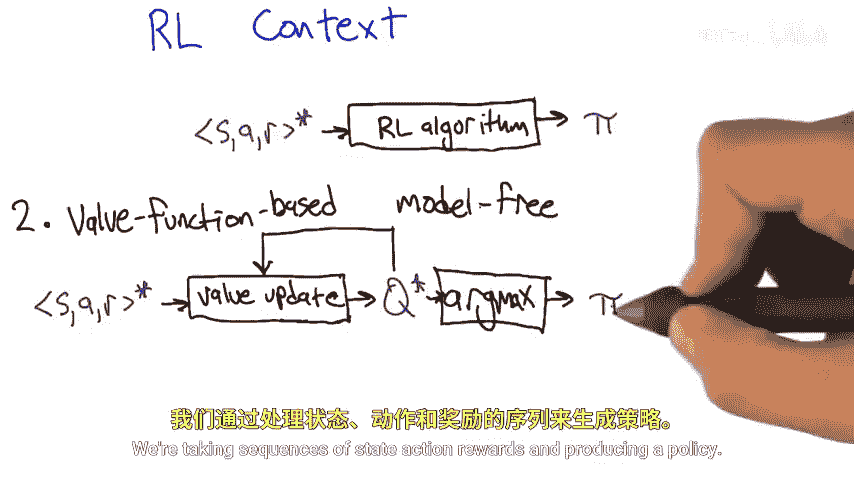

# 佐治亚理工【中英⚡强化学习导论｜CS8803 Introduction to Reinforcement Learning】 p72 P72 RL Context - 2 -BV1cJnfzTEBt_p72-

So the way I like to think about it is there's kind of three main families of reinforcement learning algorithms。

 So the one that's most like what we've talked about so far is what we could call model based reinforcement learning algorithm。

 So model based reinforcement learning algorithm takes the state action reward doubleples that it gets and sends them to a model learner。

Which learns the transitions and rewards。

Those transition rewards are once you've learned them。

 you could put through an MDP solver like we've talked about。

Which could be used to spit out a Q star， an optimal value function。

 And once you have the optimal value function， you can use just by taking the agon max of the state that you're in。

 you can choose which action you should take in any given state， and that gives you the policy。

 So it's still mapping the state action reward sequence to policies。

 but it's doing it by creating all these sort of intermediate values in between。

Cool， and let me just add one more thing， which is that the the model learner takes the history that is seeing。

 but it also takes its current estimate of the transitions and rewards to produce the new estimate of the transition rewards。

 So this is how I want to kind of represent the learning piece of the of the sequence。

 Does that make sense。

Allright， so this is one type。 Now let me show you another type。

 So the second kind of class of reinforcement learning algorithm that's important to think about。

 they're referred to as value function based or actually sometimes model free。

 So the beginning of the end of it are still the same。

 We're taking sequences of state action rewards and producing a policy。

 and we even have this Q star in between that we generate the policy。

