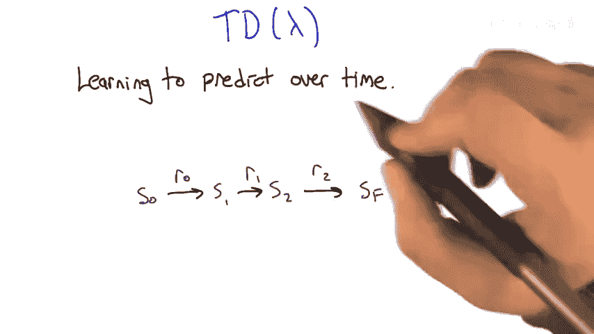
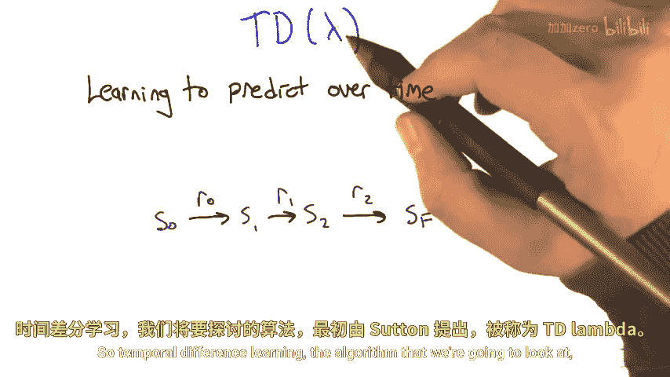
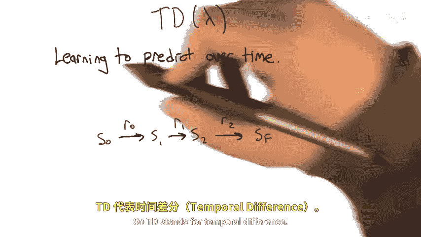
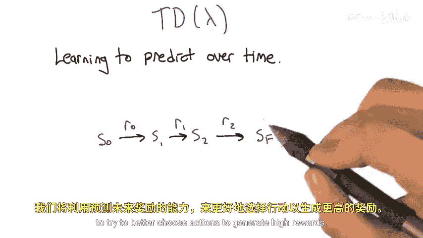
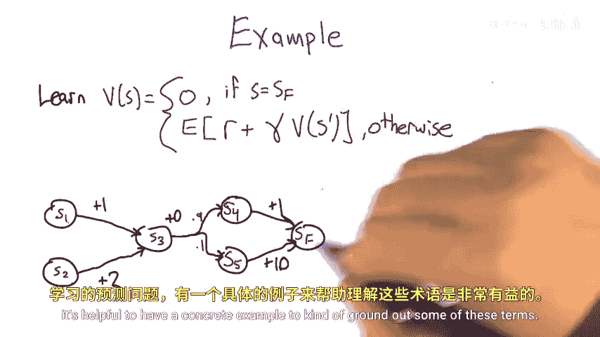

# 佐治亚理工【中英⚡强化学习导论｜CS8803 Introduction to Reinforcement Learning】 p73 P73 TD Lambda -BV1cJnfzTEBt_p73-

All right， so that brings us to temporal difference learning。 So temporal difference learning。

 the algorithm that we're going to look at originally by Sutton is called TD Lambda。

 This is a little lambmbda symbol。 So TD stands for temporal difference。

 And what really it's about is learning to make predictions that take place over time。

And so as a concrete example， a concrete way of looking at this。

 we're going to look at how we can from a sequence of states。

 state0 goes to state 1 goes to state  two goes to， let's say， a final state。

And each time there's a transition， there's some reward that's associated with that。

 we're going to try to predict the expected sum of discounted rewards from that。Okay。

Which is what we're trying to do anyway。 Yeah， so this is going to be a really important subroutine for trying to do reinforcement learning because we're going to use the。

 the notion that we can predict future rewards to try to。

Better choose actions to generate high rewards。 Okay， that's fair。Al right。

 so for the kind of prediction problems that we're going to be learning with temporal difference methods。

 it's helpful to have a concrete example to kind of ground out some of these terms。 So here。

 let's let's take this as a Markov chain with states， S1， S 2， S 3， S 4。

 S5 and S F for the final state。

I've labeled each of the transitions with the reward that happens when you make a transition from that to the next。

And this particular transition out of S3 actually is a stochastic transition with 90% probability going to S4 and 10% probability going to S5。

 Okay， that makes sense。