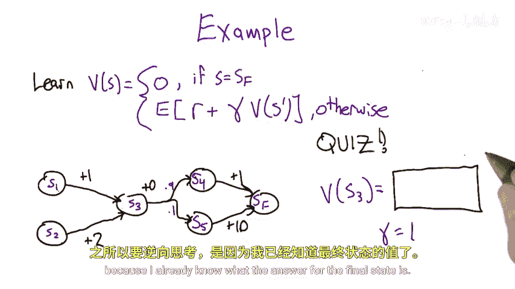
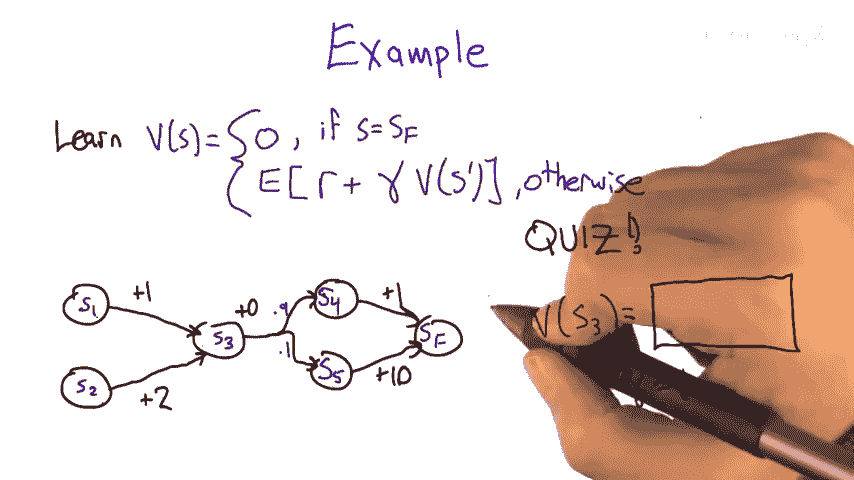
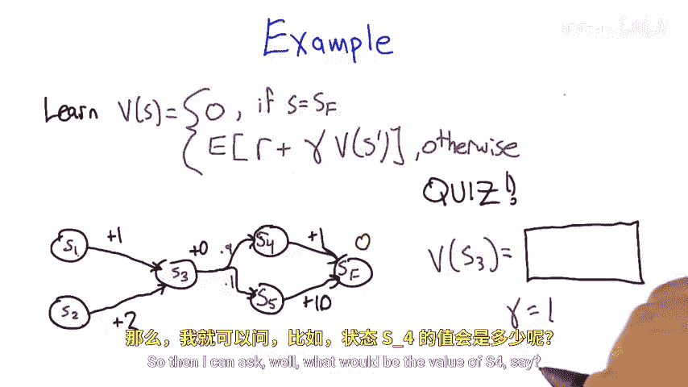
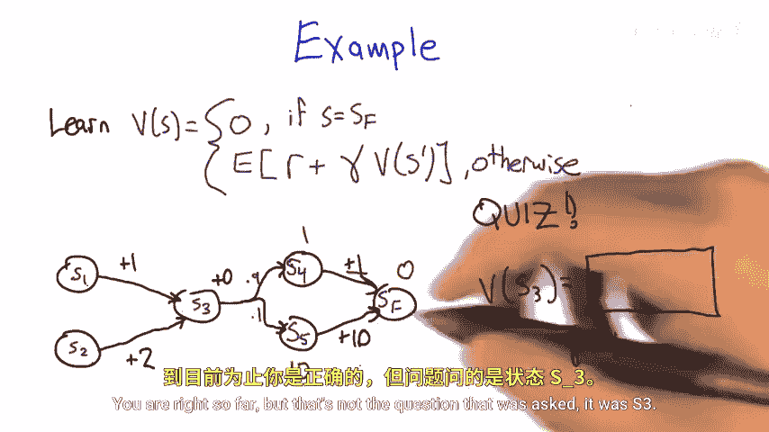
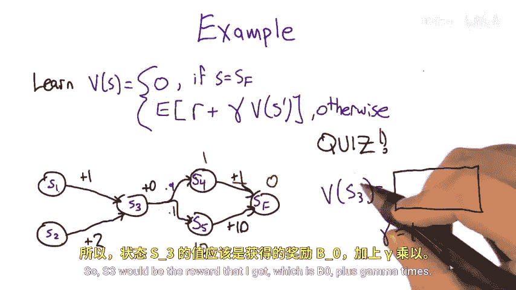

# 佐治亚理工【中英⚡强化学习导论｜CS8803 Introduction to Reinforcement Learning】 p75 P75 Value Computation Example Solution -BV1cJnfzTEBt_p75-

All right， Charles， let's let's work this out。 Oh， we're gonna to work this out。 Well。

 you're going to work this out。 Okay， well， so I'm looking at this。

 I actually think this one's pretty straightforward to do once you have the first insight。

 when the first insight is you want to go backwards。

And the reason you want to go backwards is because I already know what the answer for the final state is and I can go back one step and use that to figure out what the states before are and so on and so forth so with that why don't we actually be explicit about it then so yes the value of S of F S of F would be zero that's given that's pretty easy Okay so then I can ask well what would be the value of S4 say so S4 is the reward you get。

For leaving that state， taking the action。Plus gamma times the state you're going to end up in well。

 so that would be one plus gamma times  zero， which is1。That's pretty good Okay， and then for S5。

 I can do the same thing in this case， it would be 10。Plus， gamma times 0， which， of course， is 10。

 All right， I right so far。 You are right so far， but that's not the question that was asked。

 It was S3。 No， okay， fair enough。 Al right， so let's do S3 then。

 So S3 would be the reward that I get， which is be 0 plus gamma times。

The value of the state that I end up in。