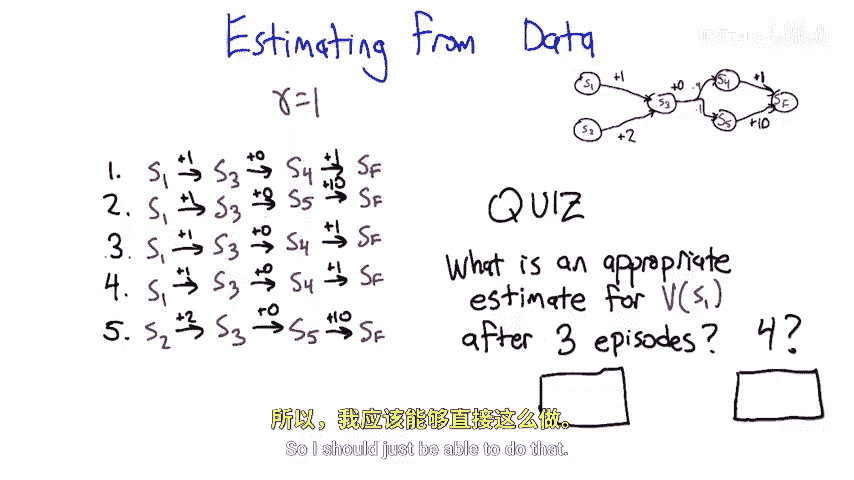
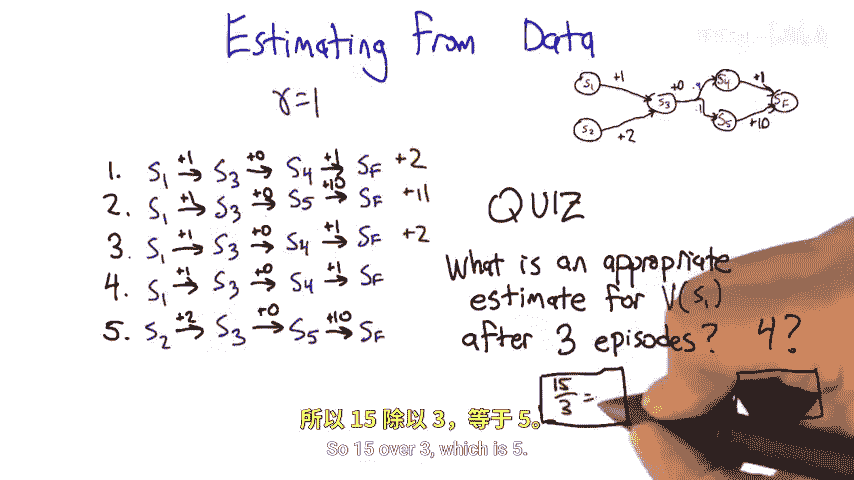
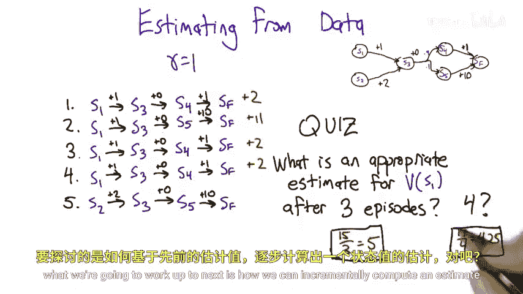

# 佐治亚理工【中英⚡强化学习导论｜CS8803 Introduction to Reinforcement Learning】 p77 P77 Estimating from Data Solution -BV1cJnfzTEBt_p77-

All right， so do you have an answer for this quiz， I don't， But I think I know how to get one。

 Let's go for it。 Okay， so basically， you're asking me to estimate from data。 So you really。

 what you're really doing is you' asking to estimate youre asking me to do an expectation， Right。

 right， because that's what we're trying to estimate is an expectation。 right。

 And the way you do that is you just。Average things。 so I should just be able to do that。

 So I can look at episode 1 and I can see what the value for S1 turned out to be。

 And because you're so nice and made gamma equal to1。

 I can basically just add up the numbers on the arrows right so the value to S1 and episode 1 is2 good and the value to S1 and episode 2 is 11。

Good。And the value to S1 and episode three is two again， good。Allright。

 so then if I wanted to know what an appropriate estimate was after three episodes。

 I would just average those three numbers， and I would get five。They right。😊，Yeah， so 15 over3。

 which is5。

Nice， okay， so then for four， I see two again， and so that would be 17 over four good。

 which is a number。4。25 good。Yeah， that's what I was looking for。 Nice done。 Oh， so in fact。

 I could do this for one episode or two episodes。That's right。 In fact。

 what we're going to work up to next is how we can incrementally compute an estimate for the value of a state given the。

