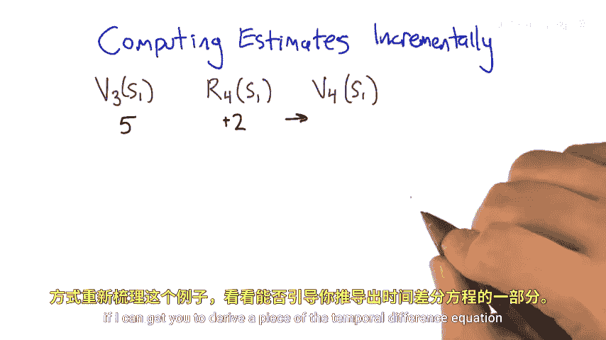
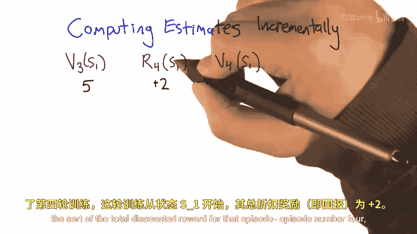
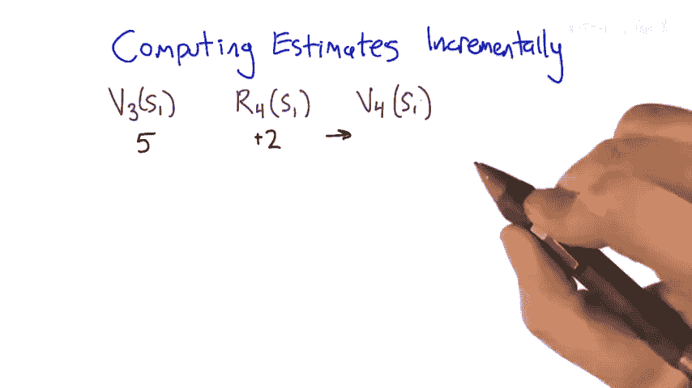
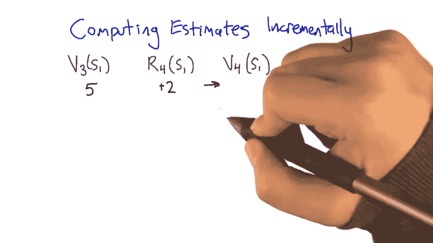

# 佐治亚理工【中英⚡强化学习导论｜CS8803 Introduction to Reinforcement Learning】 p78 P78 Computing Estimates Incrementally -BV1cJnfzTEBt_p78-

Okay， Charles， I'm going to see if I can get you to derive a piece of the temporal difference equation just by working through this example again in a slightly different way。

 So from the last thing we talked about， we said that the value estimate for S1 after three episodes was5 And then we ran an episode and the return of that episode just sort of the total discounted reward for that episode episode number4 starting from that state S1 was plus2。

Could we just from this information figure out what the new estimates going to be， Sure。

 So let's see if we can do that。 Let's work through that step by step。 Okay， well， I can cheat right。

 by just， I mean， you have everything indexed by time。

 So I know that five is an estimate of the last three。

And for is an estimate of the fourth one。 right， So I should be able to， you know。

 wait the first one with。3 and the other one with one or something like that。

 And that'll give me the right answer。 All right， so what do you mean by wait。 So。

 so what you mean is since 5 is the average of the first three episodes。

 15 is the total from the first three episodes， right， That's right。 I've seen it three times。 Good。

 as if we had seen five， three times。 So， you know， the details actually varied from that。

 but that's okay， because averages work out nicely。 That's right， it doesn't matter。

 Then we got an additional。Reward of two。 and now we want to know the average over four steps， right？

