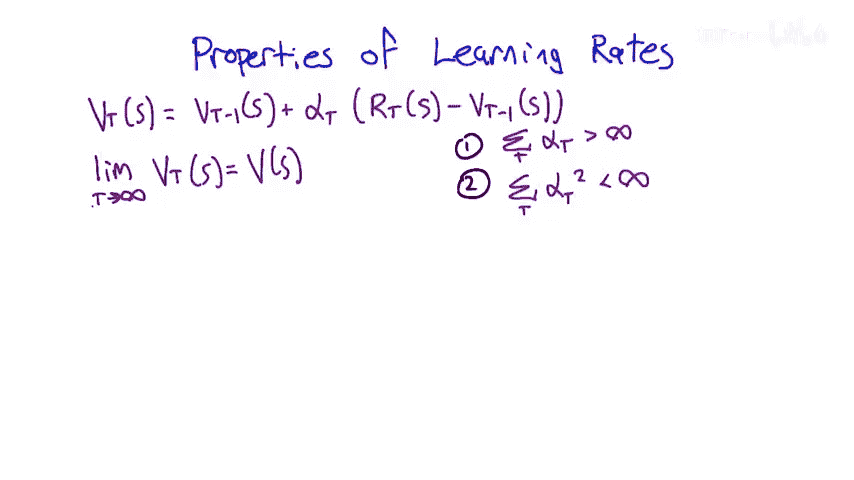
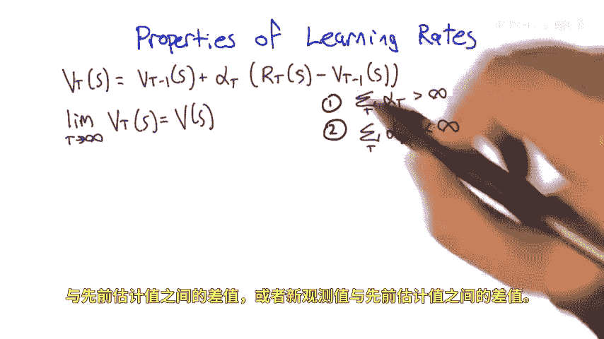
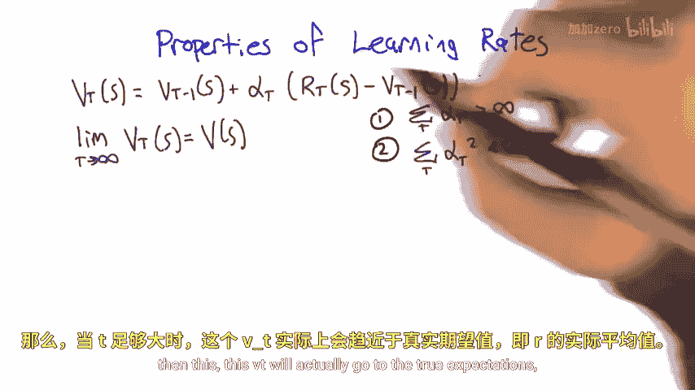
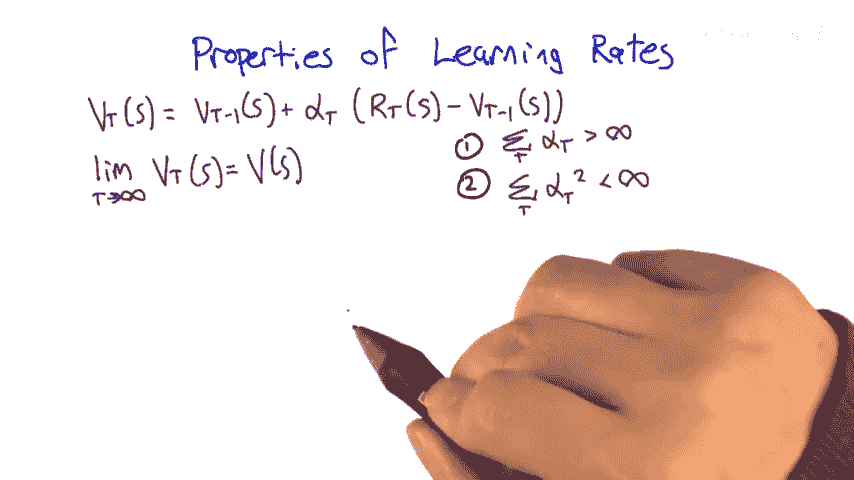
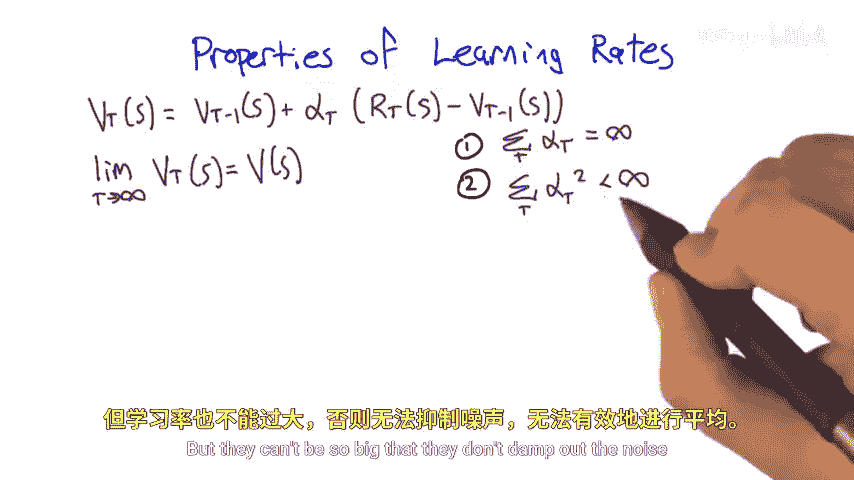

# 佐治亚理工【中英⚡强化学习导论｜CS8803 Introduction to Reinforcement Learning】 p79 P79 Properties of Learning Rates -BV1cJnfzTEBt_p79-

So that was very ast of you。 And in fact， there is a very general property that can be stated about learning algorithms of this type。

 So if we have a learning update rule， like the one that we have。

 which is that the value at time t is the value at t time t -1 plus some learning rate times the difference between the new estimate and the previous estimate or the new observed value and the previous estimate。

 then this this Vt will actually go to the true expectations。 the actual。

Average value of the R's once T is big enough。

Okay， so that's good， that means it's actually learning the right thing。

 but there are conditions that we have to put on the learning rate sequence。

Then the learning rate sequence has to have the property that if you sum up all the learning rates。

 it actually sums up to infinity。 it's unbounded， it diverges as opposed to greater than infinity。

 Oh good point。 Yes， that it's equal to infinity。 Very good。

 it's actually greater than any finite number anyway。

 so it diverges but the square of the learning rates。 if you sum those up。

 it's less than infinity and we're not going to get into the details about why these are the standard properties for making this kind of learning rule work but to first approximation the learning rates have to be big enough so that you can move to what the true value is no matter where you start。

But they can't be so big that they don't damp out the noise and actually do a proper job of averaging。

