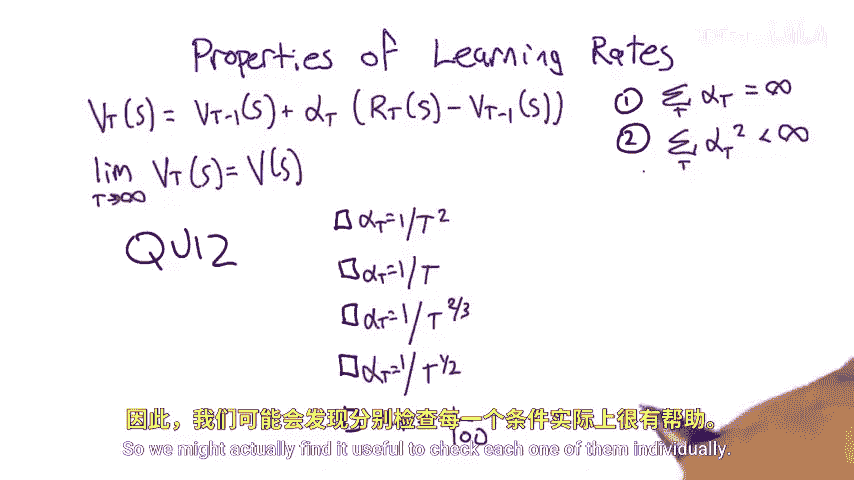
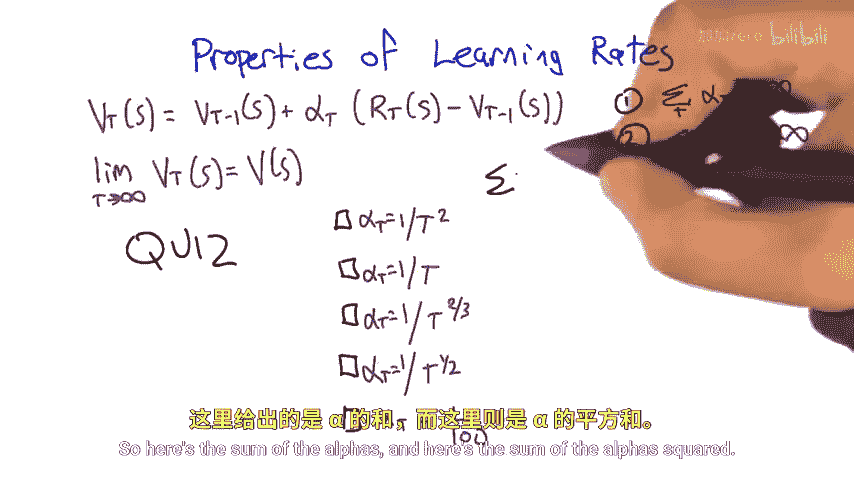
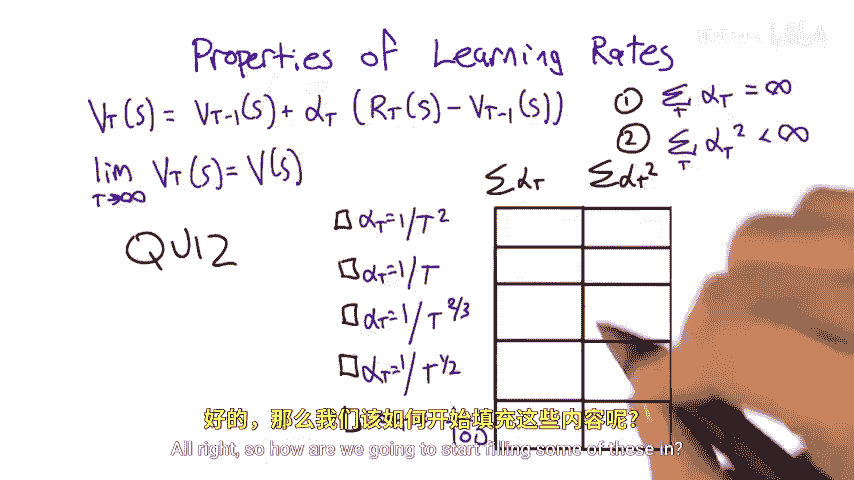
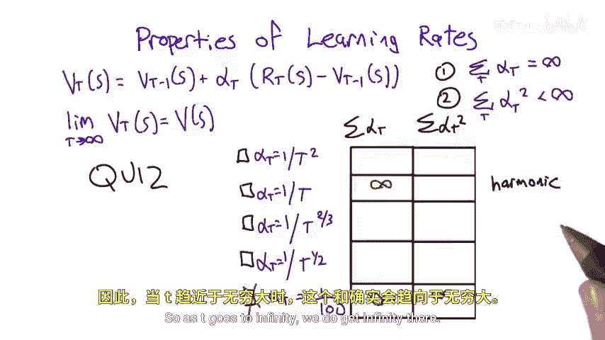

# 佐治亚理工【中英⚡强化学习导论｜CS8803 Introduction to Reinforcement Learning】 p81 P81 Selecting Learning Rates Solution -BV1cJnfzTEBt_p81-

All right， so to actually figure this out， we're going to need to check these two conditions。

 So we might actually find it useful to check each one of them individually。

 So here's the sum of the alphas and here's the sum of the alphas squared All right。

 so how are we going start filling some of these in any of these cases that we actually know what the sums are going to be yeah。

 two of them I think at least so well let's go ahead and get the easiest one out of the way first。

 that's number well， actually I think two of them are equal easy。

 let's do number five great So we know that that's going to be infinite。

 the sequence will be infinite because it's a constant and we also know the square。

 which is just another constant and that's nonze。 So it's also going to be infinite。 All right。

 so what does that tell us about this learning rate。

 It says if if your learning rate doesn't get smaller over time。 then you never going to converge。

 That's right， So this one， this learning rate doesn't work as far as the theorems concerned All right you said there was another easy one All right so number two。

 I think is easy because you told me last time that that one works。

Yeah， I guess that's a that's a reasonable way to do it the you recognize this this the sum of these。

 you know what this is this is called if you sum up alphates of this sort of form。

 isnn't it a geometric series or is it harmonic which one is it harmonic？😊，Yeah， that's right。

 That's the harmonic sequence。 and the sum of this up to T acts a lot like log of T。

 So as t goes to infinity， we do get infinity there and we also know that the square of it is。

