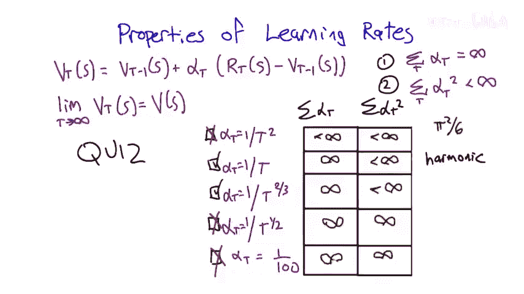
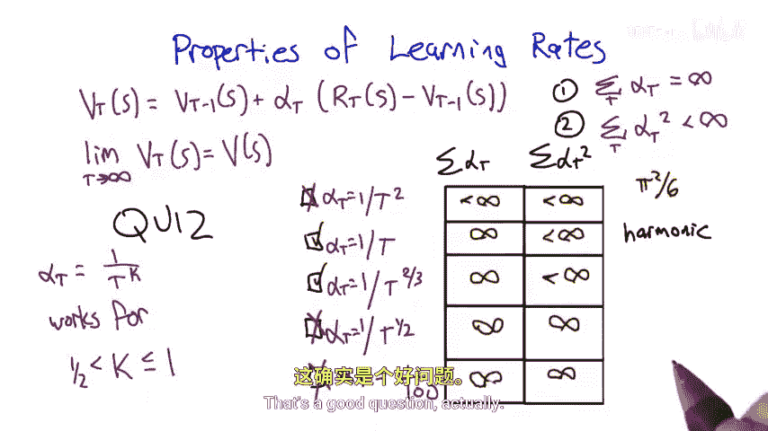
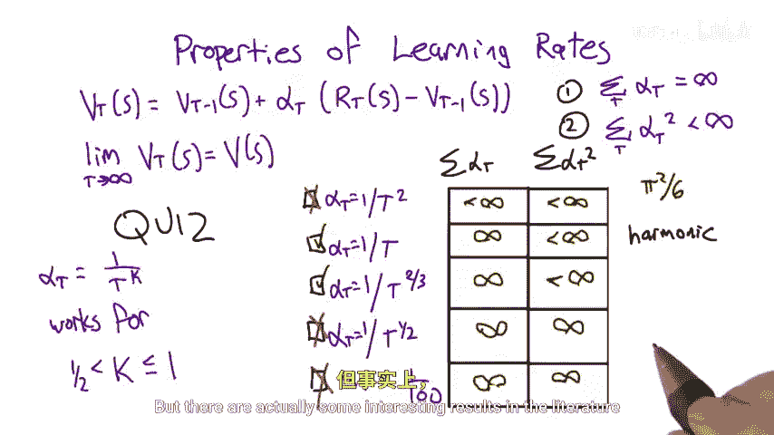

# 佐治亚理工【中英⚡强化学习导论｜CS8803 Introduction to Reinforcement Learning】 p82 P82 Selecting Learning Rates - Solution - 2 -BV1cJnfzTEBt_p82-

So can we extract a general rule from this。 So if we have a learning rate sequence that looks like one over t to the K。

 this is going to work for some range of ks right So we saw that if k is too big。

 then it fails because everything sums to something finite and if it's too small。

 then it fails because everything sums to something infinite。

 So what's the range of ks that's going to work here So there's two we should be able to back into this So we we know that the exponent will go to infinitefinity。

 which is what we want for K， if it is one or less So K has to be less than equal to1 we want one over t to the K squared also needs to be greater than1 So since it's an exponent that would be 2。

 So that would be2 k greater than1 as long as it's bigger than a half， it's going to work。

 but if it's equal to a half， it actually fails because then when we square it， we get one over t。

 which has an infinite sum So we have to have it has to be strictly greater than half。

Be less or equal to one any particular reason why you pick one over the other。

 some particular value of K over the other。 That's a good question。

 actually for the purposes of what we're talking about now， no。

 but there are actually some interesting results in the literature where you can run into trouble with things like k equal1 it's a little bit too unstable and you want something a little bit lower to smooth things out better And where does that instability come from it just come from it's it's close to the edge。

 Yeah， I think so。 And so if you're very unlucky in the things that。

