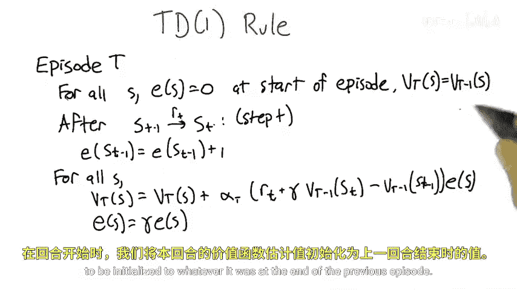
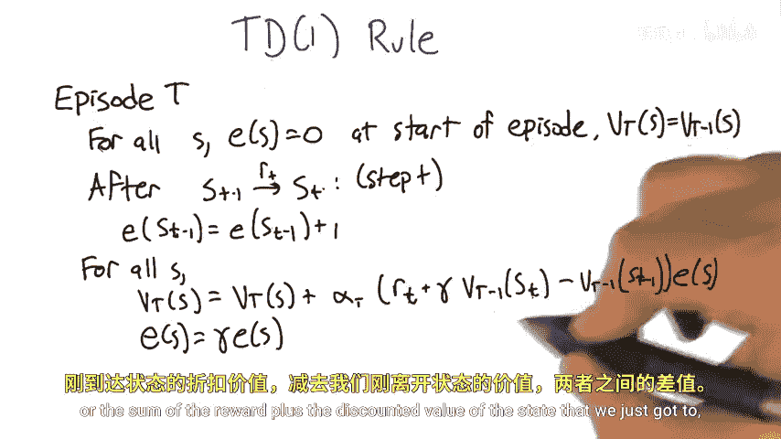
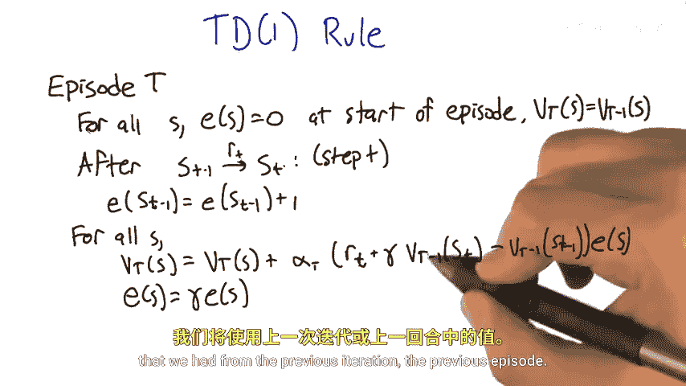
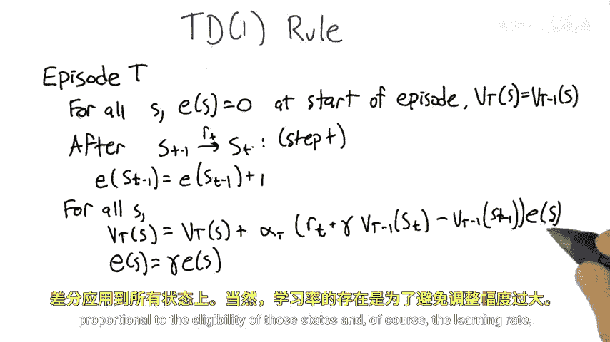
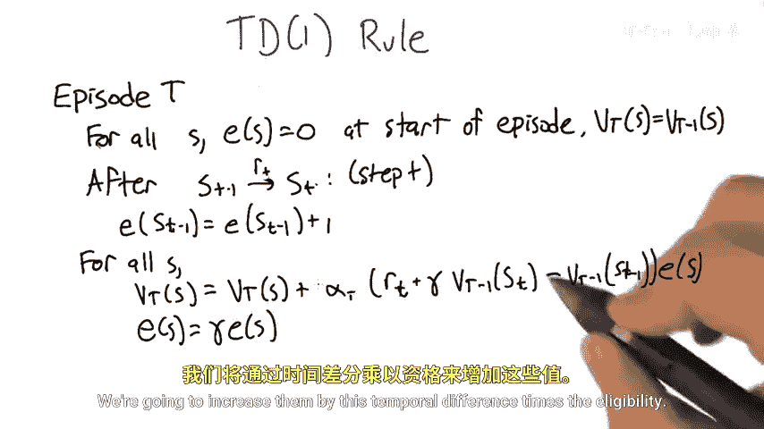

# 佐治亚理工【中英⚡强化学习导论｜CS8803 Introduction to Reinforcement Learning】 p83 P83 TD(1) Rule -BV1cJnfzTEBt_p83-

So I think this leaves us in a position where we can actually state the TD1 update rule。

 So it looks a little hairy， but we're going to be able to go through it and see that it does something very sensible or at least somewhat sensible。

 So this is the structure of the rule of TD1。 So for each time we start a new episode。

 we're going initialize this thing called the eligibility E of s for all the states to 0。

 So we just start them off as ineligible at the start of the episode。

 and we start off our estimate for the value function for this episode to be initialized to whatever it was at the end of the previous episode。

 That makes sense。 So then each time we take a step within the episode。

 a step from some S little t -1 to some state S little T getting reward R T。

What we're going to do is first update the eligibility of the state that we just left。

 then go through all the states， compute this one quantity， which is the same for all states。

 this is the temporal difference this is the difference between or the sum of the reward plus the discounted value of the state that we just got to minus the state that we just left and we're going to use the values of the that we had from the previous iteration。

 the previous episode that's going to be our temporal difference and we're going to apply that temporal difference to all states proportional to the eligibility of those states and of course the learning rate because we don't want to move too much and we're just going to update them by that we're going to increase them by this temporal difference times the eligibility then we decrease or decay the eligibility for those states and then we're back up to the next step。

