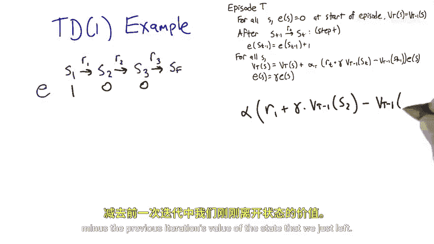
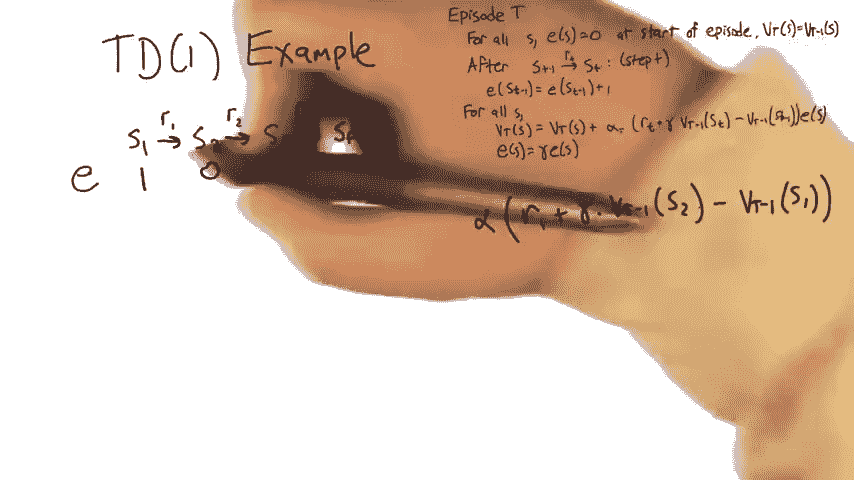
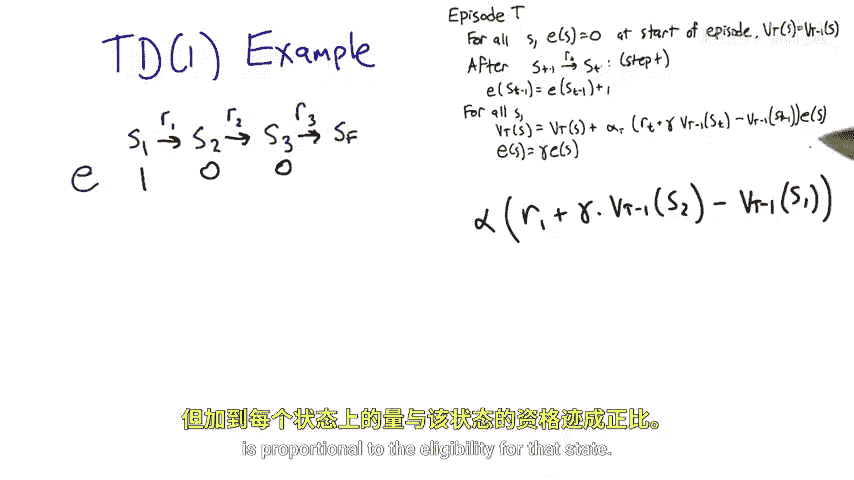

# 佐治亚理工【中英⚡强化学习导论｜CS8803 Introduction to Reinforcement Learning】 p84 P84 TD(1) Example - 1 -BV1cJnfzTEBt_p84-

All right， so let's walk through the pseudocode with a very tiny little example in mind just to see how the value updates work。

 So what we're doing here is we start off at the beginning of an episode。

 we say that the eligibility for all the states is 0。 And the new values。

 the new value function is whatever the value function was at the end of the previous episode。

 So we just just make a note of that。 What we're going to do for this example is just keep track of the changes。

 So so this ultimately it's all going to get added to whatever the previous value was。 All right。

 so now we make a transition。 And the first transition we make is from S1 to S2 with reward R1。

 What is that do to the eligibility。 Well， for S1， if that's the eligibility to one。Good。Allright。

 then we're now going to loop through all the states， all of them。

 and we're going to apply the same little update to all of them， and the update has the form。

 whatever the current learning rate is。😡，Times the reward that we just experienced， the R1。Plus。

Gmma times whatever the previous iteration value was for the state that we landed in。

Minus the previous iteration's value of the state that we just left。

So this quantity is going to actually get added to all the states。

 but the amount that it's going to get added to all the states is proportional to the eligibility for that state。

 and since at the moment states S2 and S3 are ineligible， they have their eligibility set to zero。

