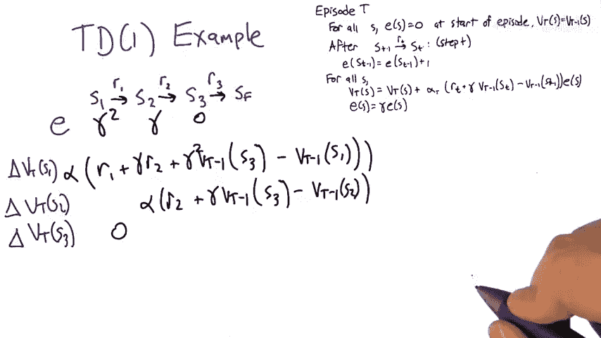
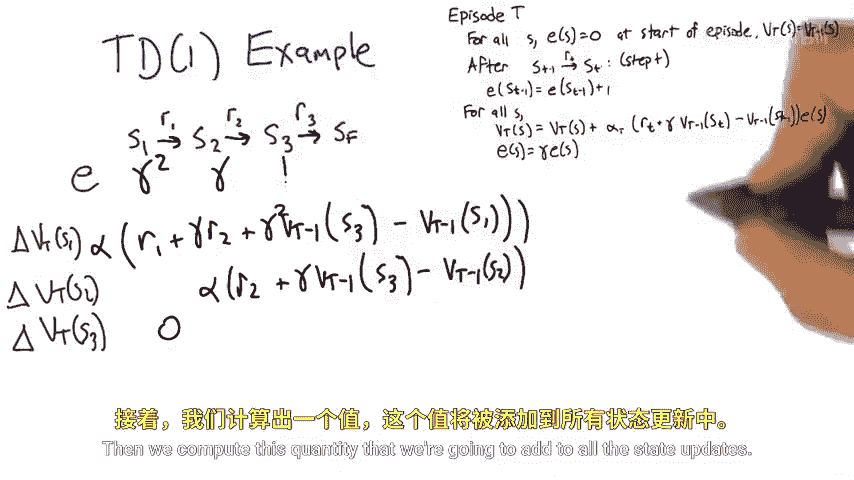
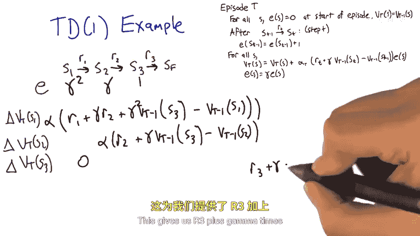
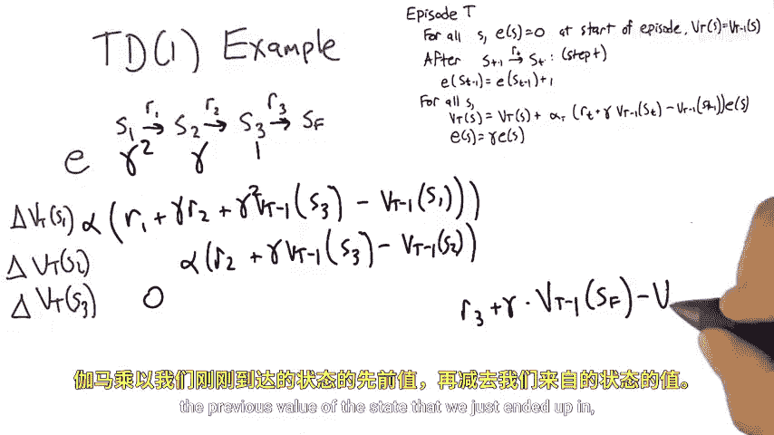
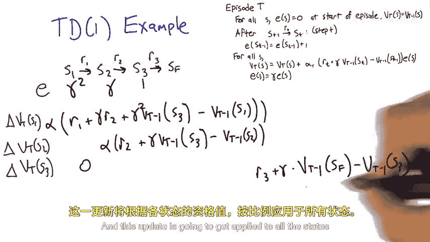
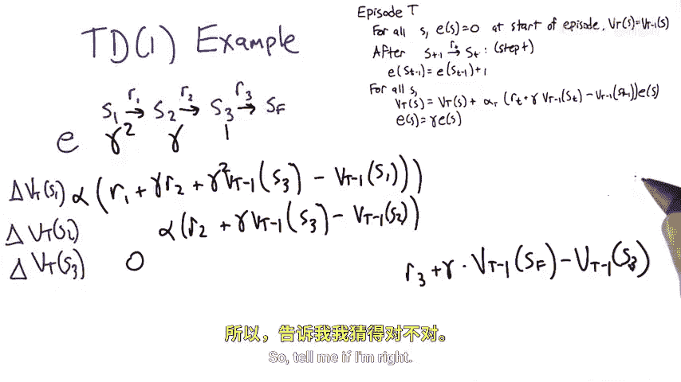

# 佐治亚理工【中英⚡强化学习导论｜CS8803 Introduction to Reinforcement Learning】 p85 P85 TD(1) Example - 2 -BV1cJnfzTEBt_p85-

The next step takes us from S3 to SF， and we get reward R3 when that happens。

 The first thing that happens is we update the eligibility for that state。

 Then we compute this quantity that we're going to add to all the state updates。

 This gives us r3 plus gamma times the previous value of the state that we just ended up in minus the state that we came from。

And this update is going to get applied to all the states proportional to their eligibility。

 So we can do that that same thing again。 Just add this quantity into all these things and simplify。

 that sound okay。

It does sound okay， and I think I finally see where this is going。

 So if you look at the pseudocode right， you say for all us and you update the value of the state。

 if you look at the stuff that's you know multiplied by your by alpha sub T all that is basically is your error right right that's why this is TD learning right。

 so it's it's what you thought it was。The difference between what you thought it was and what it turned out to be when you actually saw the reward。

 if you assume that your future guesses about the values are right， exactly。

So because of that cute little compactified telescoping thing that you just did。

 I think without actually writing everything out， I can guess what the next values are going to look like。

So tell me if I'm right。

The deelta for VT of S1 is basically going to have seen one more thing， so it'll end up being R1。

