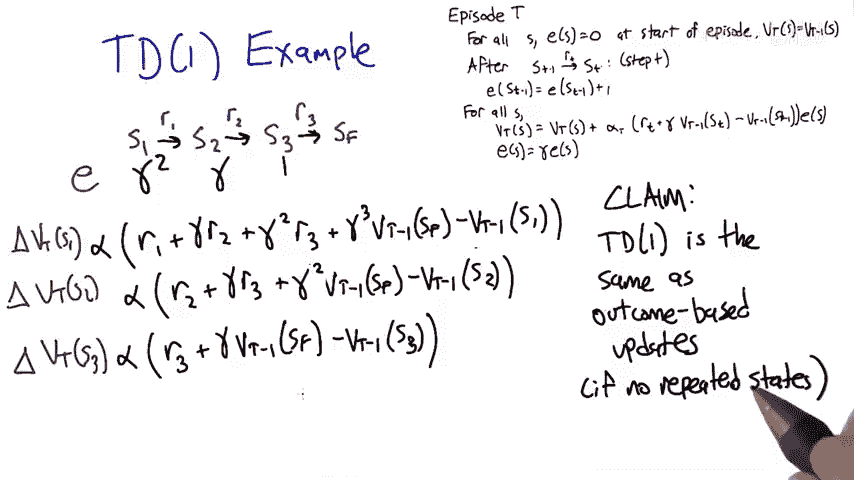
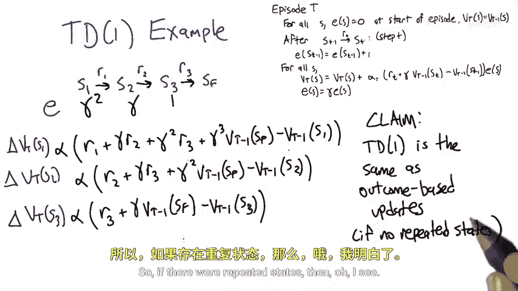
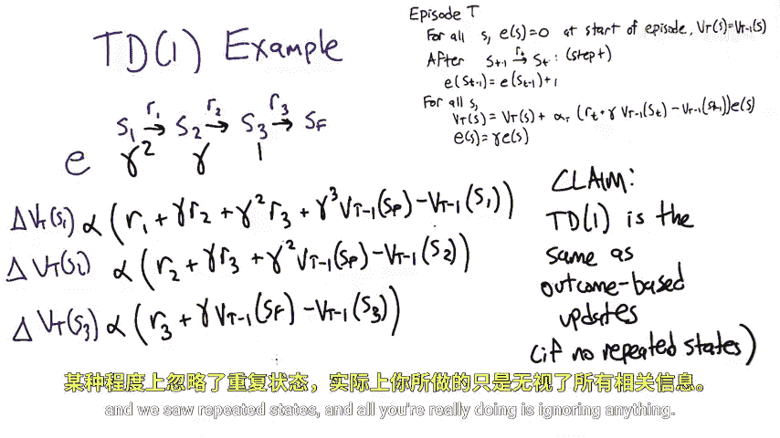
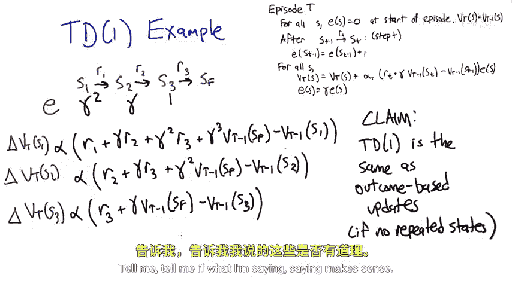
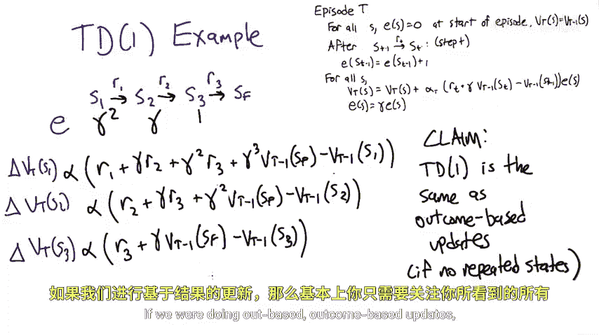
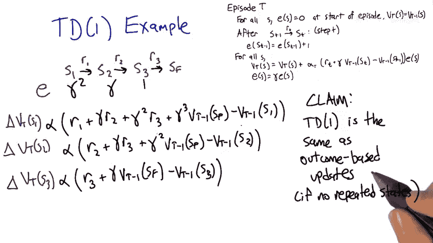
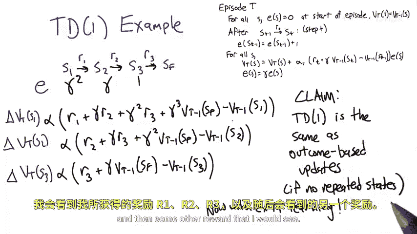

# 佐治亚理工【中英⚡强化学习导论｜CS8803 Introduction to Reinforcement Learning】 p86 P86 TD(1) Example - 3 -BV1cJnfzTEBt_p86-

So what happens if there are repeated states。 So if there were repeated states， then oh， I see。

 So okay， so let's imagine that we did outcome based updates sort of， but without。

 then we saw repeated states。 And all you're really doing is ignoring anything。 Oh， I see。 Okay。

 okay， how about this， Michael me tell me if what I'm saying saying makes sense。 So。

If we were doing out based。

Outcome based updates。 Then basically you're just looking at all the rewards that you see。

 the values that you kind of expected along the way。

 and it's exactly what you have written down before。 But if we had a repeated state。

 then you're basically ignoring。Anything you learned along the way so during the episode so outcome based updates say learn nothing during the episode so if if your sequence up there instead of being S1 S2 S3 SF had been S1。

 S2， S3。

S1， then what would have happened is I would have seen the rewards that I saw R 1 R 2， R 3。

 and then some other reward that I would see。 Let's call it R1 prime or something I don't know。

 I would。

I would be pretending as if I didn't already know something about state 1。

 because I also saw it go from state 1 to state 2 and saw a particular reward R1， yes。

I'd be ignoring that so what this TD1 update。