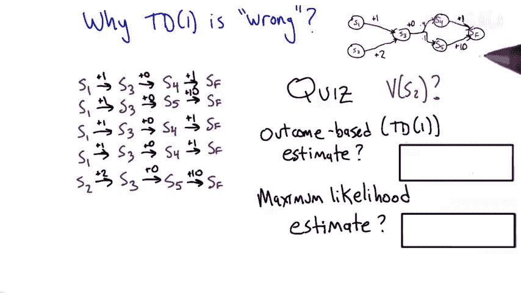
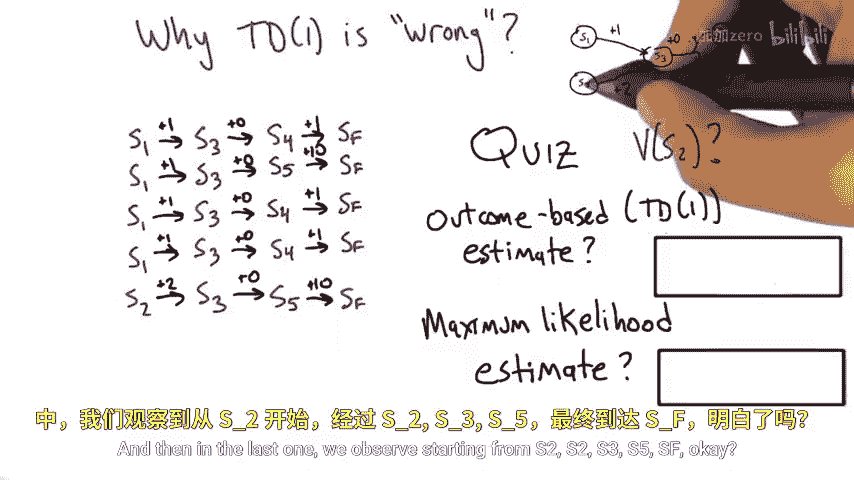
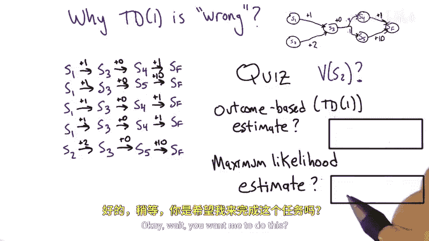
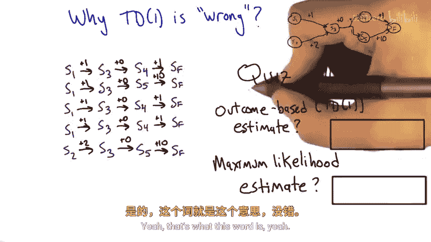
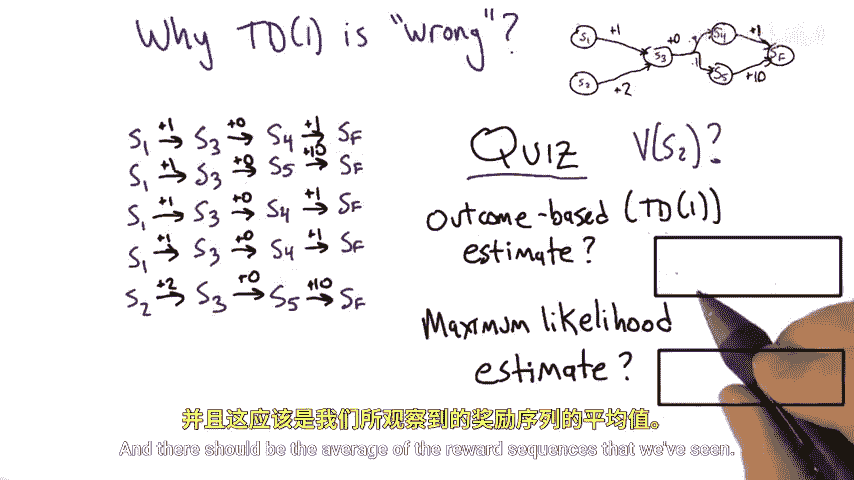

# 佐治亚理工【中英⚡强化学习导论｜CS8803 Introduction to Reinforcement Learning】 p87 P87 Why TD(1) Is _Wrong_ -BV1cJnfzTEBt_p87-

All right， Charles， so now that I've talked through how we can compute these outcome based estimates with these TD1 estimates。

I'm going to try to tell you that it's not exactly what we want。

 So I'm going to try to explain why TD1 kind of is wrong sometimes Okay， And to do this。

 we're going to go back to the example that we looked at before where we've got this Markov chain with rewards。

And we're observing some trajectories through it like S1， S3， S4， S final。

And so we we observe a bunch of those。 And then then last one， we observe starting from S2， S2， S3。

 S5， SF and now we want to figure out is what does TD1 or an outcome based estimate give us as an approximation for the value of S2。

 given this set of data， and then we'll compare it to what we get with the maximum likelihood estimate okay。

Wait， you want me to do this。 Yeah， Oh okay， so it really is a quiz。 Yeah。

s this that's what this word it is。

Allright， fine。 I think I have some questions， but in fact， let me ask some of it now。 So yeah。

 I think we we should make sure that it's clear enough so you can work on it。 Okay。

 so you want me to tell you what the value of S2 is or what I would estimate the value of S2 to be using sort of the TD1 outcome based estimate which and and there should be the average of the you know the reward sequences that we've seen upon encountering S2 okay。

