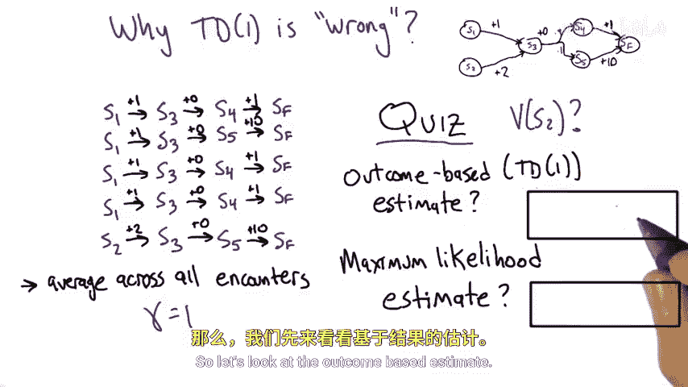
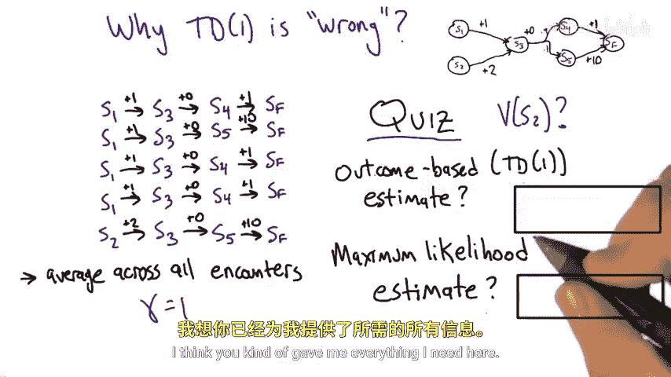
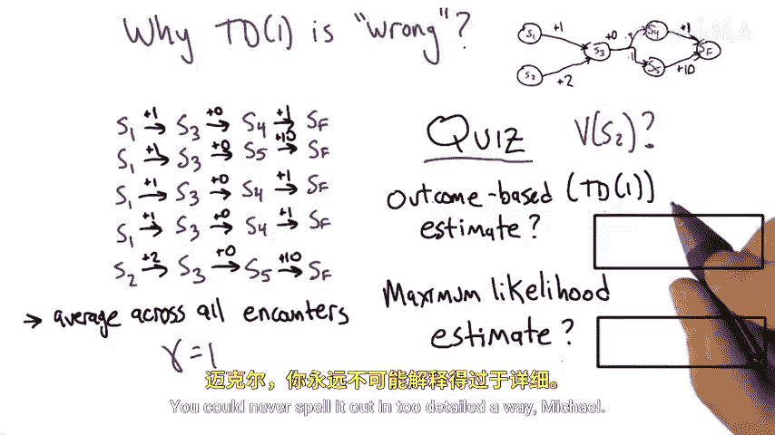
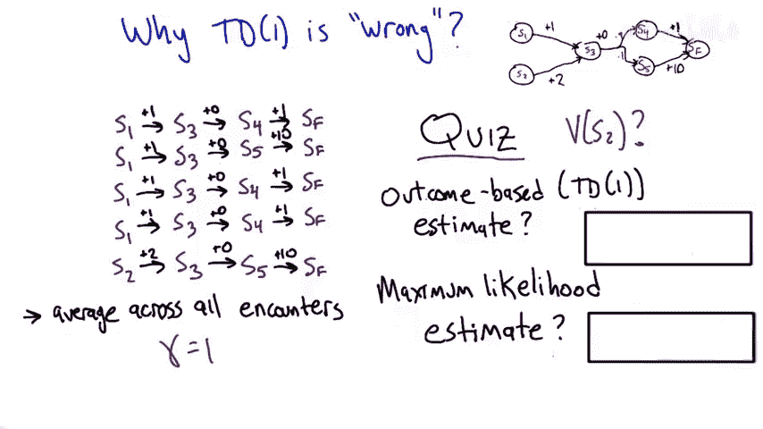
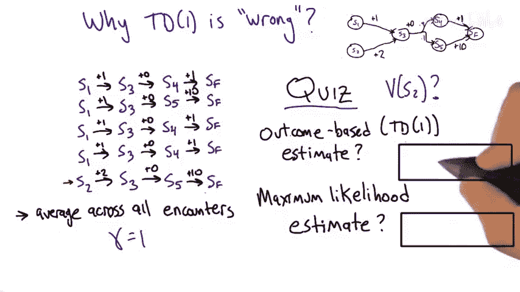
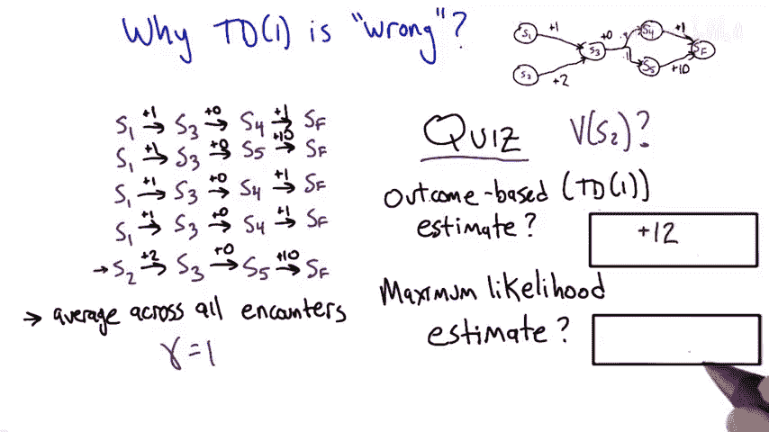
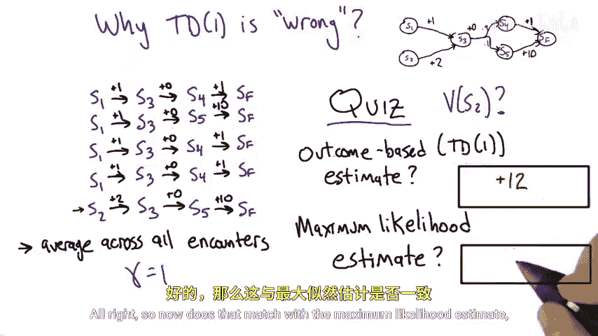
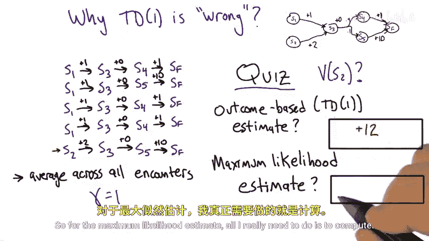
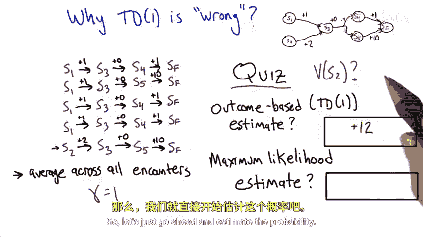

# 佐治亚理工【中英⚡强化学习导论｜CS8803 Introduction to Reinforcement Learning】 p88 P88 Why TD(1) Is _Wrong_ Solution -BV1cJnfzTEBt_p88-

Okay， so let's go through this。So let's look at the outcome based estimate。

Good， I think you kind of gave me everything I knew here。 So yeah。

 it's possible I spelled it out too detailed。 You could never spell it out in too detailed away。

 Michael。 So if I look at it， we encounter S2， exactly once。 exactly once。

 And so the average of one is pretty easy。 It's that thing。 Okay。

 and what is the the estimate for that one。 Well，2 plus 0 plus 10。 Yeah， which is 12。

ca because gammas  one。

Because gammas1 So good。 so this is saying because we've only ever encountered S2 once。

 and the one time that we saw it we ended up with the reward of 12 getting to the final state。

 that's going to be our estimate。 And that's what tD1 would actually do mod load learning rate and how you initialize the values and so forth。

 But that's sort of what it's trying to be like given this data All right so now does that match with the maximum likelihood estimate。

 the estimate that we'd get if you use the data to build a model and then solved it So for the maximum likelihood estimate all I really need to do is to compute let's see the probability from going from S3 to S and the probability of going from S3 to S5 because everything else is deterministic and in all five of those transitions I get to see every state in every reward。

 So I have everything that I need So let's just go ahead and estimate the probability。

 So looking it through I go from S3。

