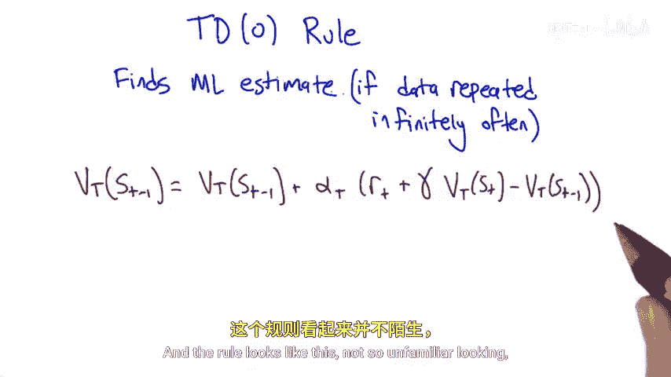
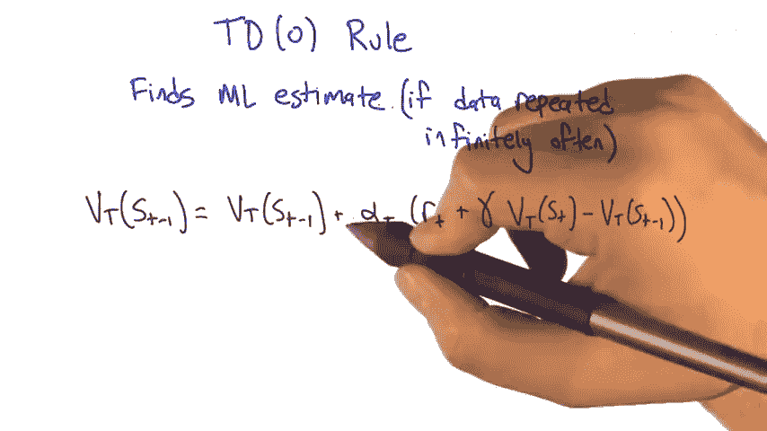
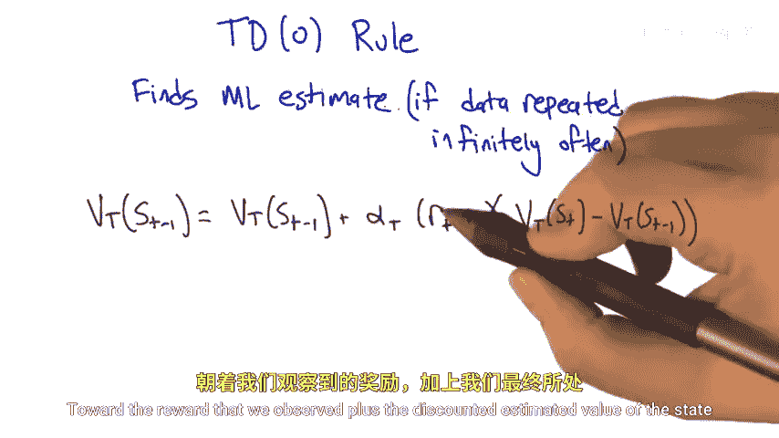
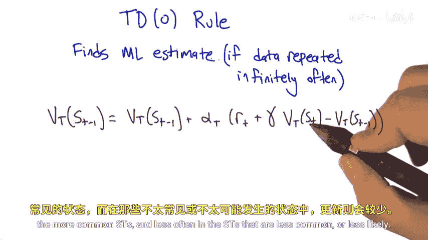
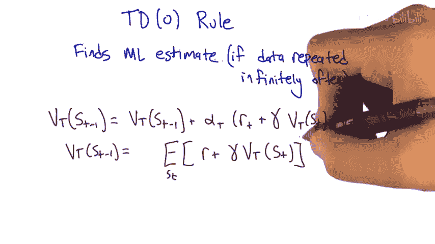
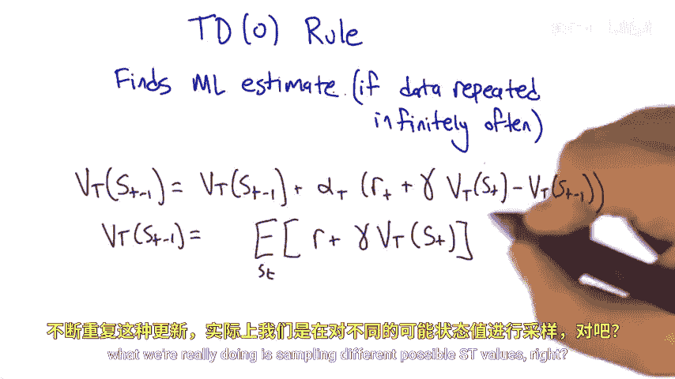

# 佐治亚理工【中英⚡强化学习导论｜CS8803 Introduction to Reinforcement Learning】 p89 P89 TD(0) Rule -BV1cJnfzTEBt_p89-

Alright， so here is a rule we're going to call the TD0 rule。

 which gives it a different name from TD1， but eventually we're going to connect those0 and the1 together。

And the rule looks like this， not so unfamiliar looking that the way we're going to compute our value estimate for the state that we just left when we make a transition。

At Epoch T， you know for trajectory T， big T is what the previous value was。

 plus we're going to move a little bit in the direction with our learning rate toward what。

 toward the reward that we observed plus the discounted estimated value of the state that we ended up in minus the estimated value of the state that we just left。

So does this look familiar， It's got V's and R's and alphas in it。 Well sure， all right。

 but let's maybe we can be a little more precise about this。

 So what what would we expect this outcome to look like on average right So the thing that's random here。

 at least the way we've been talking about it is if we were in some state。

 S T-1 and we make a transition， we don't know what state we're going to end up in。

 But there's some probabilities of those So basically this update is being done more often in the states that we end up in more often the more common STs and less often in the Sts that are less common or less likely。

And so really， if we take the expectation of this， what is it going to look like If we repeat this update over and over again。

 what we're really doing is sampling different possible S values。 So really。

 we're taking an expectation over。

What we get。