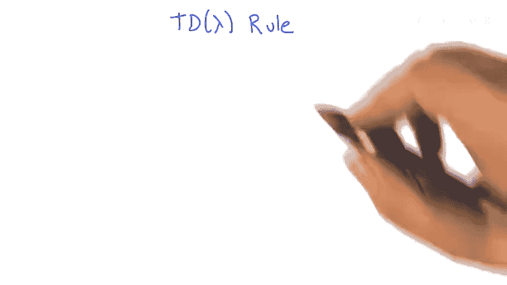
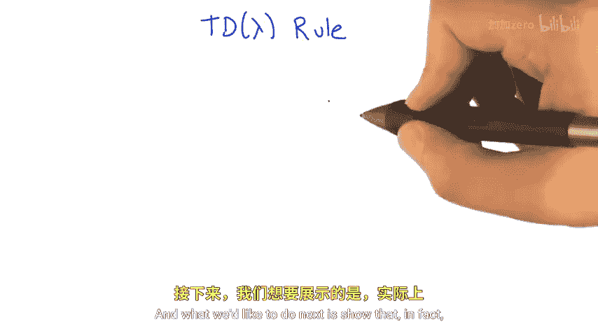
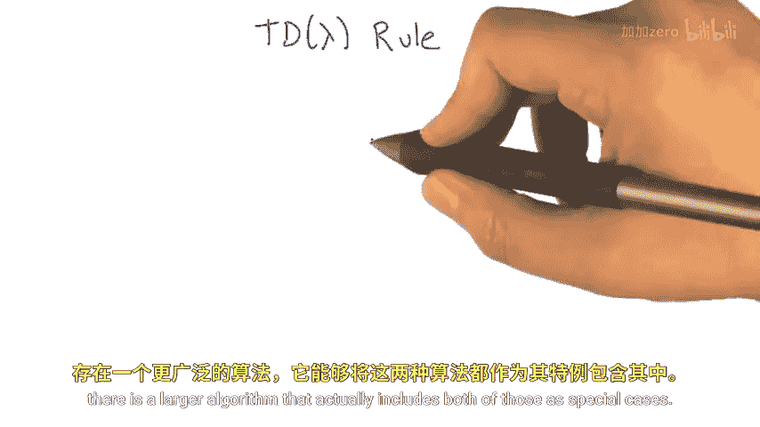
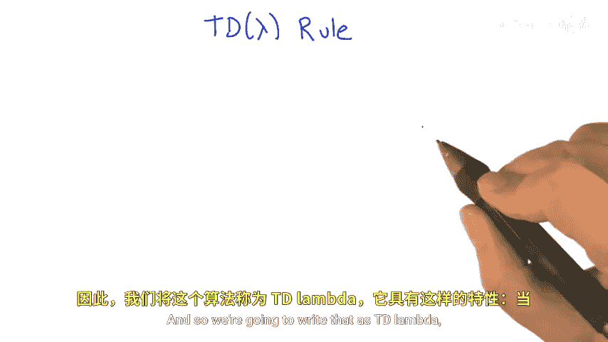
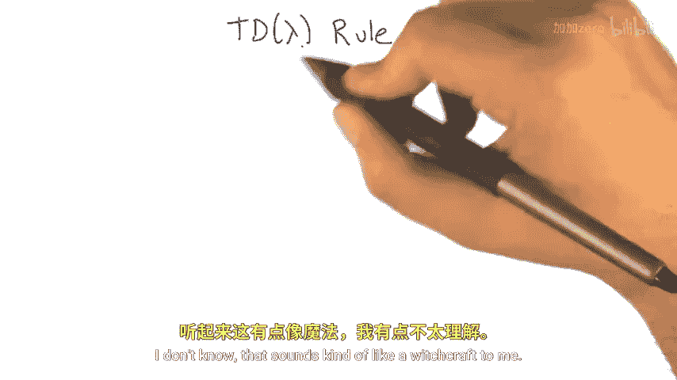
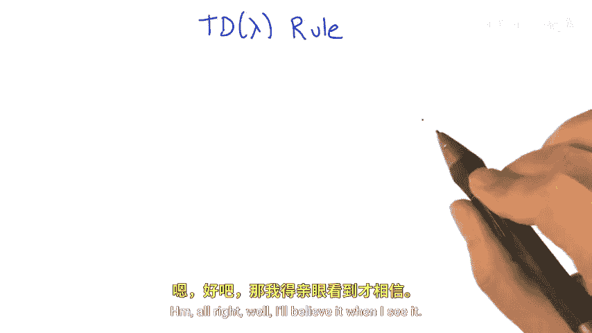
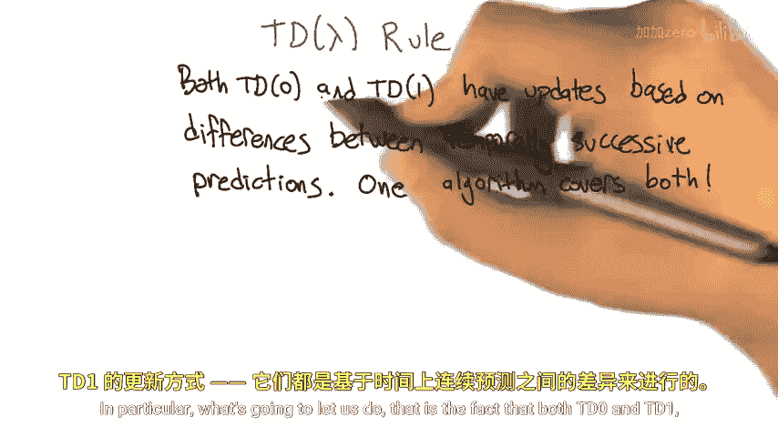
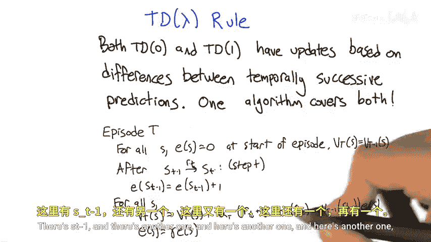

# 佐治亚理工【中英⚡强化学习导论｜CS8803 Introduction to Reinforcement Learning】 p90 P90 TD(Lambda) Rule -BV1cJnfzTEBt_p90-

All right， so now we've talked about two different algorithms， TD0 and TD1。

 and what we'd like to do next is show that， in fact。

 there is a larger algorithm that actually can includes both of those as special cases。

 And so we're going to write that as TD lambda and it's going to have the property that when lambda set to 0。

 we get td0。 and when lambda set to1， we get TD1。 but we also get update rules for all sorts of in between values of lambda。

 no， that sounds kind of like witch graph to me No， no， no， it's just algorithm design it's all good。

 All right well I believe it when I see it in particular。

 what's going to let us do that is the fact that both TD0 and TD1。

 the way that we were writing them have updates that are based on differences between temporally successive predictions。

 temporal differences that's the TD part。 And so we can actually unite them into1。

 and I don't need to say that again because I've already said it。

 All right So I copy the algorithm back down here。 and you know which algorithm this is。

 And the hope is that it's a little bit challenging because in fact， if it's TD0 or TD1。

Actually look an awful lot the same。 They have a lot of stuff in common。

 The update rule itself looks almost identical， but they are different。

 So which which one is this Well I'm trying to remember and let's see well。

 let's see there's a zero1 and one line and one in another line that's not going help me。

I was hoping I could count the number wins and through。

Actually there's a bunch of ones right there's an ST minus one and there's another one and here's another one and here's another one and another one Yeah most of those are minus ones。

 not plus ones and you didn't ask me it wast。

