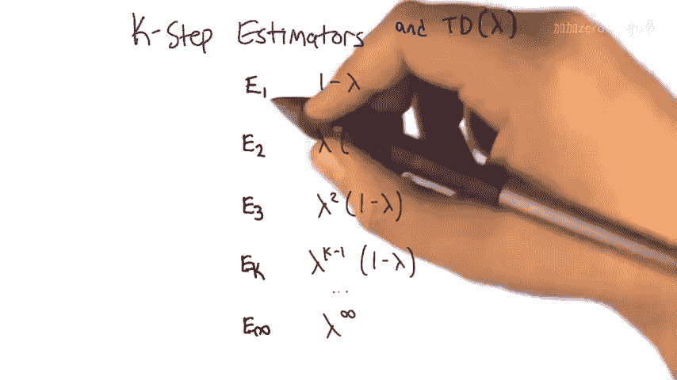
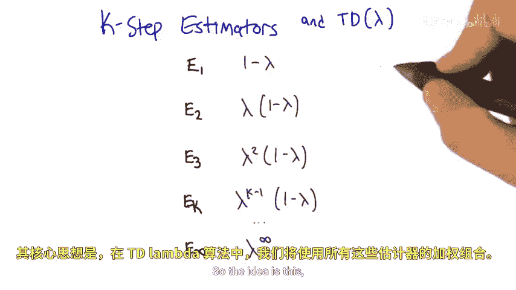
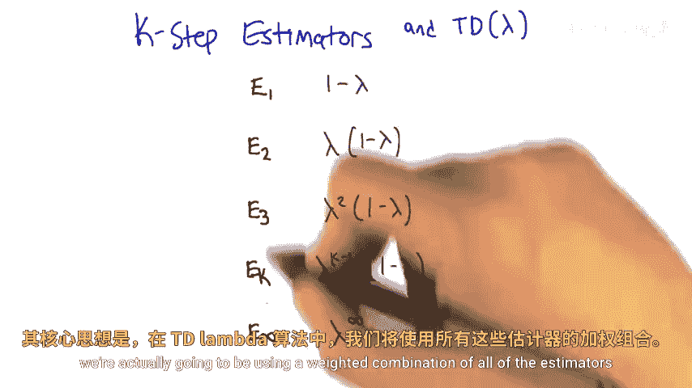
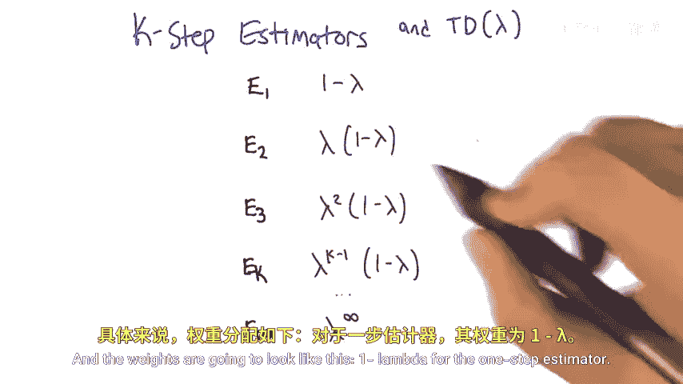
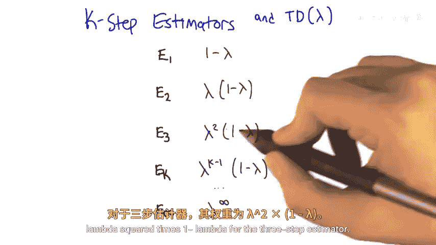
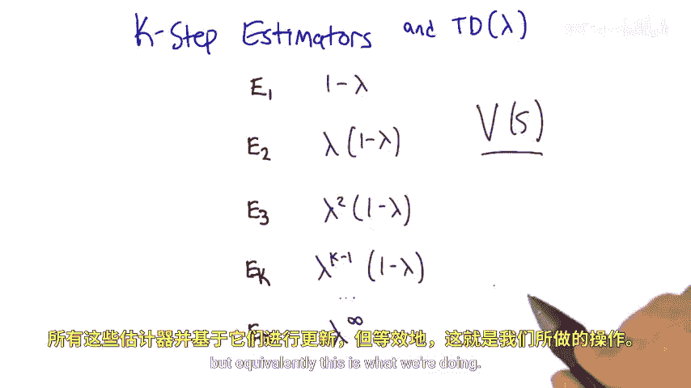
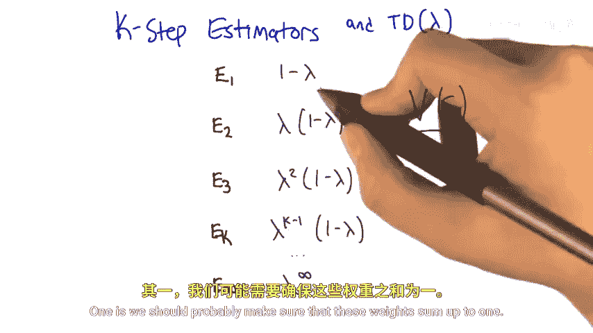

# 佐治亚理工【中英⚡强化学习导论｜CS8803 Introduction to Reinforcement Learning】 p92 P92 K-Step Estimators and TD(Lambda) -BV1cJnfzTEBt_p92-

So here's how we relate the case step estimators that we just talked about with TD Lambda。

 So the idea is this we're actually going to be using a weighted combination of all of the estimators on for any one of these TD Lada algorithms。

And the weights are going to look like this，1 minus lambda for。

The one step estimator， lambda times 1 minus lambda for the two step estimator。

 lambda squared times 1 minus lambda for the three step estimator。

 Lada to the k -1 times 1 minus lambda for the K step estimator。 and then all the way down to。

Essentially lambda the infinity， but of course， that one literally doesn't get any weight Wait except well let's leave it at that for now and then we'll explain why that's an okay thing to say in a second。

 Okay， so so far， everything you said makes sense except you haven't told me what you're waiting exactly。

Oh， so what we're going to do is when we move the value， when we change the value of a state。

We're going to change it by all the different estimators all the different estimators are going to give us their own preference as to what we should be moving the value toward and we're just going to take a convex combination。

 a weighted combination of all of them each time that we do an update for the value of a state Oh I see now we don't literally get to list all of these an update based on them but equivalently this is what we're doing and so lets there's a couple things that we should probably check one is we should probably make sure that these weights sum up to one。

😡。

Mmhm。So。