# 佐治亚理工【中英⚡强化学习导论｜CS8803 Introduction to Reinforcement Learning】 p93 P93 TD(Lambda) Empirical Performance -BV1cJnfzTEBt_p93-

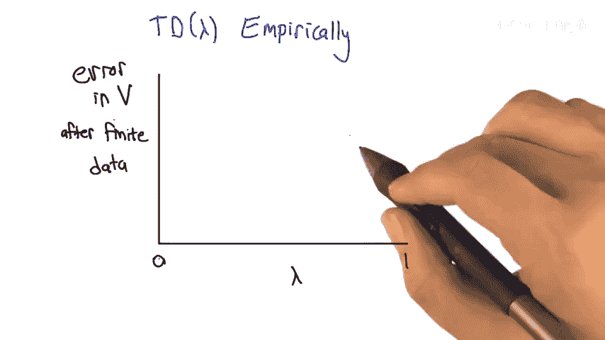

All right， so let's see if we can think through or maybe guess what's going to happen if TD Lambda is run as an update algorithm on some finite amount of data。

 so we give the system some finite amount of data and then we run TD Lada with different possible values of Lambda and then we ask。

 all right， the V that you've learned how far is that from what the V should have been if we had infinite data。

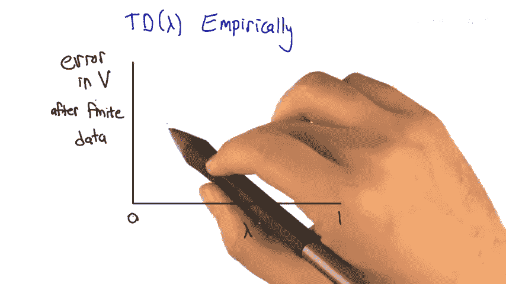

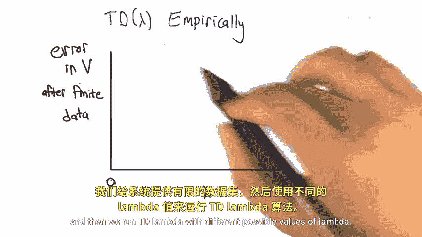

Allright， so let's I don't know。 let's sort of see if we can figure out or or maybe even guess what this might look like。

 So let's say if we use lambda equals 0。 So we do TD0。 So after some finite amount of data。

 there's gonna to be some amount of error。 Let's just you know， I don't know， call it。

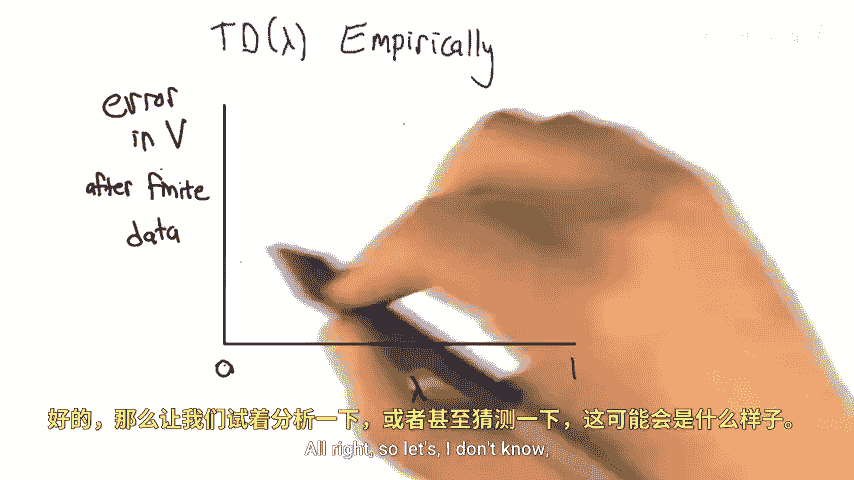

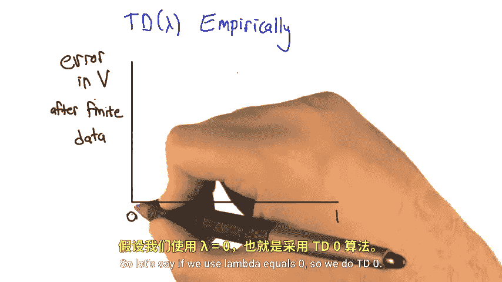

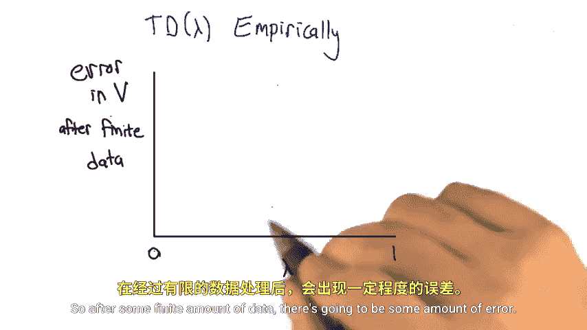

That。Okay， now it turns out empirically， if you play with this， it's。

 it's pretty typical for TD1 to give you。Worse error， given finite data。

And now the important thing is what happens in between。

 so it could be like a straight line if it was literally interpolating， it could be kind of bowed up。

 but it's actually typically bowed down。

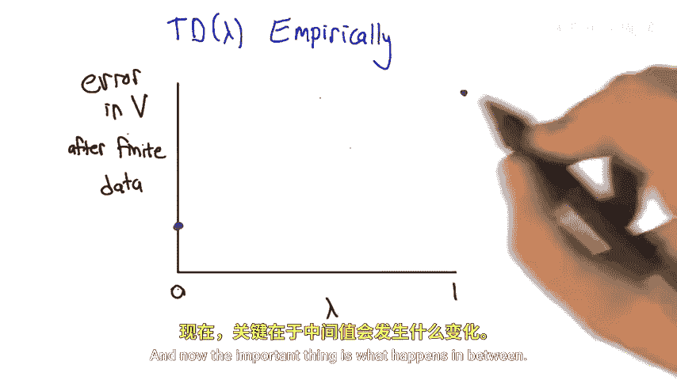

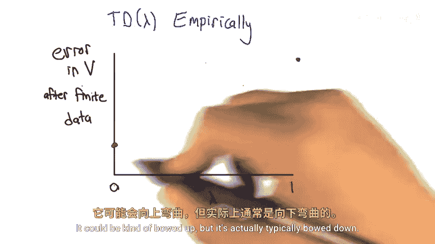

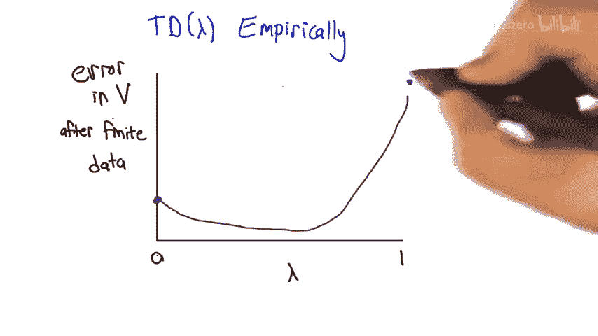

So it's not so atypical to see a curve kind of like this。Gets better。

 The amount of error goes down as lambmbda gets to some intermediate value。 Let's call it。

 I du't know，7。

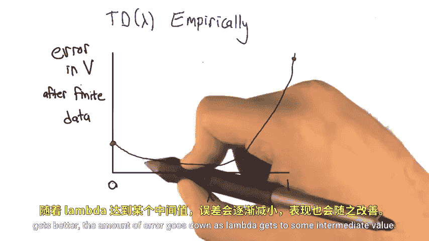

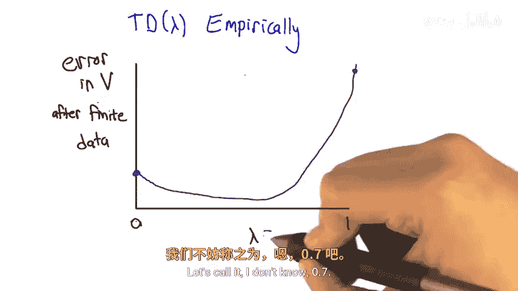

It depends， of course， on the particular problem， and then kind of start to shoot up again and eventually hit the error for TD1 as Lambda approaches one。

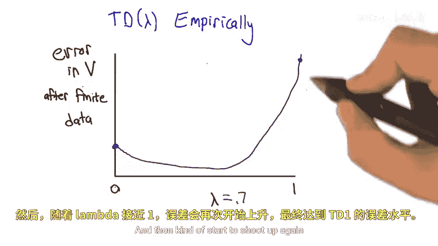

And so this is kind of the justification for why we want to consider TD Lambda that it's actually combining the。

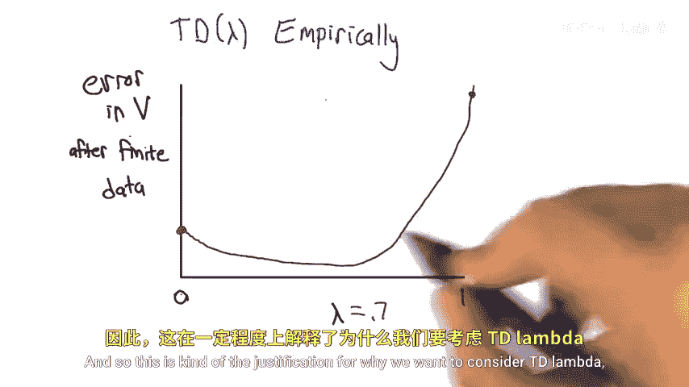